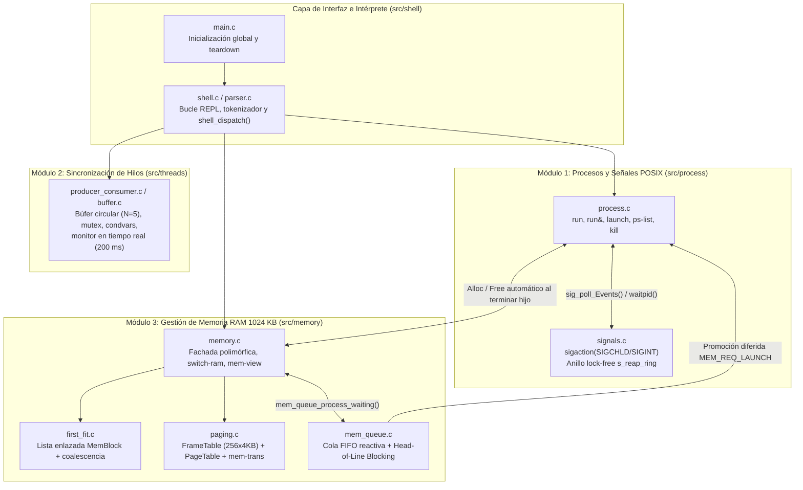

# miniOS — Simulador Interactivo de Subsistemas de Kernel en C11

[](https://en.cppreference.com/w/c/11)
[](https://pubs.opengroup.org/onlinepubs/9699919799/)
[](docs/valgrind_report.txt)
[](docs/valgrind_report.txt)

**miniOS** es un shell interactivo tipo REPL (*Read-Eval-Print Loop*) desarrollado en **C11 estándar (`-std=c11`)** sobre la API **POSIX.1-2008** (`_POSIX_C_SOURCE=200809L`). Modela de forma integrada e interactiva los tres subsistemas fundamentales de un sistema operativo moderno:

1. **Módulo 1 — Gestión de Procesos y Señales POSIX:** Creación de procesos reales del sistema operativo en primer plano (*foreground*) y segundo plano (*background*) mediante `fork()` + `execvp()`, aislamiento de grupos de procesos con `setpgid(0, 0)`, recolección asíncrona *async-signal-safe* de procesos terminados vía `sigaction(SIGCHLD)` + `waitpid(-1, &status, WNOHANG)` y acoplamiento directo con el subsistema de memoria RAM (`launch <tam_kb> <cmd>`).
2. **Módulo 2 — Concurrencia y Sincronización de Hilos (`pthread`):** Simulación en tiempo real del problema clásico **Productor-Consumidor** sobre un búfer circular acotado (`BUFFER_SIZE = 5`) sincronizado con un mutex (`pthread_mutex_t`), dos variables de condición (`not_full`, `not_empty`) bajo predicados `while`, banderas atómicas C11 (`atomic_int`) y visualización periódica en consola cada 200 ms.
3. **Módulo 3 — Gestión Híbrida de Memoria RAM (1024 KB):** Simulador polimórfico que soporta asignación contigua mediante **First-Fit (`ff`)** con partición dinámica y coalescencia bidireccional O(N), y asignación no contigua mediante **Paginación (`pag`)** con 256 marcos físicos de 4 KB y traducción de direcciones lógicas a físicas. Incluye una cola FIFO reactiva de procesos en espera (`mem_queue`) con política *Head-of-Line Blocking*, visualizador gráfico Unicode (`mem-view` / `ram-view`) y conmutación atómica en caliente entre algoritmos (`switch-ram [ff|pag]`).

---

## Tabla de Contenidos

1. [Arquitectura del Sistema](#1-arquitectura-del-sistema)
2. [Estructura del Directorio](#2-estructura-del-directorio)
3. [Requisitos del Sistema](#3-requisitos-del-sistema)
4. [Compilación, Ejecución y Auditoría](#4-compilación-ejecución-y-auditoría)
5. [Referencia Completa de Comandos (19 Comandos + Alias)](#5-referencia-completa-de-comandos-19-comandos--alias)
6. [Guía de Uso y Sesiones Interactivas de Ejemplo](#6-guía-de-uso-y-sesiones-interactivas-de-ejemplo)
7. [Documentación Técnica y Entregables](#7-documentación-técnica-y-entregables)

---

## 1. Arquitectura del Sistema

El sistema está diseñado bajo una arquitectura modular desacoplada en cuatro paquetes (`shell`, `process`, `threads`, `memory`), donde el bucle REPL actúa como orquestador central y los subsistemas de procesos y memoria colaboran mediante callbacks de ciclo de vida y reactividad FIFO:



---

## 2. Estructura del Directorio

```text
mini-OS/
├── Makefile                        # Sistema de construcción C11 + objetivo de auditoría Valgrind
├── README.md                       # Guía maestra de usuario y arquitectura (Issue 9.1 / SIS-68)
├── include/
│   └── config.h                    # Constantes globales (RAM=1024KB, Marco=4KB, Buffer=5, Límites)
├── src/
│   ├── main.c                      # Punto de entrada: signals_init(), memory_init(), shell_loop()
│   ├── shell/
│   │   ├── shell.h / shell.c       # REPL interactivo, validaciones y dispatcher de 19 comandos
│   │   └── parser.h / parser.c     # Tokenizador léxico y detección de operador background (&)
│   ├── process/
│   │   ├── process.h / process.c   # Gestión de procesos POSIX (fork, execvp, setpgid, tabla bg)
│   │   └── signals.h / signals.c   # Manejadores async-signal-safe (SIGCHLD, SIGINT)
│   ├── threads/
│   │   ├── buffer.h / buffer.c     # Búfer circular acotado y primitivas pthread_mutex / cond
│   │   └── producer_consumer.h/.c  # Hilos productores/consumidores, métricas y vista tiempo real
│   └── memory/
│       ├── memory.h / memory.c     # Fachada unificada, mem-view, switch-ram y reset atómico
│       ├── first_fit.c             # Algoritmo First-Fit con partición y coalescencia contigua
│       ├── paging.h / paging.c     # Algoritmo de Paginación, tablas de páginas y traducción MMU
│       └── mem_queue.h / mem_queue.c # Cola FIFO polimórfica y desencolado reactivo automático
└── docs/
    ├── INFORME_TECNICO.md          # Entregable 2: Informe Técnico Formal (Issue 9.2 / SIS-69)
    ├── recomendaciones.md          # Análisis de condición TOCTOU en access() vs Pipe FD_CLOEXEC
    ├── valgrind_report.txt         # Evidencia de auditoría de memoria (ASan/Valgrind) y hilos (TSan)
    ├── PROJECT_MANAGEMENT.md       # Planificación de hitos, épicas y trazabilidad del proyecto
    ├── use-cases/                  # Especificación detallada de casos de uso (UC-00 a UC-06)
    └── issues/                     # Documentación técnica por Issue (SIS-53, SIS-58, SIS-59, SIS-64..69)
```

---

## 3. Requisitos del Sistema

- **Sistema Operativo:** Linux (Ubuntu/Debian/Fedora/Arch) o macOS (Darwin POSIX).
- **Compilador C:** `gcc` (≥ 9.0) o `clang` (≥ 11.0) con soporte completo para **ISO C11 (`-std=c11`)** y atomics (`<stdatomic.h>`).
- **Bibliotecas:** `libpthread` (`-lpthread`) y biblioteca estándar POSIX (`libc`).
- **Herramientas de construcción y auditoría:**
  - `make` (GNU Make).
  - `valgrind` (en Linux) o Sanitizers de compilador (`-fsanitize=address,undefined` y `-fsanitize=thread` en Linux/macOS).

---

## 4. Compilación, Ejecución y Auditoría

### Compilación estándar (Producción / Desarrollo)
```bash
make
```
Genera el binario ejecutable `./minios` compilado con banderas estrictas de calidad:
`-Wall -Wextra -Werror -std=c11 -g -D_POSIX_C_SOURCE=200809L -Iinclude -lpthread`.

### Ejecución interactiva
```bash
./minios
```

### Limpieza de artefactos de compilación
```bash
make clean
```

### Auditoría de Memoria (Valgrind / AddressSanitizer) y Concurrencia (ThreadSanitizer)
- **En Linux con Valgrind:**
  ```bash
  make valgrind
  ```
- **Con AddressSanitizer + UndefinedBehaviorSanitizer (Linux / macOS):**
  ```bash
  gcc -Wall -Wextra -Werror -std=c11 -g -fsanitize=address,undefined -D_POSIX_C_SOURCE=200809L -Iinclude \
      src/main.c src/shell/shell.c src/shell/parser.c src/process/process.c src/process/signals.c \
      src/threads/buffer.c src/threads/producer_consumer.c src/memory/memory.c src/memory/first_fit.c \
      src/memory/paging.c src/memory/mem_queue.c -o minios_asan -lpthread
  ```
- **Con ThreadSanitizer para verificar ausencia de Data Races (Linux / macOS):**
  ```bash
  gcc -Wall -Wextra -Werror -std=c11 -g -fsanitize=thread -D_POSIX_C_SOURCE=200809L -Iinclude \
      src/main.c src/shell/shell.c src/shell/parser.c src/process/process.c src/process/signals.c \
      src/threads/buffer.c src/threads/producer_consumer.c src/memory/memory.c src/memory/first_fit.c \
      src/memory/paging.c src/memory/mem_queue.c -o minios_tsan -lpthread
  ```

---

## 5. Referencia Completa de Comandos (19 Comandos + Alias)

### 5.1 Comandos Base del Shell
| Comando | Sintaxis | Descripción | Ejemplo |
| :--- | :--- | :--- | :--- |
| `help` | `help` | Muestra el catálogo completo de comandos organizados por módulo. | `miniOS> help` |
| `clear` | `clear` | Limpia la pantalla de la terminal mediante secuencias ANSI. | `miniOS> clear` |
| `status` | `status` | Muestra un resumen ejecutivo de los 3 módulos (procesos activos, hilos y RAM). | `miniOS> status` |
| `exit` | `exit` | Libera toda la memoria dinámica, limpia estructuras y cierra el shell con código `0`. | `miniOS> exit` |

### 5.2 Módulo 1: Gestión de Procesos POSIX
| Comando | Sintaxis | Descripción | Ejemplo |
| :--- | :--- | :--- | :--- |
| `run` (FG) | `run <cmd> [args...]` | Crea un proceso hijo con `fork()` + `execvp()` y espera de forma bloqueante (`waitpid`). | `miniOS> run ls -la` |
| `run` (BG) | `run <cmd> [args...] &` | Crea un proceso hijo aislado en segundo plano (`setpgid(0,0)`) y devuelve el control al prompt. | `miniOS> run sleep 10 &` |
| `launch` | `launch <tam_kb> <cmd> [args...]` | Solicita `<tam_kb>` KB de RAM antes de lanzar `<cmd>` en background. Si no cabe, encola el proceso en `mem_queue` y lo lanza automáticamente al liberarse RAM. | `miniOS> launch 256 sleep 15` |
| `ps-list` | `ps-list` | Lista la tabla de procesos en background (`PID`, comando, estado `ACTIVO`/`TERMINADO` y `RAM_KB`). | `miniOS> ps-list` |
| `kill` | `kill <pid>` | Envía `SIGTERM` al proceso `<pid>`, recolecta su salida y libera automáticamente su memoria RAM. | `miniOS> kill 48210` |

### 5.3 Módulo 2: Concurrencia Productor-Consumidor (`pthread`)
| Comando | Sintaxis | Descripción | Ejemplo |
| :--- | :--- | :--- | :--- |
| `pc-start` | `pc-start [prod] [cons] [items]` | Inicia la simulación con vista en tiempo real (por defecto: `2` prod, `2` cons, `5` ítems/prod). Rango válido: `1..10` hilos, `≥1` ítems. | `miniOS> pc-start 3 2 10` |
| `pc-status` | `pc-status` | Muestra el estado visual del búfer circular (`[█][░]`), barra de llenado y métricas acumuladas. | `miniOS> pc-status` |
| `pc-stop` | `pc-stop` | Señaliza parada limpia (`stop_flag`), despierta hilos con `pthread_cond_broadcast` y ejecuta `pthread_join`. | `miniOS> pc-stop` |

### 5.4 Módulo 3: Gestión de Memoria RAM (First-Fit y Paginación)
| Comando | Sintaxis | Descripción | Ejemplo |
| :--- | :--- | :--- | :--- |
| `mem-mode` | `mem-mode <ff\|pag>` | Conmuta directamente el modo de memoria reiniciando las estructuras al algoritmo elegido. | `miniOS> mem-mode pag` |
| `switch-ram` | `switch-ram <ff\|pag>` | Conmutación atómica en caliente con confirmación interactiva `[s/N]` si existen procesos en RAM o en cola. | `miniOS> switch-ram pag` |
| `mem-alloc` | `mem-alloc <pid> <tam_kb>` | Asigna `<tam_kb>` KB al proceso `<pid>` (`pid > 0`, `1 ≤ tam_kb ≤ 1024`). Si no hay espacio suficiente, lo encola en `mem_queue`. | `miniOS> mem-alloc 101 256` |
| `mem-free` | `mem-free <pid>` | Libera la RAM de `<pid>` (con coalescencia en `ff` o liberación de marcos en `pag`) y dispara el desencolado reactivo (`mem_queue_process_waiting`). | `miniOS> mem-free 101` |
| `mem-view` / `ram-view` | `mem-view` o `ram-view` | Renderiza el mapa gráfico Unicode de la RAM adaptándose al algoritmo activo (`FIRST-FIT` o `PAGINACIÓN`), métricas y cola de espera. | `miniOS> ram-view` |
| `mem-status` | `mem-status` | Alias de compatibilidad hacia `mem-view`. | `miniOS> mem-status` |
| `mem-Queue` | `mem-queue` | Muestra la tabla detallada de procesos esperando memoria en la cola FIFO (`Pos`, `PID`, `Memoria KB`, `Tipo`). | `miniOS> mem-queue` |
| `mem-trans` | `mem-trans <pid> <dir_logica>` | *(Solo en modo `pag`)* Traduce una dirección lógica en bytes a `(página, offset)` y calcula su dirección física real `marco * 4096 + offset`. | `miniOS> mem-trans 1 5000` |

---

## 6. Guía de Uso y Sesiones Interactivas de Ejemplo

### Escenario A: Fragmentación Externa en First-Fit y Desencolado Reactivo FIFO
```text
miniOS> mem-alloc 1 300
[MEM-FF] Asignados 300 KB al PID 1 (Base: 0 KB, Límite: 300 KB).
miniOS> mem-alloc 2 400
[MEM-FF] Asignados 400 KB al PID 2 (Base: 300 KB, Límite: 400 KB).
miniOS> mem-alloc 3 300
[MEM-FF] Asignados 300 KB al PID 3 (Base: 700 KB, Límite: 300 KB).
miniOS> mem-free 1
[MEM-FF] Liberados 300 KB del PID 1.
miniOS> mem-alloc 4 320
[MEM] Sin espacio para PID 4 (320 KB). Proceso encolado en espera de RAM (Posición: 1).
miniOS> ram-view
╔════════════════════════════════════════════════════════════════════╗
║                      MAPA DE MEMORIA RAM (MiniOS)                  ║
║                      Algoritmo Activo: FIRST-FIT                   ║
╠════════════════════════════════════════════════════════════════════╣
  [FREE: 300K] -> [P2: 400K | USED] -> [P3: 300K | USED] -> [FREE: 24K]
╠════════════════════════════════════════════════════════════════════╣
║ MÉTRICAS DE ESTADO:                                                ║
║  • Memoria Total:       1024 KB                                    ║
║  • Memoria Usada:        700 KB (68.4%)                            ║
║  • Memoria Libre:        324 KB (31.6%)                            ║
║  • Frag. Externa:          2 bloques libres no contiguos (324 KB)  ║
║  • Procesos en Cola:       1 esperando RAM (PID 4: 320K)           ║
╚════════════════════════════════════════════════════════════════════╝
miniOS> mem-free 2
[MEM-FF] Liberados 400 KB del PID 2.
  [COALESCENCIA] Bloques libres fusionados -> Nuevo bloque libre (Base: 0 KB, Límite: 700 KB).
[AUTO-ALLOC] Proceso en espera PID 4 asignado exitosamente en RAM (320 KB).
```

### Escenario B: Conmutación en Caliente (`switch-ram`) a Paginación y Traducción MMU (`mem-trans`)
```text
miniOS> switch-ram pag
ADVERTENCIA: Hay 2 proceso(s) en RAM y 0 en cola de espera.
El cambio a 'pag' liberará toda la memoria y purgará la cola.
¿Está seguro de continuar? [s/N]: s
[OK] Memoria reiniciada. Algoritmo activo cambiado a: pag
miniOS> mem-alloc 10 50
[MEM-PAG] Asignados 50 KB al PID 10 en 13 marcos (52 KB físicos, frag. interna: 2 KB).
miniOS> mem-trans 10 5000
  ┌─── Traducción de Dirección (MMU Simulada) ──────────────────┐
  │  PID:                 10                                     │
  │  Dirección Lógica:    5000 bytes                             │
  │  Tamaño de Página:    4096 bytes (4 KB)                      │
  ├──────────────────────────────────────────────────────────────┤
  │  Número de Página (p): 1       (5000 / 4096)                 │
  │  Desplazamiento (d):   904     (5000 % 4096)                 │
  │  Marco Físico (f):     1       (Tabla de Páginas[1])         │
  ├──────────────────────────────────────────────────────────────┤
  │  Dirección Física:    5000 bytes  ((1 * 4096) + 904)         │
  └──────────────────────────────────────────────────────────────┘
```

### Escenario C: Acoplamiento Procesos POSIX + Memoria (`launch`) y Concurrencia (`pc-start`)
```text
miniOS> launch 512 sleep 3
[MEM-PAG] Asignados 512 KB al PID 52104 en 128 marcos (512 KB físicos, frag. interna: 0 KB).
[BG] Proceso iniciado en segundo plano con PID: 52104 (512 KB RAM asignados)
miniOS> ps-list
PID      COMANDO                        ESTADO          RAM (KB)
----------------------------------------------------------------
52104    sleep                          ACTIVO          512 KB

# Tras 3 segundos, SIGCHLD recolecta el hijo y libera automáticamente sus 128 marcos:
miniOS>
[BG] Proceso 52104 (sleep) terminó con código 0.
[MEM-PAG] Liberados 128 marcos (512 KB) del PID 52104.

miniOS> pc-start 2 2 5
[PC] Iniciando simulación: 2 productor(es), 2 consumidor(es), 5 items/prod (Total: 10 items)
...
  Items Producidos:    10 / 10
  Items Consumidos:    10 / 10
  Diferencia (En Buf): 0
[PC] Simulación completada exitosamente (0 pérdida de datos).
```

---

## 7. Documentación Técnica y Entregables

Toda la documentación de ingeniería, casos de prueba y reportes de auditoría se encuentran en el directorio [`docs/`](file:///Users/luisc/Documents/mini-OS/docs):

- **[`docs/INFORME_TECNICO.md`](file:///Users/luisc/Documents/mini-OS/docs/INFORME_TECNICO.md)**: **Entregable 2 — Informe Técnico Formal** (Introducción, Diseño de la Solución, Implementación POSIX/C11, Pruebas y Resultados `UC-00..UC-06`, Dificultades Encontradas, Recomendaciones Técnicas sobre TOCTOU/`FD_CLOEXEC`, Conclusiones y Referencias Bibliográficas).
- **[`docs/recomendaciones.md`](file:///Users/luisc/Documents/mini-OS/docs/recomendaciones.md)**: Análisis de ingeniería sobre verificación de ejecutables (`access()` pre-`fork` vs Pipe de error con `FD_CLOEXEC` post-`execvp`).
- **[`docs/valgrind_report.txt`](file:///Users/luisc/Documents/mini-OS/docs/valgrind_report.txt)**: Reporte completo de auditoría de memoria (0 fugas de heap) y concurrencia (0 condiciones de carrera).
- **[`docs/PROJECT_MANAGEMENT.md`](file:///Users/luisc/Documents/mini-OS/docs/PROJECT_MANAGEMENT.md)**: Planificación ágil por hitos, épicas e issues (`SIS-35` a `SIS-69`).
- **Documentación de Issues e Hitos:**
  - [`docs/issues/sis-53.md`](file:///Users/luisc/Documents/mini-OS/docs/issues/sis-53.md) — Issue 4.4: Desencolado reactivo FIFO (`mem_queue_process_waiting`).
  - [`docs/issues/sis-57.md`](file:///Users/luisc/Documents/mini-OS/docs/issues/sis-57.md) — Issue 6.1: Visualizador gráfico interactivo `mem-view` / `ram-view`.
  - [`docs/issues/sis-58.md`](file:///Users/luisc/Documents/mini-OS/docs/issues/sis-58.md) — Issue 6.2: Conmutación interactiva en caliente `switch-ram [ff|pag]`.
  - [`docs/issues/sis-59.md`](file:///Users/luisc/Documents/mini-OS/docs/issues/sis-59.md) — Issue 6.3: Transición atómica y limpieza libre de fugas en `switch-ram`.
  - [`docs/issues/sis-64-67.md`](file:///Users/luisc/Documents/mini-OS/docs/issues/sis-64-67.md) — Issues 8.1 a 8.4: Manejo robusto de señales POSIX, blindaje de entradas, pruebas integrales y auditoría Valgrind/Sanitizers.
  - [`docs/issues/sis-68-69.md`](file:///Users/luisc/Documents/mini-OS/docs/issues/sis-68-69.md) — Issues 9.1 y 9.2: Documentación maestra (`README.md`) e Informe Técnico Formal (`docs/INFORME_TECNICO.md`).
