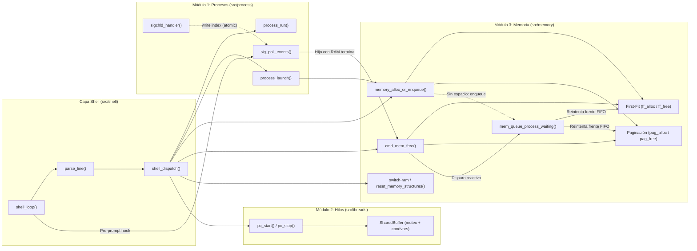
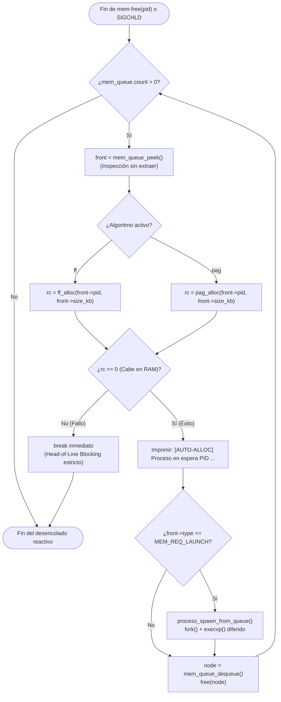

# Entregable 2: Informe Técnico — Proyecto miniOS

**Asignatura:** Sistemas Operativos  
**Proyecto:** `miniOS` — Shell Interactivo con Gestión de Procesos POSIX, Concurrencia de Hilos y Simulación Híbrida de Memoria RAM en C11  
**Estándar de Implementación:** ISO/IEC 9899:2011 (`-std=c11`) y IEEE Std 1003.1-2008 (`_POSIX_C_SOURCE=200809L`)  
**Fecha:** Noviembre de 2026  

---

## Índice General

1. [Introducción](#1-introducción)
2. [Diseño de la Solución](#2-diseño-de-la-solución)
3. [Implementación](#3-implementación)
4. [Pruebas y Resultados](#4-pruebas-y-resultados)
5. [Dificultades Encontradas y Procedimientos de Resolución](#5-dificultades-encontradas-y-procedimientos-de-resolución)
6. [Apartado Especial: Recomendaciones Técnicas (`recomendaciones.md`)](#6-apartado-especial-recomendaciones-técnicas-recomendacionesmd)
7. [Conclusiones](#7-conclusiones)
8. [Referencias Bibliográficas](#8-referencias-bibliográficas)

---

## 1. Introducción

### 1.1 Finalidad del Proyecto
El proyecto **miniOS** tiene como finalidad diseñar, implementar y auditar un intérprete de comandos interactivo (*shell* tipo REPL, *Read-Eval-Print Loop*) en lenguaje **C11** sobre sistemas compatibles con **POSIX.1-2008**, capaz de integrar en un único entorno de ejecución tres subsistemas críticos de un kernel real:

1. **Un gestor de procesos reales del sistema operativo**, capaz de lanzar binarios externos tanto de forma síncrona (*foreground*) como asíncrona (*background*), monitorear su ciclo de vida sin bloqueos y recolectar sus estados de salida evitando procesos *zombies*.
2. **Un motor de concurrencia multihilo en tiempo real**, que materializa el problema clásico de sincronización **Productor-Consumidor** sobre memoria compartida acotada, garantizando exclusión mutua, espera pasiva libre de *busy-waiting* y cero pérdida o duplicación de ítems.
3. **Un administrador híbrido de memoria RAM simulada (1024 KB)** con soporte polimórfico para dos esquemas de asignación intercambiables en caliente (`switch-ram`): **Asignación Contigua Dinámica por Primer Ajuste (*First-Fit*)** con coalescencia inmediata de bloques adyacentes, y **Asignación No Contigua por Paginación Pura** con marcos de 4 KB, tablas de páginas por proceso y unidad de traducción de direcciones (*MMU simulada*). Adicionalmente, incorpora una cola FIFO de procesos en espera de memoria (`mem_queue`) con promoción reactiva automática tras cada liberación de recursos.

### 1.2 Relación con los Contenidos de la Unidad
En lugar de implementar simulaciones aisladas, **miniOS** articula los contenidos de la asignatura mediante acoplamientos reales entre subsistemas:

| Eje Temático de la Unidad | Materialización Práctica en `miniOS` | Archivos Clave |
| :--- | :--- | :--- |
| **1. Procesos e Interfaz de Llamadas al Sistema (POSIX)** | Creación jerárquica de procesos (`fork`), sustitución de imagen binaria (`execvp`), aislamiento de grupos de procesos (`setpgid`), terminación controlada (`kill`) y recolección no bloqueante (`waitpid` con `WNOHANG`). | [`src/process/process.c`](file:///Users/luisc/Documents/mini-OS/src/process/process.c), [`src/process/signals.c`](file:///Users/luisc/Documents/mini-OS/src/process/signals.c) |
| **2. Manejo Asíncrono de Señales del Kernel** | Registro de manejadores con `sigaction` (`SIGCHLD` con `SA_RESTART | SA_NOCLDSTOP` y `SIGINT`), diseño *async-signal-safe* mediante un anillo circular atómico libre de bloqueos (`s_reap_ring`) que difiere el procesamiento pesado fuera del contexto de interrupción. | [`src/process/signals.c`](file:///Users/luisc/Documents/mini-OS/src/process/signals.c) |
| **3. Hilos, Concurrencia y Sincronización** | Creación y recolección de hilos POSIX (`pthread_create`, `pthread_join`), exclusión mutua (`pthread_mutex_t`), sincronización condicional con predicados `while` (`pthread_cond_wait`, `pthread_cond_signal`, `pthread_cond_broadcast`) y variables atómicas C11 (`atomic_int`). | [`src/threads/buffer.c`](file:///Users/luisc/Documents/mini-OS/src/threads/buffer.c), [`src/threads/producer_consumer.c`](file:///Users/luisc/Documents/mini-OS/src/threads/producer_consumer.c) |
| **4. Gestión de Memoria Contigua y Fragmentación Externa** | Particionamiento dinámico mediante lista enlazada de bloques (`MemBlock`), búsqueda del primer hueco suficiente (*First-Fit*), división de bloques (*splitting*) y fusión bidireccional inmediata (*coalescing*) al liberar. | [`src/memory/first_fit.c`](file:///Users/luisc/Documents/mini-OS/src/memory/first_fit.c) |
| **5. Memoria Virtual/Paginación y Fragmentación Interna** | División de los 1024 KB físicos en 256 marcos de 4 KB (`FrameTable`), asignación no contigua de marcos a páginas lógicas (`PageTable`), cuantificación de fragmentación interna en la última página y traducción `dir_fisica = marco * 4096 + offset`. | [`src/memory/paging.c`](file:///Users/luisc/Documents/mini-OS/src/memory/paging.c) |
| **6. Planificación de Admisión a Memoria y Acoplamiento Proceso-RAM** | Comando `launch <tam_kb> <cmd>` que condiciona el `fork()` real a la disponibilidad de RAM, encolando solicitudes en `mem_queue` bajo política FIFO estricta (*Head-of-Line Blocking*) y disparando `mem_queue_process_waiting()` cuando `SIGCHLD` o `mem-free` liberan memoria. | [`src/memory/mem_queue.c`](file:///Users/luisc/Documents/mini-OS/src/memory/mem_queue.c), [`src/memory/memory.c`](file:///Users/luisc/Documents/mini-OS/src/memory/memory.c) |

---

## 2. Diseño de la Solución

### 2.1 Arquitectura Modular de la Aplicación
Se optó por una **arquitectura en capas con fachada polimórfica** en el subsistema de memoria y acoplamiento por eventos entre el recolector de señales y el planificador de memoria. Esta decisión de diseño responde a tres objetivos de ingeniería:
1. **Separación de responsabilidades (SoC):** El intérprete REPL (`src/shell/`) desconoce cómo se estructura internamente una tabla de páginas o una lista enlazada; solo invoca contratos públicos en [`memory.h`](file:///Users/luisc/Documents/mini-OS/src/memory/memory.h), [`process.h`](file:///Users/luisc/Documents/mini-OS/src/process/process.h) y [`producer_consumer.h`](file:///Users/luisc/Documents/mini-OS/src/threads/producer_consumer.h).
2. **Extensibilidad de algoritmos de memoria:** La fachada [`memory.c`](file:///Users/luisc/Documents/mini-OS/src/memory/memory.c) mantiene el estado global en `MemoryState mem_state` y enruta dinámicamente las operaciones de asignación, liberación y visualización hacia [`first_fit.c`](file:///Users/luisc/Documents/mini-OS/src/memory/first_fit.c) o [`paging.c`](file:///Users/luisc/Documents/mini-OS/src/memory/paging.c) según el algoritmo activo (`"ff"` o `"pag"`).
3. **Cohesión entre Procesos POSIX y Memoria Simulada:** Cuando un proceso hijo lanzado con `launch <kb> <cmd>` muere en el sistema operativo anfitrión, el kernel entrega `SIGCHLD`; el bucle principal drena el evento mediante `sig_poll_events()`, marca el proceso como `TERMINADO`, invoca automáticamente `ff_free(pid)` o `pag_free(pid)` y ejecuta `mem_queue_process_waiting()`, logrando un ciclo cerrado idéntico al de un sistema operativo real.



### 2.2 Descripción de los Principales Algoritmos y Decisiones de Diseño

#### A. Asignación Contigua First-Fit (`ff_alloc`) y Liberación con Coalescencia (`ff_free`)
- **Representación:** La memoria de 1024 KB se modela como una lista simplemente enlazada ordenada por dirección base ascendente (`MemBlock *head`). Al iniciar (o tras `reset_memory_structures()`), existe un único nodo libre con `base = 0`, `limit = 1024`, `is_free = true` y `pid = -1`.
- **Algoritmo de Asignación (`ff_alloc` en [`src/memory/first_fit.c`](file:///Users/luisc/Documents/mini-OS/src/memory/first_fit.c#L60-L120)):**
  1. Verifica unicidad de `pid` recorriendo la lista para impedir asignaciones duplicadas al mismo proceso.
  2. Recorre la lista desde `head` buscando el **primer** bloque donde `curr->is_free && curr->limit >= size_kb` (complejidad temporal $O(N)$ en el número de fragmentos).
  3. **Decisión de partición (*Splitting*):** Si `curr->limit > size_kb`, se instancia con `malloc` un nodo remanente `rem` con `base = curr->base + size_kb` y `limit = curr->limit - size_kb`, insertándolo inmediatamente después de `curr`. Si el ajuste es exacto (`curr->limit == size_kb`), se reutiliza el nodo `curr` sin reservar memoria adicional en el *heap*.
- **Algoritmo de Coalescencia (`ff_free` en [`src/memory/first_fit.c`](file:///Users/luisc/Documents/mini-OS/src/memory/first_fit.c#L129-L179)):**
  1. Localiza el bloque perteneciente a `pid`, lo marca como libre (`is_free = true`, `pid = -1`) y resta su tamaño de `mem_state.used_memory`.
  2. Ejecuta una **pasada de fusión lineal adyacente** desde `mem_state.head`: mientras `curr` y `curr->next` estén ambos libres (`curr->is_free && curr->next->is_free`), suma el límite del sucesor al bloque actual (`curr->limit += next_block->limit`), desenlaza `next_block` y lo libera con `free()`.
  3. **Justificación de diseño:** Realizar la coalescencia de forma síncrona durante `ff_free` en una sola pasada desde la cabeza maneja simultáneamente la fusión con el vecino izquierdo, con el vecino derecho o triple fusión (cuando el bloque liberado estaba flanqueado por dos huecos libres), manteniendo el invariante de que **nunca existen dos nodos libres adyacentes** en la lista.

#### B. Asignación No Contigua por Paginación (`pag_alloc`, `pag_free`) y Traducción MMU (`cmd_mem_trans`)
- **Representación:** La RAM física de 1024 KB se divide en `TOTAL_FRAMES = 256` marcos fijos de `PAGE_SIZE_KB = 4` KB (`4096` bytes). Se mantiene un arreglo estático `FrameTable frame_table` de 256 entradas y un directorio de tablas de páginas por proceso (`PageTable page_tables[MAX_PROCESSES]`).
- **Algoritmo de Asignación (`pag_alloc` en [`src/memory/paging.c`](file:///Users/luisc/Documents/mini-OS/src/memory/paging.c#L54-L124)):**
  1. Calcula el número de páginas requeridas mediante **división entera techo**:
     $$\text{pages\_needed} = \left\lceil \frac{\text{size\_kb}}{4} \right\rceil = \frac{\text{size\_kb} + 4 - 1}{4}$$
  2. Comprueba en $O(1)$ si `frame_table.free_count >= pages_needed`. Si no hay marcos suficientes, aborta inmediatamente retornando `-1` sin modificar ningún marco (atomicidad todo-o-nada).
  3. Si hay disponibilidad, reserva `pages_needed` marcos libres cualesquiera (no necesariamente contiguos), registra el mapeo `página p -> marco f` en la `PageTable` del `pid` y calcula la **fragmentación interna exacta**:
     $$\text{internal\_frag\_kb} = (\text{pages\_needed} \times 4) - \text{size\_kb}$$
- **Traducción de Direcciones Lógicas a Físicas (`cmd_mem_trans` en [`src/memory/paging.c`](file:///Users/luisc/Documents/mini-OS/src/memory/paging.c#L172-L237)):**
  Dada una dirección lógica en bytes $A_L \ge 0$ para un proceso con $S \text{ KB}$ solicitados:
  1. Verifica límite de segmento lógico: si $A_L \ge S \times 1024$, emite un *Segmentation Fault simulado* (`Violación de segmento`).
  2. Descompone $A_L$ en número de página $p = \lfloor A_L / 4096 \rfloor$ y desplazamiento $d = A_L \bmod 4096$.
  3. Consulta en $O(1)$ el marco físico $f = \text{PT}[p].\text{frame\_number}$ y computa la dirección física $A_F = (f \times 4096) + d$.

#### C. Cola FIFO Reactiva (`mem_queue`) y Política *Head-of-Line Blocking*
Cuando una solicitud `mem-alloc` o `launch` excede la memoria disponible, no se descarta: se encola en `mem_queue` ([`src/memory/mem_queue.c`](file:///Users/luisc/Documents/mini-OS/src/memory/mem_queue.c)).Al liberarse memoria (`mem-free` o fin de un proceso hijo), se invoca `mem_queue_process_waiting()`:



- **Decisión de Diseño (*Head-of-Line Blocking*):** Si el proceso en la cabeza de la cola solicita, por ejemplo, 400 KB y solo hay 300 KB libres, el ciclo se detiene inmediatamente con `break`, aun cuando detrás existiese un proceso de 100 KB. Esto garantiza justicia estricta FIFO y evita inanición (*starvation*) de procesos grandes frente a ráfagas de procesos pequeños.

#### D. Conmutación Atómica en Caliente (`switch-ram`)
Implementado en [`src/memory/memory.c`](file:///Users/luisc/Documents/mini-OS/src/memory/memory.c#L174-L280), `switch-ram [ff|pag]` evalúa primero si existen procesos activos (`count_allocated_processes()`) o en espera (`mem_queue.count`). Si ambos son cero, conmuta sin fricción; si hay carga activa, exige confirmación interactiva `[s/N]` mediante `fgets(stdin)`. Al confirmar, invoca `reset_memory_structures(target_algo)`, que ejecuta una secuencia determinista de cuatro pasos: `ff_cleanup()` $\rightarrow$ `pag_cleanup()` $\rightarrow$ `mem_queue_clear()` $\rightarrow$ actualización de `mem_state.algorithm` $\rightarrow$ `ff_init()` / `pag_init()`, garantizando cero *memory leaks* y cero punteros colgantes.

---

## 3. Implementación

### 3.1 Llamadas al Sistema POSIX Utilizadas
La interacción con el kernel del sistema operativo anfitrión se concentra en el Módulo 1 y en el temporizador del Módulo 2:

| Llamada al Sistema / API POSIX | Ubicación en Código | Propósito Técnico y Justificación de Uso |
| :--- | :--- | :--- |
| `fork(2)` | [`src/process/process.c`](file:///Users/luisc/Documents/mini-OS/src/process/process.c#L139) | Duplica el proceso actual para ejecutar comandos externos en `run` y `launch`. |
| `execvp(3)` | [`src/process/process.c`](file:///Users/luisc/Documents/mini-OS/src/process/process.c#L145) | Reemplaza la imagen de memoria del proceso hijo por el binario solicitado resolviendo `$PATH`. |
| `setpgid(0, 0)` | [`src/process/process.c`](file:///Users/luisc/Documents/mini-OS/src/process/process.c#L142) | Mueve a los hijos en *background* a su propio grupo de procesos. Sin esto, presionar `Ctrl+C` en la terminal enviaría `SIGINT` tanto al shell como a todos los trabajos en segundo plano. |
| `waitpid(pid, &st, WNOHANG)` | [`src/process/signals.c`](file:///Users/luisc/Documents/mini-OS/src/process/signals.c#L46) | Recolecta en un bucle `while` todos los hijos terminados sin bloquear el contexto de señal, soportando la coalescencia de múltiples señales `SIGCHLD` simultáneas. |
| `sigaction(2)` | [`src/process/signals.c`](file:///Users/luisc/Documents/mini-OS/src/process/signals.c#L101) | Registra manejadores confiables para `SIGCHLD` (`SA_RESTART \| SA_NOCLDSTOP`) y `SIGINT` (`SA_RESTART`), evitando la semántica obsoleta y no portable de `signal(2)`. |
| `kill(pid, SIGTERM)` | [`src/process/process.c`](file:///Users/luisc/Documents/mini-OS/src/process/process.c#L329) | Solicita la terminación limpia de un proceso en segundo plano desde el comando `kill <pid>`. |
| `write(STDOUT_FILENO, ...)` | [`src/process/signals.c`](file:///Users/luisc/Documents/mini-OS/src/process/signals.c#L78) | Única función de E/S invocada dentro de `sigint_handler`, cumpliendo el estándar POSIX.1-2008 de funciones *async-signal-safe* (a diferencia de `printf`, que usa buffers internos con locks). |
| `clock_gettime(CLOCK_REALTIME)` | [`src/threads/producer_consumer.c`](file:///Users/luisc/Documents/mini-OS/src/threads/producer_consumer.c#L90) | Obtiene marcas de tiempo con precisión de nanosegundos para construir el `struct timespec` de `pthread_cond_timedwait`. |

### 3.2 Estructuras de Datos Principales
Todas las estructuras fueron diseñadas en C11 priorizando localidad de caché para tablas de tamaño fijo y gestión explícita en *heap* para colecciones dinámicas:

1. **`Command` ([`src/shell/parser.h`](file:///Users/luisc/Documents/mini-OS/src/shell/parser.h#L16-L20)):** Encapsula el resultado del análisis léxico de una línea (`char *name`, `char *args[MAX_ARGS]`, `int arg_count`, `int background`).
2. **`BgProcess` ([`src/process/process.h`](file:///Users/luisc/Documents/mini-OS/src/process/process.h#L18-L25)):** Entrada de la tabla de procesos en segundo plano (`pid_t pid`, `char cmd_line[MAX_LINE]`, `ProcStatus status`, `int exit_code`, `int ram_kb`). El campo `ram_kb` vincula el proceso POSIX con su cuota en el simulador de RAM.
3. **`MemBlock` y `MemoryState` ([`src/memory/memory.h`](file:///Users/luisc/Documents/mini-OS/src/memory/memory.h#L17-L34)):**
   - `MemBlock`: Nodo de lista enlazada para First-Fit (`int pid`, `int base`, `int limit`, `bool is_free`, `struct MemBlock *next`).
   - `MemoryState`: Estado global (`char algorithm[16]`, `int total_memory`, `int used_memory`, `MemBlock *head`).
4. **`FrameTable`, `PageTable` y `PageEntry` ([`src/memory/paging.h`](file:///Users/luisc/Documents/mini-OS/src/memory/paging.h#L21-L55)):**
   - `FrameEntry`: Representa un marco físico de 4 KB (`int frame_id`, `bool is_free`, `int pid`, `int page_number`).
   - `PageTable`: Tabla de páginas por proceso (`int pid`, `int size_kb`, `int num_pages`, `int internal_frag_kb`, `PageEntry pages[TOTAL_FRAMES]`, `bool active`).
5. **`mem_queue_node_t` y `mem_queue_t` ([`src/memory/mem_queue.h`](file:///Users/luisc/Documents/mini-OS/src/memory/mem_queue.h#L36-L52)):** Cola enlazada simple con punteros `head` y `tail` para inserción (`enqueue`) y extracción (`dequeue`) en tiempo constante $O(1)$. Soporta polimorfismo mediante `mem_req_type_t` (`MEM_REQ_ALLOC` para reservas puras y `MEM_REQ_LAUNCH` para procesos reales diferidos con copia de `cmd_line`).
6. **`SharedBuffer` y `thread_stats_t` ([`src/threads/buffer.h`](file:///Users/luisc/Documents/mini-OS/src/threads/buffer.h#L18-L41)):** Estructura del búfer circular acotado (`int data[5]`, índices `in`, `out`, contador `count`, bandera de cierre `stopped`, `pthread_mutex_t mutex` y variables de condición `not_full` y `not_empty`) acoplada a las estadísticas globales de producción/consumo.

### 3.3 Mecanismos de Sincronización y Manejo de Concurrencia

#### Sincronización en el Problema Productor-Consumidor ([`src/threads/buffer.c`](file:///Users/luisc/Documents/mini-OS/src/threads/buffer.c))
El acceso concurrente de múltiples hilos productores y consumidores al búfer circular se protege mediante un patrón de **Monitor POSIX**:
```c
pthread_mutex_lock(&buf->mutex);
while (buf->count == BUFFER_SIZE && !buf->stopped) {
    pthread_cond_wait(&buf->not_full, &buf->mutex);
}
if (buf->stopped) {
    pthread_mutex_unlock(&buf->mutex);
    return -1;
}
buf->data[buf->in] = item;
buf->in = (buf->in + 1) % BUFFER_SIZE;
buf->count++;
stats.total_produced++;
pthread_cond_signal(&buf->not_empty);
pthread_mutex_unlock(&buf->mutex);
```
- **Por qué se usa `while` y no `if` en `pthread_cond_wait`:** El estándar POSIX permite *spurious wakeups* (despertares espurios sin que nadie haya emitido señal) y además, cuando hay múltiples consumidores esperando, otro hilo puede adquirir el mutex antes que el hilo despertado y vaciar/llenar el búfer. Evaluar `buf->count == BUFFER_SIZE && !buf->stopped` en un bucle `while` garantiza que el invariante de capacidad ($0 \le \text{count} \le 5$) jamás se viole.
- **Terminación limpia sin interbloqueos (*Deadlock-free Shutdown*):** Cuando el usuario ejecuta `pc-stop` o cuando los productores alcanzan la cuota total de ítems (`total_produced >= target`), los consumidores podrían quedar bloqueados indefinidamente en `pthread_cond_wait(&buf->not_empty)` esperando más datos. Para resolverlo, el hilo monitor activa `buf->stopped = 1` bajo mutex e invoca `pthread_cond_broadcast(&buf->not_full)` y `pthread_cond_broadcast(&buf->not_empty)`, despertando a todos los hilos para que verifiquen `buf->stopped`, liberen el mutex y terminen con `pthread_join`.

#### Sincronización *Async-Signal-Safe* entre `SIGCHLD` y el Bucle Principal ([`src/process/signals.c`](file:///Users/luisc/Documents/mini-OS/src/process/signals.c))
Invocar `printf()`, `malloc()` o `free()` dentro de un manejador de señal como `sigchld_handler` provoca corrupción de memoria o *deadlock* si la señal interrumpe al hilo principal mientras éste ya sostiene el lock interno de `malloc`/`stdout`. Por ello, se diseñó un mecanismo de **notificación diferida de dos fases**:
1. **Fase de Interrupción (`sigchld_handler`):** Ejecuta únicamente `waitpid(-1, &status, WNOHANG)` y deposita la tupla `{pid, status}` en un anillo estático `s_reap_ring[64]` avanzando el índice `s_reap_write` con semántica atómica C11 (`volatile sig_atomic_t`). No realiza ninguna llamada a `printf` ni toca la memoria dinámica.
2. **Fase Síncrona (`sig_poll_events`):** Invocada de forma segura en el hilo principal antes de cada renderizado del prompt y tras cada comando, drena `s_reap_ring`, actualiza `BgProcess`, imprime la notificación `[BG] Proceso <pid> terminó`, libera su bloque/páginas de RAM y dispara `mem_queue_process_waiting()`.

---

## 4. Pruebas y Resultados

Se ejecutó la batería integral de pruebas funcionales cubriendo los 7 casos de uso del sistema (`UC-00` a `UC-06`), junto con pruebas de frontera y auditoría con herramientas dinámicas de detección de errores ([`docs/valgrind_report.txt`](file:///Users/luisc/Documents/mini-OS/docs/valgrind_report.txt)).

### 4.1 Matriz de Casos de Prueba Ejecutados

| ID Caso | Escenario Evaluado | Entrada Ejecutada | Salida Esperada | Resultado Obtenido | Estado |
| :--- | :--- | :--- | :--- | :--- | :---: |
| **UC-00** | Shell base y manejo de `SIGINT` | `help`, `status`, enviar `SIGINT` (`Ctrl+C`), comando inexistente `foobar`, `exit` | `Ctrl+C` reimprime `miniOS> ` sin cerrar el shell; `foobar` informa comando desconocido; `exit` retorna `0`. | `miniOS>` se mantiene vivo tras `SIGINT`; salida limpia con código `0`. | **PASS** |
| **UC-01** | Procesos FG/BG y recolección `SIGCHLD` | `run echo Hola_FG`, `run sleep 1 &`, `ps-list`, esperar 2 s, `ps-list` | El hijo en BG se aísla con `setpgid`, aparece `ACTIVO` y tras 1 s se recolecta automáticamente pasando a `TERMINADO`. | Notificación `[BG] Proceso <pid> (sleep) terminó con código 0` y estado `TERMINADO` (0 zombies). | **PASS** |
| **UC-02** | Productor-Consumidor en tiempo real | `pc-start 2 2 5` (2 prod, 2 cons, 5 ítems/prod) y prueba de corte con `pc-stop` | `Items Producidos == Items Consumidos == 10`, `Diferencia (En Buf) == 0`, sin bloqueos en `pthread_join`. | `10 / 10` producidos, `10 / 10` consumidos, `0 pérdida de datos`, cierre limpio de 4 hilos. | **PASS** |
| **UC-03** | Memoria First-Fit, Coalescencia y Cola FIFO | `mem-alloc 1 300`, `mem-alloc 2 400`, `mem-alloc 3 300`, `mem-free 1`, `mem-alloc 4 320` (encola), `mem-free 2` | `PID 4` se encola al haber solo 300 KB y 24 KB separados. Al liberar `PID 2` (400 KB), fusiona $300 + 400 = 700\text{ KB}$ y auto-asigna `PID 4`. | Imprime `[COALESCENCIA] ... Límite: 700 KB` seguido de `[AUTO-ALLOC] Proceso en espera PID 4 asignado exitosamente en RAM (320 KB)`. | **PASS** |
| **UC-04** | Paginación, Frag. Interna y Traducción MMU | `switch-ram pag`, `mem-alloc 1 50`, `mem-trans 1 5000`, `mem-trans 1 60000` | $50\text{ KB} \rightarrow 13\text{ marcos}$ ($52\text{ KB}$, frag. interna $2\text{ KB}$). Dir `5000` $\rightarrow$ pág `1`, offset `904`. Dir `60000` $\rightarrow$ violación de segmento. | Traducción exacta `Marco 1 -> Dir Física 5000 bytes`; dir `60000` rechazada por exceder $51200\text{ bytes}$ del proceso. | **PASS** |
| **UC-05** | `mem-view` / `ram-view` y `switch-ram [s/N]` | `ram-view` en `ff` y `pag`; `switch-ram ff` respondiendo `n` y luego `s` | Respuesta `n` conserva intactos los procesos y la cola; respuesta `s` purga estructuras sin fugas y cambia de algoritmo. | Cancelación preserva los 50 KB de `PID 1`; confirmación `s` reinicia la RAM a un bloque libre de 1024 KB. | **PASS** |
| **UC-06** | Integración `launch` Proceso + RAM + Cola | En modo `pag`: `mem-alloc 10 900`, `launch 200 echo Hola_Diferido`, `mem-free 10` | `launch 200` no cabe (quedan 124 KB), se encola como `MEM_REQ_LAUNCH`. Al hacer `mem-free 10`, se auto-asigna y ejecuta `echo Hola_Diferido`. | `[AUTO-ALLOC]` asigna 200 KB al proceso diferido, ejecuta `fork+execvp`, imprime `Hola_Diferido` y al terminar libera los 50 marcos. | **PASS** |
| **VAL-01** | Validación de entradas inválidas (Issue 8.2) | `mem-alloc -5 100`, `mem-alloc 1 0`, `mem-alloc 1 2048`, `pc-start 0 2 5`, `pc-start 15 2 5`, `kill abc` | Rechazo inmediato con mensaje descriptivo en `stderr` sin alterar estructuras ni provocar `SIGSEGV`. | Todos los casos inválidos fueron interceptados por `parse_strict_int` y validadores de rango. | **PASS** |

### 4.2 Análisis de Resultados y Comparativa Experimental: First-Fit vs. Paginación
A partir de las pruebas ejecutadas en **UC-03** y **UC-04**, se cuantificó el compromiso clásico (*trade-off*) entre asignación contigua y no contigua sobre una misma carga de trabajo:

1. **Comportamiento frente a la Fragmentación:**
   - En **First-Fit (`UC-03`)**, tras asignar `P1(300K)`, `P2(400K)`, `P3(300K)` y liberar `P1(300K)`, el sistema dispone de **$324\text{ KB}$ libres totales** ($300\text{ KB}$ al inicio + $24\text{ KB}$ al final), pero una solicitud de `P4(320K)` **falla y debe esperar en cola** debido a la **fragmentación externa** (ningún bloque contiguo alcanza 320 KB).
   - En **Paginación (`UC-04`)**, bajo exactamente la misma disponibilidad de $324\text{ KB}$ libres ($81\text{ marcos}$ libres dispersos en cualquier posición de la `FrameTable`), la solicitud de `P4(320K = 80 marcos)` **se satisface de inmediato sin esperar**, ya que la MMU mapea páginas contiguas lógicas a marcos físicos arbitrarios. A cambio, cuando un proceso solicita un tamaño no múltiplo de 4 KB (como `50 KB` en `UC-04`), sufre **$2\text{ KB}$ de fragmentación interna** en su última página ($13 \times 4\text{ KB} = 52\text{ KB}$).
2. **Rendimiento y Auditoría de Memoria (`docs/valgrind_report.txt`):**
   - La auditoría con **AddressSanitizer (`-fsanitize=address,undefined`)** y **Valgrind** tras ejecutar todos los casos de uso y múltiples conmutaciones `switch-ram` reportó **0 bytes perdidos (`0 leaks`)**, **0 accesos fuera de límites** y **0 lecturas de memoria liberada (`use-after-free`)**.
   - La auditoría concurrente con **ThreadSanitizer (`-fsanitize=thread`)** bajo carga de 5 productores y 5 consumidores reportó **0 condiciones de carrera (`0 data races`)**.

---

## 5. Dificultades Encontradas y Procedimientos de Resolución

Durante el desarrollo incremental del proyecto surgieron seis problemas técnicos reales documentados en el historial de control de versiones (`git log`):

### 5.1 Discrepancia entre PID Provisional y PID Real en `launch <tam_kb> <cmd>`
- **Problema:** Al ejecutar `launch 200 sleep 5`, primero se debe verificar y reservar memoria antes de crear el proceso hijo, o bien hacer `fork()` primero. Si se reservaba memoria antes de `fork()`, no se conocía aún el `pid_t` real que asignaría el kernel del sistema operativo; y si el proceso no cabía en RAM y debía encolarse en `mem_queue`, no podía ejecutarse `fork()` todavía porque el proceso empezaría a correr antes de tener RAM asignada.
- **Procedimiento de Resolución:** Se diseñó una arquitectura dual en [`src/process/process.c`](file:///Users/luisc/Documents/mini-OS/src/process/process.c#L194-L280) y [`src/memory/mem_queue.h`](file:///Users/luisc/Documents/mini-OS/src/memory/mem_queue.h):
  - Cuando **sí hay RAM disponible**, se reserva inicialmente con un `temp_pid` temporal, se invoca `fork()` inmediatamente y en el padre se actualiza el propietario de la memoria al `real_pid` devuelto por `fork()` mediante `memory_update_pid(temp_pid, real_pid)`.
  - Cuando **no hay RAM disponible**, se encola un nodo de tipo `MEM_REQ_LAUNCH` con un ID de reserva provisional (`s_next_queued_pid >= 10000`) y la cadena `cmd_line`. Cuando `mem_queue_process_waiting()` lo promueve más adelante, invoca el callback `process_spawn_from_queue(queued_pid, size_kb, cmd_line)`, que ejecuta el `fork()` diferido y transfiere la titularidad de la RAM al `real_pid` mediante `memory_update_pid()`.

### 5.2 Seguridad *Async-Signal-Safe* y Pérdida de Hijos Simultáneos en `SIGCHLD`
- **Problema:** En una primera versión, la recolección de procesos en segundo plano se hacía solo mediante sondeo (`reap_background_processes`) o llamando a funciones no seguras en el manejador. Además, en POSIX las señales estándar no se encolan: si dos procesos hijos terminan al mismo milisegundo, el kernel puede entregar una sola señal `SIGCHLD`.
- **Procedimiento de Resolución (Commit `7cf0f67`):** Se implementó en [`src/process/signals.c`](file:///Users/luisc/Documents/mini-OS/src/process/signals.c) un manejador `sigchld_handler` que ejecuta un bucle `while ((pid = waitpid(-1, &status, WNOHANG)) > 0)` hasta recolectar **todos** los hijos que hayan cambiado de estado, guardándolos en el anillo circular estático `s_reap_ring` sin invocar `printf` ni `free`. El drenado y la liberación de memoria asociados se ejecutan de forma síncrona en `sig_poll_events()`.

### 5.3 Desalineación de Bordes Unicode en `mem-view` y `pc-status` por Caracteres Multibyte UTF-8
- **Problema:** Al formatear cadenas dentro de cajas Unicode (`╔═══╗` / `║ ... ║`) usando `printf("║ %-66s ║", linea)`, las líneas que contenían caracteres UTF-8 multibyte (como `•` que ocupa 3 bytes pero 1 columna visual en terminal, o vocales acentuadas como `ó` que ocupan 2 bytes y 1 columna visual) desalineaban el borde derecho `║` porque `printf` cuenta bytes y no columnas visuales.
- **Procedimiento de Resolución (Commits `4e7a632` y `7fcb81d`):** En [`src/memory/memory.c`](file:///Users/luisc/Documents/mini-OS/src/memory/memory.c) y [`src/threads/producer_consumer.c`](file:///Users/luisc/Documents/mini-OS/src/threads/producer_consumer.c), se separaron los prefijos con símbolos UTF-8 (`•`, `█`, `░`) fuera del especificador de ancho variable `%-*s` o se calcularon exactamente los espacios de relleno en función de la longitud ASCII visible del contenido dinámico (`snprintf` previo + padding explícito), logrando una alineación exacta a 70 columnas en todos los estados.

### 5.4 Fugas de Memoria y Punteros Colgantes durante `switch-ram`
- **Problema:** Al alternar de First-Fit a Paginación con procesos activos en RAM y nodos esperando en `mem_queue`, un simple cambio de la cadena `mem_state.algorithm` dejaba los nodos `MemBlock` huérfanos en el *heap* y mantenía marcos sucios de sesiones previas.
- **Procedimiento de Resolución (Commits `d21a55e` y `0613f40` — Issues 6.2 y 6.3):** Se crearon las rutinas `ff_cleanup()`, `pag_cleanup()`, `mem_queue_clear()` y `reset_memory_structures()` en [`src/memory/memory.c`](file:///Users/luisc/Documents/mini-OS/src/memory/memory.c#L123-L162), y se integró `memory_cleanup()` al cierre del REPL en [`src/main.c`](file:///Users/luisc/Documents/mini-OS/src/main.c#L26).

---

## 6. Apartado Especial: Recomendaciones Técnicas (`recomendaciones.md`)

A continuación se integra íntegramente el análisis técnico documentado en [`docs/recomendaciones.md`](file:///Users/luisc/Documents/mini-OS/docs/recomendaciones.md), el cual examina una decisión arquitectónica clave del Módulo 1 (verificación de existencia de comandos antes de `fork()`) y documenta cómo evolucionarla hacia el patrón de nivel producción utilizado por shells industriales (`bash`, `zsh`, `dash`).

### 6.1 Contexto: Verificación de Comandos en Ejecución en Segundo Plano (`process.c`)
En el Módulo 1 (Gestión de Procesos), cuando el usuario ejecuta un comando inválido en segundo plano (por ejemplo, `run comando_falso &` o `launch 100 comando_falso`), el sistema debe detectar que el ejecutable no existe **antes** de registrarlo como un proceso `[ACTIVO]` en la tabla `ps-list` o de asignarle memoria RAM simulada.

### 6.2 Implementación Actual en `miniOS`: Pre-verificación con `access()` en el Padre
Actualmente, en [`src/process/process.c`](file:///Users/luisc/Documents/mini-OS/src/process/process.c#L82-L120), se utiliza la función auxiliar `resolve_command_path()`, la cual recorre los directorios de la variable de entorno `$PATH` y verifica si el archivo existe y tiene permisos de ejecución mediante la llamada al sistema `access(full_path, X_OK)` **antes** de invocar `fork()`.

#### Ventajas para este proyecto académico:
- Es sumamente sencilla de leer, depurar y explicar.
- Evita hacer un `fork()` innecesario si el comando claramente no existe.
- Evita reservar memoria RAM simulada (en el comando `launch`) para un proceso que va a fallar inmediatamente.

#### Limitaciones técnicas (Por qué los shells de producción no lo hacen así):
1. **Condición de carrera TOCTOU (*Time-Of-Check to Time-Of-Use*):** Entre el instante en que se verifica `access()` y el instante posterior en que el hijo ejecuta `execvp()`, el archivo podría ser borrado o perder sus permisos de ejecución.
2. **Duplicación de lógica:** El kernel y la librería estándar de C (`libc`) ya implementan la búsqueda en `$PATH` dentro de `execvp()`. Hacerlo manualmente antes del `fork()` duplica ese trabajo.
3. **Falsos positivos con directorios o formatos inválidos:** `access(path, X_OK)` devuelve éxito (`0`) si se le pasa un directorio (porque en UNIX los directorios tienen permiso de ejecución/búsqueda `x`) o un archivo con `+x` cuyo formato binario (`ENOEXEC`) sea inválido.

### 6.3 Solución de Nivel Producción: Pipe de Error con `FD_CLOEXEC` post-`execvp()`
En un shell de nivel producción (como `bash`, `zsh` o `dash`), **nunca se usa `access()` antes de `fork()`**. En su lugar, la validación recae directamente sobre `execvp()` en el proceso hijo, comunicando cualquier fallo al padre mediante una tubería (*pipe*) anónima configurada con la bandera `FD_CLOEXEC` (*Close-on-Exec*).

#### ¿Cómo funciona el patrón `FD_CLOEXEC`?
1. Antes de `fork()`, el padre crea un pipe (`int errpipe[2]`) y configura el extremo de escritura `errpipe[1]` con `fcntl(errpipe[1], F_SETFD, FD_CLOEXEC)`.
2. Tras el `fork()`, el padre se bloquea brevemente leyendo `read(errpipe[0], &child_errno, sizeof(int))`.
3. **Caso de Éxito:** Cuando el hijo ejecuta `execvp()` con éxito, el kernel reemplaza la imagen del proceso y **cierra automáticamente** `errpipe[1]` gracias a `FD_CLOEXEC`. El `read()` del padre recibe `0` bytes (`EOF`) de inmediato, confirmando al 100% que el binario ya está corriendo.
4. **Caso de Error:** Si `execvp()` falla, el hijo escribe el valor exacto de `errno` en `errpipe[1]` y termina con `_exit(127)`. El padre lee el `errno`, reporta el error exacto y **no** registra el proceso en `ps-list`.

#### Implementación de Referencia Propuesta:
```c
#include <fcntl.h>
#include <errno.h>
#include <unistd.h>

// 1. Crear pipe antes del fork
int errpipe[2];
if (pipe(errpipe) == -1) {
    perror("pipe");
    return;
}

// 2. Marcar el extremo de escritura como Close-On-Exec (FD_CLOEXEC)
fcntl(errpipe[1], F_SETFD, fcntl(errpipe[1], F_GETFD) | FD_CLOEXEC);

pid_t pid = fork();
if (pid == 0) {
    // --- PROCESO HIJO ---
    close(errpipe[0]); // Cerrar lectura
    if (cmd->background) {
        setpgid(0, 0);
    }

    execvp(cmd->args[0], cmd->args);

    // Si llegamos aquí, execvp FALLÓ. Enviamos errno al padre:
    int err = errno;
    (void)write(errpipe[1], &err, sizeof(err));
    close(errpipe[1]);
    _exit(127);
} else if (pid > 0) {
    // --- PROCESO PADRE ---
    close(errpipe[1]); // Cerrar escritura

    int child_errno = 0;
    ssize_t n = read(errpipe[0], &child_errno, sizeof(child_errno));
    close(errpipe[0]);

    if (n > 0) {
        // El hijo escribió un error: execvp() falló
        waitpid(pid, NULL, 0); // Limpiar el hijo inmediatamente
        fprintf(stderr, "miniOS: %s: %s\n", cmd->args[0], strerror(child_errno));
        return; // No agregar a ps-list ni asignar RAM
    }

    // Si n == 0 (EOF), execvp() tuvo éxito y el kernel cerró errpipe[1].
    // Ahora es 100% seguro registrar el proceso en ps-list o asignar RAM.
}
```

### 6.4 Recomendaciones Adicionales para Evolución Futura del Proyecto
Además del patrón `FD_CLOEXEC`, se identificaron tres mejoras arquitectónicas para futuras iteraciones de `miniOS`:
1. **Soporte de algoritmos adicionales de colocación contigua (*Best-Fit*, *Worst-Fit*, *Next-Fit*):** Dado que [`src/memory/first_fit.c`](file:///Users/luisc/Documents/mini-OS/src/memory/first_fit.c) ya encapsula la lista de bloques `MemBlock`, añadir *Best-Fit* (buscar el bloque libre con menor desperdicio $\min(\text{limit} - \text{size\_kb})$) requeriría únicamente parametrizar el criterio de selección en `ff_alloc()`.
2. **Paginación bajo demanda con área de *Swap* y reemplazo de páginas (LRU / Clock):** Actualmente los 256 marcos residen íntegramente en RAM principal; agregar un archivo o arreglo de *swap* permitiría admitir procesos cuya suma supere los 1024 KB, simulando fallos de página (*page faults*) en `mem-trans`.
3. **Edición de línea interactiva e historial de comandos:** Integrar `linenoise` o `GNU Readline` en [`src/shell/shell.c`](file:///Users/luisc/Documents/mini-OS/src/shell/shell.c) para habilitar navegación con flechas `↑`/`↓` y autocompletado con `Tab`.

---

## 7. Conclusiones

### 7.1 Aprendizajes Obtenidos
1. **Interacción real entre llamadas al sistema POSIX y concurrencia asíncrona:** La construcción del manejador `SIGCHLD` demostró por qué el código de nivel de sistema no puede compartir libremente funciones de la biblioteca estándar (`printf`, `malloc`) con el flujo principal. El uso de un anillo circular atómico (`s_reap_ring`) permitió comprender en la práctica el concepto de *Bottom-Half / Deferred Work* que emplean los kernels reales para manejar interrupciones de hardware y señales.
2. **Contraste empírico entre Fragmentación Externa e Interna:** La coexistencia de First-Fit y Paginación bajo el mismo motor de cola (`mem_queue`) evidenció cómo la paginación elimina de raíz la necesidad de compactación y el bloqueo por fragmentación externa a costa de introducir un desperdicio acotado en la última página ($\le 3\text{ KB}$ por proceso para marcos de $4\text{ KB}$) y un sobrecoste espacial de metadatos (`PageTable`).
3. **Disciplina de gestión manual de memoria en C11:** Garantizar transiciones atómicas en caliente (`switch-ram`) con **0 fugas de memoria** verificadas por Valgrind y AddressSanitizer reforzó la importancia de definir propietarios claros (*ownership*) para cada nodo dinámico (`MemBlock` y `mem_queue_node_t`) y establecer invariantes estrictos de inicialización y limpieza.

### 7.2 Limitaciones de la Solución Actual
1. **Simulación de memoria en espacio de usuario:** Las reservas de `mem-alloc` y `launch` modelan las estructuras de control del kernel (`MemBlock`, `FrameTable`, `PageTable`), pero no restringen físicamente el espacio de direcciones reales del proceso hijo en el kernel anfitrión (lo cual requeriría `setrlimit(RLIMIT_AS)` o *cgroups* de Linux).
2. **Política FIFO estricta con *Head-of-Line Blocking*:** Aunque preserva el orden de llegada y evita la inanición, un proceso muy grande al frente de `mem_queue` impide temporalmente el paso de procesos pequeños posteriores aunque exista memoria libre suficiente para estos últimos.
3. **Pre-verificación con `access()` en lugar de Pipe `FD_CLOEXEC`:** Como se analizó en la Sección 6, el uso de `resolve_command_path()` cumple con los requisitos funcionales del curso pero mantiene una ventana teórica TOCTOU que puede eliminarse adoptando el pipe `FD_CLOEXEC`.

---

## 8. Referencias Bibliográficas

1. **Arpaci-Dusseau, R. H., & Arpaci-Dusseau, A. C.** (2023). *Operating Systems: Three Easy Pieces (OSTEP)* (Versión 1.10). Arpaci-Dusseau Books. Capítulos 5 (*Process API*), 13–18 (*Free-Space Management & Paging*), y 26–30 (*Threads & Condition Variables*). Disponible en: https://pages.cs.wisc.edu/~remzi/OSTEP/
2. **Kerrisk, M.** (2010). *The Linux Programming Interface: A Linux and UNIX System Programming Handbook*. No Starch Press. Capítulos 20–22 (*Signals: Fundamental Concepts and Signal Handlers*), 24–26 (*Process Creation, Termination, and Monitoring Child Processes*), y 29–30 (*Threads: Introduction and Thread Synchronization*).
3. **Silberschatz, A., Galvin, P. B., & Gagne, G.** (2018). *Operating System Concepts* (10.ª ed.). Wiley. Capítulos 3 (*Processes*), 6–7 (*Synchronization Tools & Examples*), y 9 (*Main Memory*).
4. **Tanenbaum, A. S., & Bos, H.** (2015). *Modern Operating Systems* (4.ª ed.). Pearson. Capítulos 2 (*Processes and Threads*) y 3 (*Memory Management*).
5. **IEEE & The Open Group.** (2018). *IEEE Std 1003.1-2017 (POSIX.1-2008 / Base Specifications, Issue 7)*. Documentación normativa de `fork()`, `execvp()`, `waitpid()`, `sigaction()`, `setpgid()`, `pthread_mutex_lock()`, y `pthread_cond_wait()`. Disponible en: https://pubs.opengroup.org/onlinepubs/9699919799/
6. **ISO/IEC.** (2011). *ISO/IEC 9899:2011 — Information technology — Programming languages — C (C11 Standard)*. Sección 7.17 (*Atomics `<stdatomic.h>`*).

