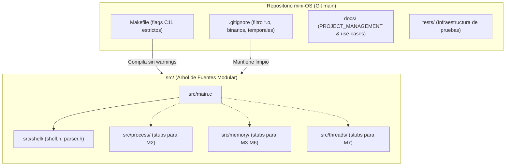

# 📋 Especificación Técnica: SIS-38 — Inicializar Repositorio Git y Estructura de Carpetas

> **Identificador Linear:** `SIS-38` | **Hito:** `Milestone 1: Infraestructura Base y Shell CLI`  
> **Proyecto / Módulo:** `Módulo 0 — Shell & Infraestructura Base`  
> **Alcance Estricto:** Configuración del repositorio Git en branch `main`, estructura desacoplada de directorios, `.gitignore` estricto y `Makefile` automatizado con flags C11  
> **Estado:** Completado (`Done`) | **Etapa Git:** Commit 1.1 — `feat(infra): bootstrap modular structure, Makefile and base headers (Issue 1.1)`  
> **🔗 Depende de:** Ninguna *(Punto de partida)*  
> **🔒 Bloquea a:** [SIS-39](sis-39.md) (*Issue 1.2: Implementar el ciclo principal del shell REPL*)  

---

## 1. Objetivo y Alcance Estricto de la Tarea

La tarea **SIS-38 (Issue 1.1)** establece las bases operativas, estructurales y de compilación del proyecto **mini-OS**, garantizando un entorno reproducible y desacoplado para el desarrollo incremental de los 3 módulos del sistema operativo didáctico.

### 🎯 Lo que SÍ cubre esta tarea:
1. **Inicialización de Git:** Repositorio local versionado con rama predeterminada `main`.
2. **Estructura Modular de Carpetas:** Creación de los directorios clave (`src/`, `src/shell/`, `src/process/`, `src/memory/`, `src/threads/`, `docs/`, `docs/issues/`, `docs/use-cases/`, `tests/`).
3. **Archivos Fuente Base y Stubs:** Creación de `src/main.c` y los encabezados (`.h`) con sus respectivas implementaciones mínimas (`.c` stubs) que permitan compilar el proyecto de extremo a extremo sin warnings.
4. **Makefile Automatizado:** Reglas estándar `all`, `clean`, `run`, `debug` con banderas estrictas del estándar C11 (`-Wall -Wextra -std=c11 -D_POSIX_C_SOURCE=200809L -D_DEFAULT_SOURCE -Isrc -lpthread`).
5. **Configuración de Ignorados (`.gitignore`):** Filtrado explícito de binarios, archivos objeto (`*.o`), volcados de depuración (`*.dSYM`), reportes de Valgrind y temporales de editor/SO.
6. **Limpieza del Árbol de Fuentes:** Asegurar que `src/` permanezca libre de archivos objeto compilados u otros artefactos no solicitados.

### 🚫 Lo que NO cubre esta tarea (pertenece a issues posteriores):
- **NO incluye el bucle interactivo REPL ni lectura con `fgets`:** Corresponde a **SIS-39 (Issue 1.2)**.
- **NO incluye el parseo de tokens ni banderas `&`:** Corresponde a **SIS-40 (Issue 1.3)**.
- **NO incluye el dispatcher ni comandos internos (`help`, `clear`, `exit`):** Corresponde a **SIS-41 (Issue 1.4)**.
- **NO implementa la lógica de Procesos, Memoria o Hilos:** Esos módulos se mantienen como stubs mínimos desacoplados.

---

## 2. Arquitectura de Directorios y Archivos

Estructura solicitada por el Plan de Gestión y Linear para el punto de partida:

```
mini-OS/
├── .clangd                 # Configuración de Language Server para IDE
├── .gitignore              # Reglas de exclusión de binarios y temporales
├── Makefile                # Script de compilación estricta C11
├── README.md               # Documentación general del proyecto
├── docs/                   # Documentación técnica y académica
│   ├── PROJECT_MANAGEMENT.md # Plan de hitos, dependencias y WBS
│   ├── issues/             # Especificaciones técnicas de cada issue (SIS-38, SIS-39, ...)
│   └── use-cases/          # Casos de uso funcionales (UC-00 a UC-06)
├── tests/                  # Directorio de pruebas y suites de integración
│   └── README.md
└── src/                    # Código fuente modular en C
    ├── main.c              # Punto de entrada principal
    ├── shell/              # Módulo Shell / CLI Base
    │   ├── shell.c / shell.h
    │   └── parser.c / parser.h
    ├── process/            # Módulo 1: Procesos
    │   ├── process.c / process.h
    │   └── signals.c / signals.h
    ├── memory/             # Módulo 3: Memoria
    │   ├── memory.c / memory.h
    │   ├── first_fit.c / first_fit.h
    │   ├── paging.c / paging.h
    │   └── mem_queue.c / mem_queue.h
    └── threads/            # Módulo 2: Hilos
        ├── buffer.c / buffer.h
        └── producer_consumer.c / producer_consumer.h
```

---

## 3. Diagrama de Arquitectura de la Solución



---

## 4. Configuración Clave de Herramientas

### 4.1. Makefile
```makefile
CC ?= gcc
CFLAGS ?= -Wall -Wextra -std=c11 -D_POSIX_C_SOURCE=200809L -D_DEFAULT_SOURCE -Isrc
LDFLAGS ?= -lpthread

TARGET = mini-os

SRCS = src/main.c \
       src/shell/shell.c \
       src/shell/parser.c \
       src/process/process.c \
       src/process/signals.c \
       src/memory/memory.c \
       src/memory/first_fit.c \
       src/memory/paging.c \
       src/memory/mem_queue.c \
       src/threads/buffer.c \
       src/threads/producer_consumer.c

OBJS = $(SRCS:.c=.o)

.PHONY: all clean run debug

all: $(TARGET)

$(TARGET): $(OBJS)
	$(CC) $(CFLAGS) -o $@ $(OBJS) $(LDFLAGS)

%.o: %.c
	$(CC) $(CFLAGS) -c $< -o $@

debug: CFLAGS += -g3 -O0 -DDEBUG
debug: clean $(TARGET)

run: $(TARGET)
	./$(TARGET)

clean:
	rm -rf $(OBJS) $(TARGET) *.dSYM valgrind-out.txt
```

### 4.2. `.gitignore`
Filtros esenciales activos:
- **Binarios:** `mini-os`, `*.exe`, `*.out`, `*.app`
- **Objetos:** `*.o`, `*.obj`, `*.so`, `*.dylib`, `*.a`
- **Directorios de compilación/debug:** `build/`, `bin/`, `*.dSYM/`
- **Valgrind:** `valgrind-out.txt`, `*.valgrind`, `valgrind.log`, `vgcore.*`
- **Editores:** `.DS_Store`, `.vscode/`, `.idea/`, `*.swp`

---

## 5. Matriz de Criterios de Aceptación y Validación

| ID | Criterio de Aceptación | Método de Comprobación | Estado |
|:---:|:---|:---|:---:|
| **CA-01** | Repositorio Git inicializado con branch `main`. | `git branch --show-current` retorna `main`. | ✅ Aprobado |
| **CA-02** | Directorios modulares completos (`src/`, `docs/`, `tests/`). | Verificación de árbol con `find src docs tests`. | ✅ Aprobado |
| **CA-03** | `.gitignore` activo filtrando artefactos objeto y ejecutables. | `git status --ignored` oculta o ignora `*.o` y `mini-os`. | ✅ Aprobado |
| **CA-04** | `Makefile` compila limpiamente con `-Wall -Wextra -std=c11`. | `make clean && make` retorna código `0` sin warnings. | ✅ Aprobado |
| **CA-05** | Ausencia de archivos no solicitados o binarios en `src/`. | `find src -name "*.o"` no retorna ningún archivo tras `make clean`. | ✅ Aprobado |

---

## 6. Comandos de Verificación Rápida

```bash
# 1. Comprobar rama de Git
git branch --show-current

# 2. Limpiar y verificar que src no contenga artefactos .o
make clean
find src -name "*.o"

# 3. Compilar el proyecto completo
make

# 4. Probar ejecución inicial
./mini-os
```
