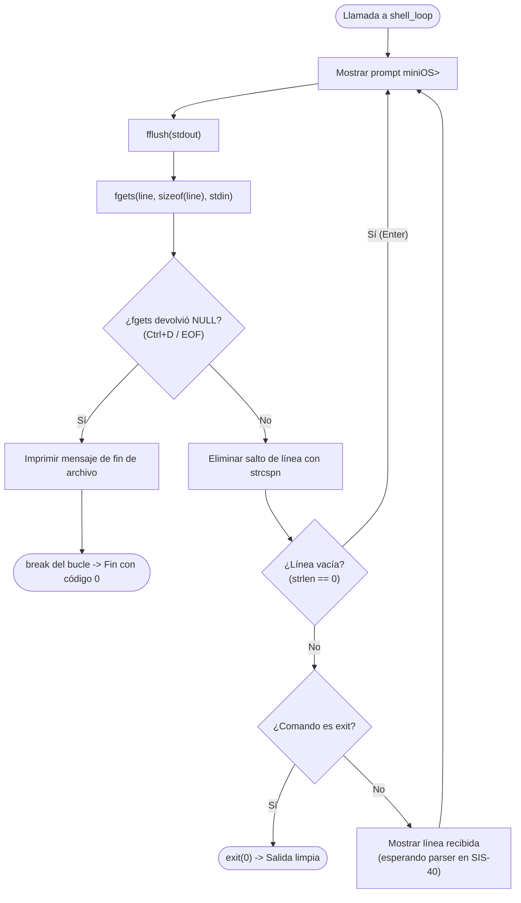

# 📋 Especificación Técnica: SIS-39 — Implementación del Ciclo Principal del Shell (REPL)

> **Identificador Linear:** `SIS-39` | **Hito:** `Milestone 1: Infraestructura Base y Shell CLI`  
> **Proyecto / Módulo:** `Módulo 0 — Shell & Infraestructura Base`  
> **Alcance Estricto:** Implementación exclusiva del ciclo REPL en [src/shell/shell.c](file:///Users/aron/githubRepo/mini-OS/src/shell/shell.c)  
> **Estado:** Listo para Implementación (`Todo`) | **Etapa Git:** Commit 1.2 — `feat(shell): implement interactive REPL loop (Issue 1.2 / SIS-39)`  
> **🔗 Depende de:** [SIS-38](sis-38.md) (*Issue 1.1: Inicializar repositorio Git y estructura de carpetas*)  
> **🔒 Bloquea a:** [SIS-40](file:///Users/aron/githubRepo/mini-OS/docs/PROJECT_MANAGEMENT.md#--issue-13-parser-y-tokenizador-de-l%C3%ADnea-de-comandos) (*Issue 1.3: Parser y tokenizador de línea de comandos*)  

---

## 1. Objetivo y Alcance Estricto de la Tarea

La tarea **SIS-39** se concentra **única y exclusivamente** en hacer que el shell sea interactivo mediante el ciclo **REPL** (*Read-Eval-Print-Loop*).

### 🎯 Lo que SÍ cubre esta tarea:
1. **Despliegue del Prompt:** Mostrar `miniOS> ` en cada iteración y forzar su renderizado inmediato con `fflush(stdout)`.
2. **Lectura Segura:** Leer líneas con `fgets(line, sizeof(line), stdin)` acotadas a `MAX_LINE` (1024 bytes).
3. **Control de EOF (`Ctrl+D`):** Si `fgets` retorna `NULL`, salir del bucle limpiamente sin bucles infinitos y terminar el programa con código `0`.
4. **Ignorar Líneas Vacías:** Si el usuario pulsa solo `Enter`, volver a mostrar el prompt sin ejecutar nada.
5. **Comando `exit` Directo:** Si la línea ingresada es `exit`, terminar la sesión con retorno `0`.

### 🚫 Lo que NO cubre esta tarea (pertenece a issues posteriores):
- **NO incluye el parser de argumentos (`argv`) ni detección de `&`:** Esto corresponde a la **Issue 1.3 (SIS-40)**.
- **NO incluye el dispatcher completo ni comandos externos (`fork`/`execvp`):** Esto corresponde a la **Issue 1.4 (SIS-41)** y **Milestone 2 (SIS-42)**.
- **NO toca módulos de memoria ni de hilos:** Esos módulos permanecen en stubs vacíos hasta sus respectivos hitos.

---

## 2. Diagrama de Flujo del REPL (SIS-39)



---

## 3. Archivo Afectado

El único archivo a modificar en esta tarea es:
- [src/shell/shell.c](file:///Users/aron/githubRepo/mini-OS/src/shell/shell.c)

---

## 4. Implementación Concreta de SIS-39

```c
#include <stdio.h>
#include <stdlib.h>
#include <string.h>
#include "shell.h"

void shell_init(void) {
    // Inicialización de variables del shell si se requieren en el futuro
}

void shell_loop(void) {
    char line[MAX_LINE];

    while (1) {
        // 1. Mostrar prompt y forzar vaciado de buffer a pantalla
        printf("miniOS> ");
        fflush(stdout);

        // 2. Leer línea de la entrada estándar
        if (fgets(line, sizeof(line), stdin) == NULL) {
            // Detección de EOF (Ctrl+D)
            printf("\n[INFO] Saliendo del shell...\n");
            break;
        }

        // 3. Sanitizar: remover el salto de línea al final
        line[strcspn(line, "\r\n")] = '\0';

        // 4. Si el usuario solo pulsó Enter (línea vacía), continuar
        if (strlen(line) == 0) {
            continue;
        }

        // 5. Soporte nativo inicial para salir
        if (strcmp(line, "exit") == 0) {
            printf("[INFO] Finalizando miniOS. ¡Hasta luego!\n");
            exit(0);
        }

        // 6. Mensaje provisional mientras se implementa el parser en SIS-40
        printf("[miniOS] Entrada recibida: '%s'\n", line);
    }
}

int shell_dispatch(char *line) {
    (void)line;
    // Se completará en la Issue 1.4 (SIS-41)
    return 0;
}
```

---

## 5. Casos de Prueba y Criterios de Aceptación

| ID | Prueba | Entrada | Resultado Esperado | Criterio |
|:---:|:---|:---|:---|:---:|
| **CP-01** | Prompt interactivo | `./mini-os` | Muestra `miniOS> ` en pantalla esperando entrada. | ✅ Aprobado |
| **CP-02** | Pulsaciones de Enter | Pulsar `Enter` varias veces | El prompt vuelve a aparecer sin errores ni saltos extraños. | ✅ Aprobado |
| **CP-03** | Comando `exit` | Escribir `exit` | Imprime mensaje de despedida y termina con código `0` (`echo $?` da 0). | ✅ Aprobado |
| **CP-04** | Atajo `Ctrl+D` (EOF) | Pulsar `Ctrl+D` en prompt | Imprime `[INFO] Saliendo del shell...` y termina con código `0`. | ✅ Aprobado |
| **CP-05** | Texto genérico | `hola mundo` | Muestra `[miniOS] Entrada recibida: 'hola mundo'` y vuelve a `miniOS> `. | ✅ Aprobado |

---

## 6. Comandos de Verificación Rápida

```bash
# Compilar
make clean && make

# Prueba automatizada de Enter, texto, exit y EOF
printf "\n\nhola miniOS\nexit\n" | ./mini-os
printf "" | ./mini-os
echo "Código de salida: $?"
```
