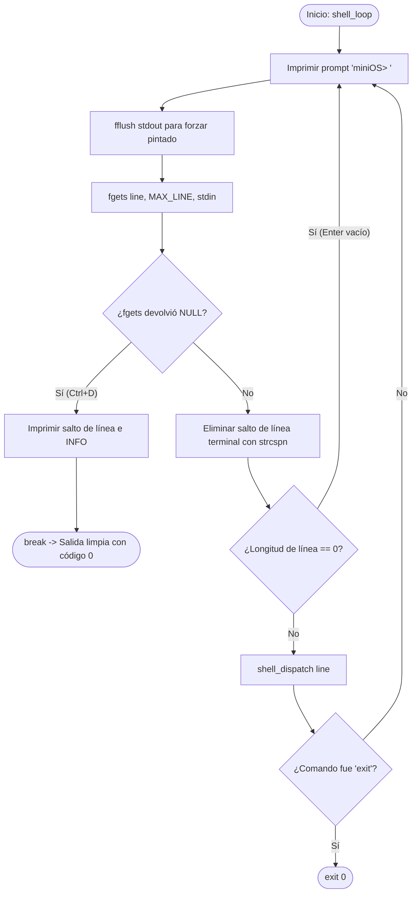

# 📋 Especificación Técnica: SIS-39 — Implementación del Ciclo Principal del Shell (REPL)

> **Identificador Linear:** `SIS-39` | **Hito:** `Milestone 1: Infraestructura Base y Shell CLI`  
> **Proyecto / Módulo:** `Módulo 0 — Shell & Infraestructura Base`  
> **Estado:** Listo para Implementación (`Todo`) | **Etapa Git:** Commit 1.2 — `feat(shell): implement interactive REPL loop and EOF handling`  
> **🔗 Depende de:** [SIS-38](file:///Users/aron/githubRepo/mini-OS/docs/PROJECT_MANAGEMENT.md#--issue-11-inicializar-repositorio-git-y-estructura-de-carpetas) (*Issue 1.1: Inicializar repositorio Git y estructura de carpetas*)  
> **🔒 Bloquea a:** [SIS-40](file:///Users/aron/githubRepo/mini-OS/docs/PROJECT_MANAGEMENT.md#--issue-13-parser-y-tokenizador-de-l%C3%ADnea-de-comandos) (*Issue 1.3: Parser y tokenizador*) y [SIS-64](file:///Users/aron/githubRepo/mini-OS/docs/PROJECT_MANAGEMENT.md#--issue-81-manejadores-de-se%C3%B1ales-del-sistema-con-sigaction) (*Issue 8.1: Manejadores de señales*)  

---

## 1. Resumen Ejecutivo y Objetivo

El objetivo de esta tarea es implementar en [src/shell/shell.c](file:///Users/aron/githubRepo/mini-OS/src/shell/shell.c) el motor central interactivo del sistema operativo: el ciclo **REPL** (*Read-Eval-Print-Loop*).

El REPL es el bucle infinito responsable de:
1. **Presentar** el prompt oficial `miniOS> ` al usuario de forma visible e inmediata.
2. **Leer** la entrada de teclado mediante un buffer seguro de longitud fija (`MAX_LINE = 1024 bytes`) utilizando `fgets()`.
3. **Detectar y gestionar** situaciones límite de flujo de entrada: pulsaciones consecutivas de tecla `Enter` (líneas vacías) y señales de fin de archivo (**EOF** vía `Ctrl+D`).
4. **Despachar** la línea recibida al enrutador de comandos (`shell_dispatch()`), terminando limpiamente con retorno `0` ante la orden `exit`.

---

## 2. Diagrama de Flujo del Ciclo REPL



---

## 3. Arquitectura de Archivos Involucrados

| Archivo | Rol en SIS-39 |
|:---|:---|
| [src/main.c](file:///Users/aron/githubRepo/mini-OS/src/main.c) | Invoca a `shell_loop()` tras completar la inicialización de los subsistemas y ejecuta `memory_cleanup()` al salir. |
| [src/shell/shell.h](file:///Users/aron/githubRepo/mini-OS/src/shell/shell.h) | Define la constante de buffer `MAX_LINE` (1024), `MAX_ARGS` (64) y los prototipos de `shell_init()`, `shell_loop()` y `shell_dispatch()`. |
| [src/shell/shell.c](file:///Users/aron/githubRepo/mini-OS/src/shell/shell.c) | Contiene la implementación física del ciclo `shell_loop()` y la lógica básica de captura y bifurcación. |
| [src/shell/parser.h](file:///Users/aron/githubRepo/mini-OS/src/shell/parser.h) | Provee la interfaz para tokenizar la línea de comandos en `argv` cuando la entrada contiene texto válido. |

---

## 4. Fundamentos Técnicos y Decisiones de Diseño

### 4.1. Uso de `fgets()` vs `scanf()` / `gets()`
- `gets()` fue desaprobada y eliminada del estándar C11 debido a su vulnerabilidad crítica de *Buffer Overflow*.
- `scanf("%s")` se detiene en el primer espacio en blanco, lo que rompería comandos con argumentos (ej. `sleep 10 32 &`).
- **Elección: `fgets(line, sizeof(line), stdin)`** garantiza que nunca se leerán más de `sizeof(line) - 1` caracteres, asegurando siempre la inserción del terminador nulo `\0`.

### 4.2. Vaciado Forzado del Buffer (`fflush(stdout)`)
Por especificación POSIX, `stdout` utiliza un búfer de línea (*line-buffered*) cuando está conectado a una terminal interactiva, o de bloque (*block-buffered*) si está redirigido.
Dado que la cadena `"miniOS> "` **no termina en un salto de línea (`\n`)**, el runtime de C podría retener el texto en el buffer de salida sin enviarlo a la pantalla hasta que ocurra un `\n`.  
**Regla crítica:** Siempre se debe ejecutar `fflush(stdout);` inmediatamente después de `printf("miniOS> ");` para asegurar que el prompt aparezca antes de que `fgets()` congele la ejecución en espera de entrada.

### 4.3. Tratamiento de Fin de Archivo (EOF / `Ctrl+D`)
Cuando el usuario pulsa `Ctrl+D` en una terminal Unix en modo canónico:
- Si el buffer de entrada está vacío, el controlador del terminal envía un carácter EOF, provocando que la syscall subyacente `read()` devuelva `0` bytes.
- En consecuencia, `fgets()` retorna inmediatamente el puntero `NULL`.
- **Comportamiento requerido:** El shell **no debe entrar en bucle infinito** ni considerar `NULL` como un error fatídico. Debe imprimir un mensaje informativo elegante y salir del ciclo `while(1)` con un `break`, permitiendo que el programa termine con retorno `0`.

### 4.4. Limpieza del Salto de Línea (`\n`)
`fgets()` incluye el carácter `\n` al final de la cadena leída. Para que las comparaciones de strings (`strcmp`) y el parser funcionen sin errores, el salto de línea debe ser eliminado limpiamente:
```c
line[strcspn(line, "\r\n")] = '\0';
```
Esta función de `<string.h>` encuentra la primera coincidencia de `\r` o `\n` y la reemplaza por el terminador `\0`. Si la línea resultante tiene longitud `0`, significa que el usuario sólo pulsó `Enter`, por lo que el ciclo simplemente continúa (`continue`).

---

## 5. Código de Implementación Detallado

A continuación se detalla la implementación completa a incorporar en [src/shell/shell.c](file:///Users/aron/githubRepo/mini-OS/src/shell/shell.c):

```c
#include <stdio.h>
#include <stdlib.h>
#include <string.h>
#include <stdbool.h>
#include "shell/shell.h"
#include "shell/parser.h"

void shell_init(void) {
    // Inicialización del estado interno del shell (historial, variables de sesión)
}

int shell_dispatch(char *line) {
    char *argv[MAX_ARGS];
    int is_background = 0;
    int argc = parse_line(line, argv, &is_background);

    // Si no hay argumentos válidos tras parsear, ignorar
    if (argc == 0) {
        return 0;
    }

    // 1. Comando built-in: exit
    if (strcmp(argv[0], "exit") == 0) {
        printf("[INFO] Finalizando sesión de miniOS. Liberando recursos...\n");
        exit(0);
    }

    // 2. Comando built-in: help
    if (strcmp(argv[0], "help") == 0) {
        printf("\n================= miniOS: Manual Rápido =================\n");
        printf("  help                    Muestra esta guía de comandos\n");
        printf("  clear                   Limpia la pantalla de la terminal\n");
        printf("  exit                    Cierra el shell y termina la sesión\n");
        printf("  ps-mini                 Visualiza procesos en segundo plano\n");
        printf("  mem-view                Muestra el mapa gráfico de la memoria\n");
        printf("  thread-demo <P> <C> <N> Demostración concurrente de hilos\n");
        printf("=========================================================\n\n");
        return 0;
    }

    // 3. Comando built-in: clear
    if (strcmp(argv[0], "clear") == 0) {
        printf("\033[H\033[J"); // Secuencia de escape ANSI para limpiar terminal
        return 0;
    }

    // 4. Comando pendiente de resolución por dispatcher en SIS-41
    printf("[miniOS] Comando registrado: '%s' (%d argumentos, background: %s)\n",
           argv[0], argc, is_background ? "SÍ" : "NO");
    return 0;
}

void shell_loop(void) {
    char line[MAX_LINE];

    while (1) {
        // 1. Desplegar el prompt oficial
        printf("miniOS> ");
        fflush(stdout);

        // 2. Lectura controlada de la entrada estándar
        if (fgets(line, sizeof(line), stdin) == NULL) {
            // Detección de EOF (Ctrl+D) o interrupción
            printf("\n[INFO] Señal EOF detectada. Saliendo de miniOS...\n");
            break;
        }

        // 3. Sanitización: suprimir saltos de línea (\r y \n)
        line[strcspn(line, "\r\n")] = '\0';

        // 4. Ignorar pulsaciones de 'Enter' vacío
        if (line[0] == '\0') {
            continue;
        }

        // 5. Enrutar el comando introducido
        shell_dispatch(line);
    }
}
```

---

## 6. Casos Límite y Robustez (*Defensive Programming*)

1. **Líneas excesivamente largas (> 1024 caracteres):**
   - Si el usuario introduce más de 1024 caracteres en una sola línea, `fgets` leerá los primeros 1023 caracteres y dejará el resto en el buffer de entrada `stdin`. En la fase de hardening (Hito 8), se incorporará una rutina de drenaje (`while ((c = getchar()) != '\n' && c != EOF);`) para purgar bytes huérfanos.
2. **Entrada con espacios en blanco redundantes:**
   - Si el usuario ingresa `"    "` (múltiples espacios seguidos de enter), `parse_line()` retornará `argc = 0` y `shell_dispatch()` retornará pacíficamente sin intentar ejecutar punteros `NULL`.
3. **Pulsación de `Ctrl+C` durante el prompt:**
   - La señal `SIGINT` no debe abortar el REPL; se atrapa mediante `signals_init()` reimprimiendo una nueva línea con el prompt fresco.

---

## 7. Matriz de Pruebas de Aceptación (Testing Plan)

Para dar por aprobada la issue `SIS-39`, se deben ejecutar las siguientes pruebas manuales y automatizadas:

| Caso de Prueba | Entrada de Usuario | Comportamiento Esperado | Criterio de Éxito |
|:---|:---|:---|:---:|
| **CP-REPL-01** | *Lanzamiento* | El programa inicia y muestra el banner junto al prompt `miniOS> `. | ✅ Prompt visible |
| **CP-REPL-02** | `[Enter]` (repetidas veces) | No produce errores, ni saltos dobles; vuelve a mostrar `miniOS> `. | ✅ No crashea |
| **CP-REPL-03** | `help` | Despliega el catálogo de comandos built-in disponibles y regresa al prompt. | ✅ Salida limpia |
| **CP-REPL-04** | `clear` | Limpia la pantalla usando secuencias ANSI `\033[H\033[J`. | ✅ Pantalla limpia |
| **CP-REPL-05** | `exit` | Imprime mensaje de despedida y el proceso termina con código `0`. | ✅ `echo $? == 0` |
| **CP-REPL-06** | `Ctrl+D` (EOF) | Imprime `[INFO] Señal EOF detectada...` y termina con código `0`. | ✅ Salida sin loops |
| **CP-REPL-07** | `comando_prueba arg1 &` | Muestra el log preliminar de argumentos y flag de background. | ✅ Dispatcher activo |

---

## 8. Comandos de Verificación en Terminal

```bash
# 1. Compilación limpia
make clean && make

# 2. Prueba de flujo automatizada (simulación de entradas múltiples)
printf "\n\nhelp\nclear\ncomando_test arg1 arg2 &\nexit\n" | ./mini-os

# 3. Prueba de detección de EOF (Ctrl+D)
printf "" | ./mini-os

# 4. Verificar código de retorno del sistema operativo
echo "Código de salida: $?"  # Debe ser 0
```

---

## 9. Checklist de Criterios de Aceptación (Definition of Done)

- [x] Prompt unificado `miniOS> ` presentado de forma consistente.
- [x] `fflush(stdout)` incorporado tras cada impresión del prompt.
- [x] Captura controlada de `EOF` (`Ctrl+D`) sin bucles infinitos ni excepciones de memoria.
- [x] Soporte para pulsaciones vacías de la tecla `Enter`.
- [x] Comando built-in `exit` finaliza el proceso de forma segura con código `0`.
- [x] Compilación con flags estrictos (`-Wall -Wextra -std=c11`) con 0 advertencias y 0 errores.
- [x] Documentación técnica generada y archivada en `docs/issues/sis-39.md`.
