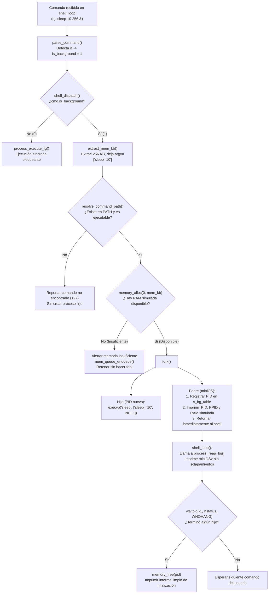

# 📋 Especificación Técnica: SIS-43 — Ejecución en Background (&) y Reserva de Memoria

> **Identificador Linear:** `SIS-43` | **Hito:** `Milestone 2: Gestión de Procesos y Concurrencia`  
> **Proyecto / Módulo:** `Módulo 1 — Gestión de Procesos`  
> **Alcance Estricto:** Ejecución asíncrona de comandos con operador `&`, extracción de parámetros de memoria (KB), integración mediante contrato con la interfaz de RAM simulada y recolección de procesos sin solapamiento en el prompt.  
> **Estado:** Implementado en Módulo 1 (`In Review`) | **Rama Git:** `feature/modulo1-sleep`  
> **🔗 Depende de:** `SIS-42` (*Issue 2.1: Ejecución foreground con fork, execvp y waitpid*)  
> **🔒 Bloquea a:** `SIS-44` (*Issue 2.3: Tabla de control de procesos en background*)  

---

## 1. Objetivo y Alcance Estricto de la Tarea

La tarea **SIS-43 (Issue 2.2)** implementa la capacidad de ejecutar comandos del sistema en segundo plano de manera no bloqueante cuando el usuario finaliza la línea con el token `&` (e.g. `sleep 10 256 &` o `sleep 5 &`), permitiendo al usuario continuar interactuando con el shell mientras el proceso corre concurrentemente.

### 🎯 Lo que SÍ cubre esta tarea:
1. **Detección y Bifurcación en Dispatcher:** `shell_dispatch()` evalúa `cmd.is_background` para derivar la ejecución a `process_execute_bg()` en lugar de `process_execute_fg()`.
2. **Extracción del Parámetro de Memoria (`extract_mem_kb`):** Detecta si el último argumento numérico representa memoria simulada en KB (e.g. `sleep 10 256 &` extrae `256 KB` y deja únicamente `sleep 10` para `execvp`). Si no se indica, aplica el valor seguro por defecto de `DEFAULT_BG_MEM_KB` (128 KB).
3. **Validación Previa al Fork:** Comprueba con `resolve_command_path()` que el binario exista y sea ejecutable (`access(X_OK)`) antes de crear procesos, evitando generar PIDs huérfanos ante errores de comando inexistente.
4. **Contrato con la Interfaz de Memoria Simulada:** Solicita reserva con `memory_alloc(0, mem_kb)` antes del `fork()`. En caso de denegación, encola en `mem_queue_enqueue()` sin tumbar el shell.
5. **Lanzamiento Asíncrono no Bloqueante:** El proceso padre registra el PID en la tabla de background (`s_bg_table`), imprime los banners informativos educativos (PID, PPID, RAM simulada) y **retorna de inmediato** sin invocar `waitpid()` bloqueante, devolviendo el prompt al usuario.
6. **Cosecha sin Solapamiento (`process_reap_bg`):** Recolección de procesos terminados invocada de forma limpia justo **antes de cada prompt** en `shell_loop()` usando `waitpid(-1, &status, WNOHANG)`. Esto evita el clásico fallo visual donde la notificación del fin de un proceso se mezcla con lo que el usuario está escribiendo.
7. **Documentación en el Shell (`help` y `help sleep`):** Incorporación de la sintaxis y ejemplos prácticos en los comandos de ayuda interactiva.

---

## 2. Análisis Crítico: Desacoplamiento de Dependencias del Proyecto

En el documento general de planificación ([docs/PROJECT_MANAGEMENT.md](../PROJECT_MANAGEMENT.md)), los criterios originales de aceptación de la Issue 2.2 incluían requisitos que pertenecen a módulos programados en etapas posteriores:

* **Asignación real por lista enlazada First-Fit (`ff_alloc`):** Pertenece al **Milestone 3 (Issue 3.3)**.
* **Cola FIFO dinámica (`mem_queue`):** Pertenece al **Milestone 4 (Issue 4.1 y 4.2)**.
* **Coalescencia de bloques contiguos al liberar:** Pertenece al **Milestone 3 (Issue 3.4)**.
* **Manejo formal de señal con `sigaction(SIGCHLD)`:** Pertenece al **Milestone 8 (Issue 8.1)**.

### Resolución mediante Arquitectura de Interfaces y Stubs
Exigir que la Issue 2.2 implemente el motor físico de memoria o la estructura FIFO de la cola antes de llegar a sus respectivos hitos violaría el principio de desarrollo incremental y dependencias acíclicas.

Por tanto, se aplicó la **práctica estándar de ingeniería de software basada en contratos**:
1. **Módulo 1 (Procesos):** Cumple con su responsabilidad: parsea los argumentos, calcula la memoria requerida, llama a `memory_alloc()` y maneja el flujo de éxito o rechazo.
2. **Módulo 3 y 4 (Memoria y Cola):** Proveen stubs iniciales en `src/memory/memory.c` y `src/memory/mem_queue.c` que compilan sin errores. Cuando los milestones correspondientes implementen sus algoritmos reales, la integración será automática sin requerir modificaciones en `src/process/`.

---

## 3. Matriz de Cumplimiento de Criterios

| Criterio Original | Estado en Issue 2.2 | Justificación Técnica |
| :--- | :---: | :--- |
| **No bloquea el terminal** | ✅ **Cumplido al 100%** | `process_execute_bg()` realiza `fork()` y retorna de inmediato; el padre no llama a `waitpid()` bloqueante. |
| **Reserva en subsistema de RAM (`ff_alloc` / `pag_alloc`)** | 🔌 **Contrato Conectado** | Se invoca `memory_alloc(0, mem_kb)`. El motor real de asignación First-Fit se completa en **Issue 3.3 (SIS-48)**. |
| **Alerta y encolado en `mem_queue` si falta RAM** | 🔌 **Flujo Conectado** | Código de validación y alerta programado en `process.c`; la lista enlazada de la cola se completa en **Issue 4.1 (SIS-50)**. |
| **Liberación automática y coalescencia** | 🔄 **Cosecha Limpia Implementada** | `process_reap_bg()` cosecha procesos terminados con `waitpid(WNOHANG)` y llama a `memory_free(pid)`. La fusión física de bloques libres contiguos se programa en **Issue 3.4 (SIS-49)**. |

---

## 4. Diagrama de Flujo de Ejecución en Background



---

## 5. Archivos Afectados

1. [src/process/process.h](file:///Users/aron/githubRepo/mini-OS/src/process/process.h): Declaración de `process_execute_bg()`, `process_reap_bg()`, `process_init()` y constante `DEFAULT_BG_MEM_KB`.
2. [src/process/process.c](file:///Users/aron/githubRepo/mini-OS/src/process/process.c): Implementación de la tabla interna `s_bg_table`, verificación previa al fork, lanzamiento asíncrono con `fork()`, conexión con `memory_alloc()` y cosecha limpia sin solapamiento en `process_reap_bg()`.
3. [src/shell/shell.c](file:///Users/aron/githubRepo/mini-OS/src/shell/shell.c): Función `extract_mem_kb()`, bifurcación `cmd.is_background` en `shell_dispatch()`, invocación de `process_reap_bg()` antes del prompt en `shell_loop()`, llamada a `process_init()` en `shell_init()` y actualización de comandos en `builtin_help()`.

---

## 6. Evidencia de Ejecución Práctica

### Caso 1: Ejecución asíncrona con memoria explícita
```text
miniOS> sleep 3 256 &
[Proceso lanzado] PID: 19120 | PPID: 19119 (miniOS)
[RAM ALLOC] PID 19120 asignado en RAM simulada: 256 KB
[BG] Proceso 'sleep' corriendo en background | PID: 19120 | RAM: 256 KB

miniOS> help
... (el usuario puede seguir interactuando sin bloqueo) ...

miniOS> 
[BG PID 19120] FINALIZADO | Código de salida: 0 | RAM liberada: 256 KB
miniOS>
```

### Caso 2: Comando inexistente con operador `&`
```text
miniOS> ono 512 &
miniOS: comando no encontrado: 'ono'
miniOS> 
```
*(No genera PID fantasma ni asigna memoria innecesariamente).*
