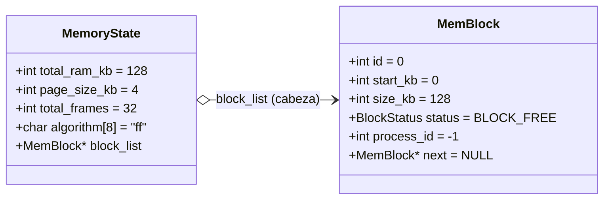

# 📋 Especificación Técnica: SIS-46 — Estructuras de Datos de Memoria y Lista de Bloques (Issue 3.1)

> **Identificador Linear:** `SIS-46` | **Hito:** `Milestone 3: Configuración de RAM, Presets y First-Fit`  
> **Proyecto / Módulo:** `Módulo 3 — Gestión de Memoria (First-Fit & Paginación)`  
> **Alcance Estricto:** Modelado de la memoria física simulada como una lista enlazada dinámica ordenada por `start_kb` iniciando con un bloque gigante libre, variable global `mem_state` e integración en el arranque del shell.  
> **Estado:** Completado (`Done`) | **Etapa Git:** `feature/3.1-memory-structures`  
> **🔗 Depende de:** `SIS-41` (*Issue 1.4: Dispatcher central y built-ins básicos*)  
> **🔒 Bloquea a:**  
> - `SIS-47` (*Issue 3.2: Comandos de configuración de RAM y presets: mem-config*)  
> - `SIS-48` (*Issue 3.3: Algoritmo First-Fit — Asignación contigua ff_alloc y split*)  
> - `SIS-50` (*Issue 4.1: Estructura de cola FIFO para procesos en espera mem_queue*)  

---

## 1. Objetivo y Alcance Estricto de la Tarea

La tarea **SIS-46 (Issue 3.1)** constituye la base estructural del **Módulo 3: Gestión de Memoria**. Su propósito es definir los tipos de datos fundamentales y la gestión del ciclo de vida de la memoria física simulada en **miniOS** para esquemas de particionamiento dinámico contiguo (First-Fit).

### 🎯 Lo que SÍ cubre esta tarea:
1. **Definición de Tipos y Enums en `src/memory/memory.h`:**
   - `BlockStatus`: enum binario (`BLOCK_FREE = 0`, `BLOCK_USED = 1`).
   - `MemBlock`: nodo de la lista enlazada que modela cada partición contigua de RAM (`id`, `start_kb`, `size_kb`, `status`, `process_id`, `*next`).
   - `MemoryState`: estructura de control global (`total_ram_kb`, `page_size_kb`, `total_frames`, `algorithm[8]`, `*block_list`).
2. **Variable Global `mem_state`:** Instanciada en `src/memory/memory.c` y exportada como `extern` en `memory.h` para acceso desde el kernel y los comandos del shell.
3. **Inicialización y "Bloque Gigante Libre":**
   - Implementación de `mem_reset_blocks()`: libera nodos existentes para evitar fugas de memoria y crea un único bloque libre que abarca toda la RAM (`start_kb = 0`, `size_kb = total_ram_kb`, `status = BLOCK_FREE`, `process_id = -1`).
   - Implementación de `mem_init()`: establece parámetros por defecto ("ff", marcos) y delega a `mem_reset_blocks()`.
   - Sincronización en `memory_init(int total_ram_kb, mem_algorithm_t algo)` para reconfigurar RAM y algoritmo activo.
   - Implementación de `memory_cleanup()`: liberación completa de la lista enlazada al finalizar el sistema.
4. **Integración con el Shell (`shell_init`):**
   - Inclusión de `memory.h` en `src/shell/shell.c`.
   - Inicialización automática en `shell_init()` con 128 KB en modo First-Fit (`MEM_ALGO_FIRST_FIT`).
   - Mensaje informativo del kernel reportando la inicialización del bloque libre inicial.

### 🚫 Lo que NO cubre esta tarea (pertenece a issues posteriores):
- **NO incluye los comandos CLI de configuración (`mem-config`, presets):** Corresponde a **SIS-47 (Issue 3.2)**.
- **NO implementa la lógica de asignación contigua (`ff_alloc`) ni partición (`split`):** Corresponde a **SIS-48 (Issue 3.3)**.
- **NO implementa la liberación (`ff_free`) ni fusión de bloques adyacentes (`coalescing`):** Corresponde a **SIS-49 (Issue 3.4)**.
- **NO implementa la cola de espera de memoria:** Corresponde a **SIS-50 / SIS-51 (Milestone 4: mem_queue)**.
- **NO implementa la visualización terminal gráfica (`mem-view`):** Corresponde a **SIS-57 (Issue 6.1)**.

---

## 2. Diagrama de la Estructura de Memoria (Lista Enlazada)



### Invariantes de la Lista Enlazada:
1. **Orden estricto por dirección base:** Para todo nodo $i$ y su sucesor $i+1$, se cumple que $\text{start\_kb}_{i+1} = \text{start\_kb}_i + \text{size\_kb}_i$.
2. **Cobertura total:** La suma de los `size_kb` de todos los nodos en `block_list` es idéntica a `total_ram_kb`.
3. **Estado inicial:** Al arrancar el SO, la lista contiene exactamente **1 nodo** libre (`BLOCK_FREE`) que representa el 100% de la RAM disponible.

---

## 3. Archivos Afectados

| Archivo | Rol en SIS-46 |
|---|---|
| [`src/memory/memory.h`](file:///Users/luisc/Documents/mini-OS/src/memory/memory.h) | Definición de `BlockStatus`, `MemBlock`, `MemoryState`, declaración `extern mem_state` y prototipos de ciclo de vida. |
| [`src/memory/memory.c`](file:///Users/luisc/Documents/mini-OS/src/memory/memory.c) | Instancia de `mem_state`, implementación de `mem_reset_blocks()`, `mem_init()`, `memory_init()` y `memory_cleanup()`. |
| [`src/shell/shell.c`](file:///Users/luisc/Documents/mini-OS/src/shell/shell.c) | Invocación de `memory_init(128, MEM_ALGO_FIRST_FIT)` e impresión del banner de memoria en `shell_init()`. |
| [`src/main.c`](file:///Users/luisc/Documents/mini-OS/src/main.c) | Orquestación general que invoca a `shell_init()` antes de arrancar `shell_loop()`. |

---

## 4. Implementación Clave

### 4.1 Definición de Estructuras (`src/memory/memory.h`)

```c
typedef enum {
    BLOCK_FREE = 0,
    BLOCK_USED = 1
} BlockStatus;

typedef struct MemBlock {
    int id;
    int start_kb;
    int size_kb;
    BlockStatus status;
    int process_id;             // -1 si libre
    struct MemBlock *next;
} MemBlock;

typedef struct {
    int total_ram_kb;
    int page_size_kb;
    int total_frames;
    char algorithm[8];          // "ff" (First-Fit) o "pag" (Paginación)
    MemBlock *block_list;
} MemoryState;

extern MemoryState mem_state;
```

### 4.2 Inicialización del Bloque Gigante (`src/memory/memory.c`)

```c
void mem_reset_blocks(void) {
    // 1. Liberación preventiva de nodos existentes
    MemBlock *current = mem_state.block_list;
    while (current != NULL) {
        MemBlock *next = current->next;
        free(current);
        current = next;
    }
    mem_state.block_list = NULL;

    // 2. Creación del bloque inicial libre
    MemBlock *initial_block = (MemBlock *)malloc(sizeof(MemBlock));
    if (initial_block == NULL) {
        perror("Error de asignacion de memoria en mem_reset_blocks");
        exit(EXIT_FAILURE);
    }

    initial_block->id = 0;
    initial_block->start_kb = 0;
    initial_block->size_kb = mem_state.total_ram_kb;
    initial_block->status = BLOCK_FREE;
    initial_block->process_id = -1;
    initial_block->next = NULL;

    // 3. Fijar como inicio de la lista
    mem_state.block_list = initial_block;
}
```

### 4.3 Inicialización en el Arranque del Shell (`src/shell/shell.c`)

```c
void shell_init(void) {
    /* Inicializar subsistema de memoria para la Issue 3.1 (SIS-46) */
    memory_init(128, MEM_ALGO_FIRST_FIT);

    if (mem_state.block_list != NULL) {
        printf("[miniOS Kernel] Memoria inicializada: %d KB RAM | Bloque inicial: %d-%d KB (%s)\n\n",
               mem_state.total_ram_kb,
               mem_state.block_list->start_kb,
               mem_state.block_list->size_kb,
               mem_state.block_list->status == BLOCK_FREE ? "BLOCK_FREE" : "BLOCK_USED");
    }
}
```

---

## 5. Casos de Prueba y Criterios de Aceptación

| ID | Caso de Prueba | Procedimiento / Entrada | Resultado Esperado | Estado / Validación |
|:---:|:---|:---|:---|:---:|
| **CP-01** | Compilación sin advertencias | `make clean && make` | Compila con `-Wall -Wextra -std=c11` generando binario `mini-os` sin warnings ni errores. | ✅ Aprobado |
| **CP-02** | Inicialización del Bloque Gigante | Ejecutar `./mini-os` | El kernel muestra: `[miniOS Kernel] Memoria inicializada: 128 KB RAM \| Bloque inicial: 0-128 KB (BLOCK_FREE)`. | ✅ Aprobado |
| **CP-03** | Consistencia de Estructura Inicial | Inspección de `mem_state` tras arranque | `mem_state.total_ram_kb == 128`, `algorithm == "ff"`, `block_list->size_kb == 128`, `block_list->next == NULL`. | ✅ Aprobado |
| **CP-04** | Prevención de Fugas de Memoria | Llamadas repetidas a `mem_reset_blocks()` | Los nodos antiguos son liberados (`free`) antes de crear el nuevo bloque inicial libre. | ✅ Aprobado |
| **CP-05** | Limpieza General del Subsistema | Invocación de `memory_cleanup()` | Vacía y libera todos los elementos de `mem_state.block_list`, dejando el puntero en `NULL`. | ✅ Aprobado |

---

## 6. Comandos de Verificación Rápida

```bash
# 1. Compilación limpia
make clean && make

# 2. Prueba de arranque con verificación de banner de memoria y salida
echo "exit" | ./mini-os

# Salida esperada:
# ================================================================
#          miniOS — Shell Interactivo Educativo en C11            
# ================================================================
# 
# [miniOS Kernel] Memoria inicializada: 128 KB RAM | Bloque inicial: 0-128 KB (BLOCK_FREE)
# 
# miniOS> [INFO] Finalizando miniOS. ¡Hasta luego!
```

