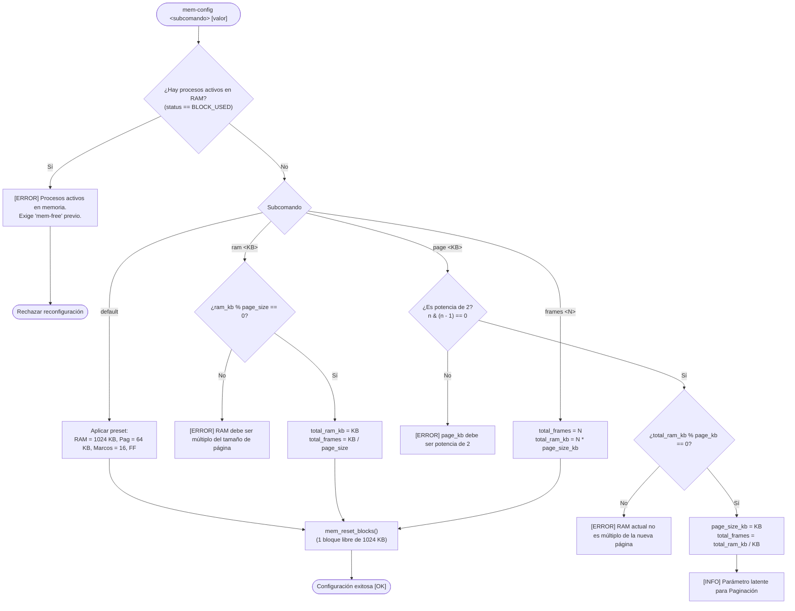

# 📋 Especificación Técnica: SIS-47 — Comandos de Configuración de RAM y Presets (Issue 3.2)

> **Identificador Linear:** `SIS-47` | **Hito:** `Milestone 3: Configuración de RAM, Presets y First-Fit`  
> **Proyecto / Módulo:** `Módulo 3 — Gestión de Memoria (First-Fit & Paginación)`  
> **Alcance Estricto:** Implementación de los comandos CLI `mem-config` (`ram`, `page`, `frames`, `default`) y `mem-status`, validaciones matemáticas de consistencia, bloqueo por procesos activos y protección contra comandos incompatibles en modo First-Fit.  
> **Estado:** Completado (`Done`) | **Etapa Git:** `feature/issue-3.2-mem-config-and-presets`  
> **🔗 Depende de:** [SIS-46](sis-46.md) (*Issue 3.1: Estructuras de datos de memoria y lista de bloques*)  
> **🔒 Bloquea a:**  
> - `SIS-48` (*Issue 3.3: Algoritmo First-Fit — Asignación contigua ff_alloc y split*)  
> - `SIS-51` (*Issue 5.1: Estructuras de paginación y asignación de marcos*)  

---

## 1. Objetivo y Alcance Estricto de la Tarea

La tarea **SIS-47 (Issue 3.2)** dota al shell de **miniOS** de la capacidad interactiva para parametrizar la memoria física simulada. Permite ajustar el tamaño de la memoria RAM, definir el tamaño de página y marcos, aplicar configuraciones preestablecidas seguras (presets) y consultar el estado del subsistema mediante una tabla formateada.

Adicionalmente, implementa las reglas de consistencia interna del kernel que previenen inconsistencias matemáticas, corrupción de datos de procesos activos y ejecuciones de comandos no permitidos según el algoritmo activo.

### 🎯 Lo que SÍ cubre esta tarea:

1. **Comandos CLI implementados:**
   - `mem-config ram <KB>`: Reconfigura la capacidad total de RAM y regenera el bloque libre gigante continuo para First-Fit.
   - `mem-config page <KB>`: Configura el tamaño de página en KB (parámetro latente para Paginación).
   - `mem-config frames <N>`: Configura la cantidad de marcos físicos $N$ y recalcula la RAM total ($N \times \text{page\_size\_kb}$).
   - `mem-config default`: Aplica el preset seguro para evaluación: **1024 KB RAM, 64 KB/página (16 marcos latentes) y Algoritmo First-Fit activo**.
   - `mem-status`: Despliega un resumen tabular del estado de memoria adaptado al algoritmo activo (bloques dinámicos en First-Fit, marcos en Paginación).

2. **Validaciones obligatorias de integridad:**
   - **Múltiplo de página:** `ram_kb` debe ser un múltiplo entero exacto de `page_size_kb`.
   - **Potencia de 2:** `page_size_kb` debe ser estrictamente potencia de 2 (`n > 0 && (n & (n - 1)) == 0`).
   - **Consistencia automática:** Se mantiene siempre la relación $\text{total\_frames} = \frac{\text{total\_ram\_kb}}{\text{page\_size\_kb}}$.
   - **Reorganización protegida:** Rechazo de cualquier cambio de configuración si existen procesos asignados en memoria (`status == BLOCK_USED`), exigiendo su liberación previa con mensaje de error explicativo.
   - **Bloqueo por incompatibilidad:** Si el algoritmo activo es First-Fit (`ff`), cualquier invocación a los comandos `mem-page-table` o `mem-translate` es bloqueada en el despachador central con un mensaje informativo que orienta al usuario sobre cómo cambiar a modo PAG.

3. **Formateo y presentación en terminal:**
   - Tabla visual de `mem-status` con alineación geométrica garantizada (ancho fijo de 52 caracteres por fila), evitando descuadres sin importar el valor de los números o porcentajes calculados.
   - Integración completa en la tabla de comandos built-in de `shell.c` y documentación en el comando `help`.

### 🚫 Lo que NO cubre esta tarea (pertenece a issues posteriores):
- **NO implementa la asignación dinámica (`ff_alloc`) ni partición (`split`):** Corresponde a **SIS-48 (Issue 3.3)**.
- **NO implementa la liberación (`ff_free`) ni fusión de bloques (`coalescing`):** Corresponde a **SIS-49 (Issue 3.4)**.
- **NO implementa la cola de espera de procesos (`mem_queue`):** Corresponde a **SIS-50 / SIS-51 (Milestone 4)**.
- **NO implementa las tablas de páginas por proceso ni la traducción de direcciones:** Corresponde a **Milestone 5 (SIS-51 a SIS-56)**.
- **NO implementa el comando de cambio dinámico `switch-ram`:** Corresponde a **SIS-58 (Issue 6.2)**.

---

## 2. Diagrama de Flujo y Reglas de Validación

### Flujo de Ejecución del Comando `mem-config`



### Matriz de Bloqueo por Compatibilidad de Algoritmo

| Comando Solicitado | Algoritmo Activo: `ff` (First-Fit) | Algoritmo Activo: `pag` (Paginación) |
|---|---|---|
| `mem-config` | ✅ Permitido | ✅ Permitido |
| `mem-status` | ✅ Adaptado a bloques dinámicos | ✅ Adaptado a marcos físicos |
| `mem-alloc` / `mem-free` | ✅ Enrutado a First-Fit | ✅ Enrutado a Paginación |
| `mem-page-table` | ❌ **Bloqueado** con aviso explicativo | ✅ Permitido (Milestone 5) |
| `mem-translate` | ❌ **Bloqueado** con aviso explicativo | ✅ Permitido (Milestone 5) |

---

## 3. Archivos Afectados

Para cumplir con la arquitectura modular del kernel y evitar la dispersión de archivos, la implementación se concentró exclusivamente en los módulos existentes:

| Archivo | Rol en SIS-47 |
|---|---|
| [`src/memory/memory.h`](file:///Users/luisc/Documents/mini-OS/src/memory/memory.h) | Declaración de prototipos públicos: `memory_config_ram`, `memory_config_page`, `memory_config_frames`, `memory_config_default`, `memory_status`, `memory_is_first_fit`. |
| [`src/memory/memory.c`](file:///Users/luisc/Documents/mini-OS/src/memory/memory.c) | Implementación de las validaciones matemáticas (potencia de 2, múltiplos), verificación de procesos activos (`has_active_processes`), recálculo de consistencia y renderizado alineado de `memory_status`. |
| [`src/shell/shell.c`](file:///Users/luisc/Documents/mini-OS/src/shell/shell.c) | Integración de `mem-config` y `mem-status` en la tabla `BUILTINS`, handlers de despacho (`builtin_mem_config`, `builtin_mem_status`), bloqueo de comandos de paginación en `shell_dispatch` y actualización del comando `help`. |

---

## 4. Implementación Concreta

### 4.1 Validaciones y Recálculo de Consistencia (`src/memory/memory.c`)

```c
/* Verificación de potencia de 2 mediante bit manipulation */
static int is_power_of_two(int n) {
    return (n > 0) && ((n & (n - 1)) == 0);
}

/* Verificación de procesos activos asignados */
static int has_active_processes(void) {
    const MemBlock *b = mem_state.block_list;
    while (b != NULL) {
        if (b->status == BLOCK_USED) return 1;
        b = b->next;
    }
    return 0;
}

/* mem-config default: Preset oficial para evaluación */
int memory_config_default(void) {
    if (has_active_processes()) {
        fprintf(stderr,
            "[ERROR] No se puede aplicar el preset: hay procesos activos en memoria.\n"
            "        Libera la memoria con 'mem-free <pid>' antes de reconfigurar.\n");
        return 1;
    }

    const int ram_kb  = 1024;
    const int page_kb = 64;
    const int frames  = ram_kb / page_kb; /* 16 marcos */

    mem_state.total_ram_kb = ram_kb;
    mem_state.page_size_kb = page_kb;
    mem_state.total_frames = frames;
    strcpy(mem_state.algorithm, "ff");
    mem_reset_blocks();

    printf("[OK] Preset aplicado: RAM = %d KB | Pagina = %d KB | Marcos = %d | Algoritmo = First-Fit\n",
           ram_kb, page_kb, frames);
    printf("[INFO] Particionamiento dinamico: 1 bloque libre continuo de %d KB inicializado.\n", ram_kb);
    return 0;
}
```

### 4.2 Visualizador Alineado `mem-status` (`src/memory/memory.c`)

Se utiliza una rutina auxiliar que formatea cada fila a una anchura fija garantizada de 52 columnas, evitando descuadres por variaciones de cifras:

```c
static void print_status_row(const char *label, const char *value) {
    char buf[64];
    snprintf(buf, sizeof(buf), "%-12s: %s", label, value);
    printf("  |  %-44s  |\n", buf);
}
```

Salida visual formateada resultante:
```text
  +================================================+
  |          ESTADO DE MEMORIA -- MiniOS           |
  +================================================+
  |  RAM total   : 1024 KB                         |
  |  Algoritmo   : First-Fit (Particion Dinamica)  |
  |  Esquema     : Bloques contiguos variables     |
  |  Bloques lib.: 1                               |
  |  Bloques uso.: 0                               |
  |  Libre       : 1024 KB (100.0%)                |
  |  Usado       : 0 KB (0.0%)                     |
  +================================================+
```

### 4.3 Bloqueo de Comandos Incompatibles en `shell_dispatch` (`src/shell/shell.c`)

```c
    /*
     * Issue 3.2 (SIS-47) — Bloqueo de comandos de paginación en modo First-Fit.
     * mem-page-table y mem-translate son exclusivos del modo PAG.
     */
    if (memory_is_first_fit()) {
        if (strcmp(cmd.argv[0], "mem-page-table") == 0 ||
            strcmp(cmd.argv[0], "mem-translate")  == 0) {
            fprintf(stderr,
                "[ERROR] '%s' solo esta disponible en modo Paginacion.\n"
                "        Algoritmo activo: First-Fit (particionamiento dinamico contiguo).\n"
                "        Cambia a modo PAG con 'switch-ram pag' para usar este comando.\n",
                cmd.argv[0]);
            free_command(&cmd);
            return 1;
        }
    }
```

---

## 5. Casos de Prueba y Criterios de Aceptación

| ID | Caso de Prueba | Entrada en Terminal | Resultado Esperado | Estado |
|:---:|:---|:---|:---|:---:|
| **CP-01** | Preset seguro por defecto | `mem-config default` | Aplica 1024 KB RAM, 64 KB página, 16 marcos, algoritmo First-Fit y 1 bloque gigante libre continuo de 1024 KB. | ✅ Aprobado |
| **CP-02** | Reconfiguración de RAM válida | `mem-config ram 512` | Actualiza RAM a 512 KB, recalcula marcos automáticamente a 8 (si página es 64 KB) y regenera bloque libre de 512 KB. | ✅ Aprobado |
| **CP-03** | Rechazo por no múltiplo de página | `mem-config ram 100` (con página 64 KB) | Emite error indicando que 100 KB no es múltiplo de 64 KB y no altera la RAM actual. | ✅ Aprobado |
| **CP-04** | Validación de potencia de 2 | `mem-config page 7` | Emite error indicando que 7 KB no es potencia de 2 y lista valores válidos (4, 8, 16, 32...). | ✅ Aprobado |
| **CP-05** | Configuración por cantidad de marcos | `mem-config frames 8` (con página 32 KB) | Establece 8 marcos y recalcula automáticamente la RAM a 256 KB. | ✅ Aprobado |
| **CP-06** | Bloqueo por compatibilidad en modo FF | `mem-translate` o `mem-page-table` | Emite error explícito indicando incompatibilidad con First-Fit y sugiere cambiar con `switch-ram pag`. | ✅ Aprobado |
| **CP-07** | Protección contra procesos activos | Reconfigurar con procesos en `BLOCK_USED` | Emite error bloqueante exigiendo liberar la memoria con `mem-free` antes de reconfigurar. | ✅ Aprobado |
| **CP-08** | Visualización estética `mem-status` | `mem-status` | Despliega tabla simétrica de 52 caracteres de ancho con bordes alineados al carácter. | ✅ Aprobado |

---

## 6. Comandos de Verificación Rápida

Ejecución automatizada en terminal para validar todos los flujos del Issue 3.2:

```bash
# 1. Compilación limpia
make clean && make

# 2. Prueba de presets, reconfiguración y bloqueo de paginación
printf "mem-status\nmem-config default\nmem-status\nmem-config ram 512\nmem-status\nmem-config page 7\nmem-config page 32\nmem-config frames 8\nmem-status\nmem-translate\nmem-page-table\nexit\n" | ./mini-os
```

