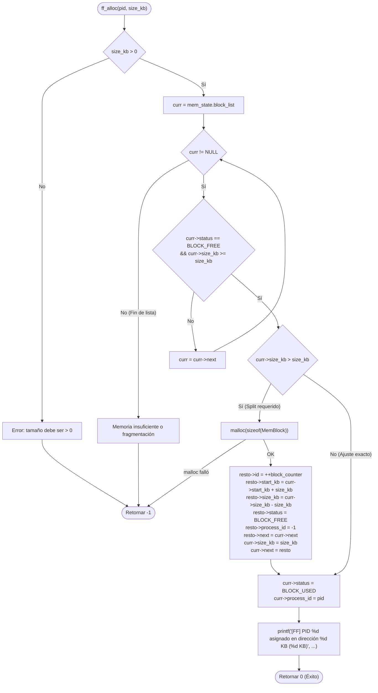

# 📋 Especificación Técnica: SIS-48 — Algoritmo First-Fit — Asignación Contigua (ff_alloc) y Split (Issue 3.3)

> **Identificador Linear:** `SIS-48` | **Hito:** `Milestone 3: Configuración de RAM, Presets y First-Fit`  
> **Proyecto / Módulo:** `Módulo 3 — Gestión de Memoria (First-Fit & Paginación)`  
> **Alcance Estricto:** Implementación de la función `ff_alloc(pid, size_kb)`, recorrido secuencial de la lista de bloques de memoria (`mem_state.block_list`), asignación del primer bloque libre con tamaño suficiente, partición dinámica (*split*) de bloques excedentes con asignación de IDs únicos incrementales y delegación en el subsistema de memoria (`memory_alloc`).  
> **Estado:** Completado (`Done`) | **Etapa Git:** `feature/issue-3.3-first-fit-alloc`  
> **🔗 Depende de:**  
> - [SIS-46](sis-46.md) (*Issue 3.1: Estructuras de datos de memoria y lista de bloques*)  
> - [SIS-47](sis-47.md) (*Issue 3.2: Comandos de configuración de RAM y presets*)  
> **🔒 Bloquea a:**  
> - `SIS-49` (*Issue 3.4: Algoritmo First-Fit — Liberación ff_free y coalescencia*)  
> - `SIS-50` (*Issue 4.1: Cola de espera para procesos sin memoria suficiente*)  

---

## 1. Objetivo y Alcance Estricto de la Tarea

La tarea **SIS-48 (Issue 3.3)** dota a miniOS del algoritmo de asignación contigua **First-Fit**. Permite a los procesos del sistema solicitar particiones de memoria RAM física contigua, dividiendo dinámicamente los bloques libres cuando su tamaño excede los requisitos del proceso (*block split*).

### 🎯 Lo que SÍ cubre esta tarea:

1. **Firma canónica de la función:**
   ```c
   int ff_alloc(int pid, int size_kb);
   ```

2. **Búsqueda First-Fit secuencial:**
   - Recorre linealmente `mem_state.block_list` desde el inicio.
   - Evalúa cada nodo verificando:
     - `curr->status == BLOCK_FREE`
     - `curr->size_kb >= size_kb`
   - Se detiene inmediatamente en el **primer bloque** que satisface ambos criterios (comportamiento determinista First-Fit).

3. **Partición dinámica del bloque (Split):**
   - Si `curr->size_kb > size_kb`:
     - Se reserva un nuevo nodo `MemBlock` con `malloc(sizeof(MemBlock))`.
     - `resto->id` se genera mediante el contador global incremental `++block_counter`.
     - `resto->start_kb = curr->start_kb + size_kb`.
     - `resto->size_kb = curr->size_kb - size_kb`.
     - `resto->status = BLOCK_FREE`.
     - `resto->process_id = -1`.
     - Se inserta inmediatamente tras `curr`: `resto->next = curr->next` y `curr->next = resto`.
     - Se ajusta el tamaño asignado: `curr->size_kb = size_kb`.

4. **Asignación y reporte:**
   - Si se encuentra bloque (con o sin split):
     - `curr->status = BLOCK_USED`.
     - `curr->process_id = pid`.
     - Se imprime por stdout el mensaje estandarizado:
       ```
       [FF] PID <pid> asignado en dirección <start_kb> KB (<size_kb> KB)
       ```
     - Retorna `0` (éxito).

5. **Manejo de errores y fallos de memoria:**
   - Validación de argumentos: Si `size_kb <= 0`, rechaza la solicitud retornando `-1`.
   - Si se recorre la lista completa y ningún bloque libre cumple el tamaño (memoria física insuficiente o fragmentación externa), retorna `-1` sin modificar la lista.
   - En caso de fallo en `malloc` durante el split, emite error a `stderr` y retorna `-1`.

6. **Integración con el subsistema de memoria:**
   - Conexión de `memory_alloc(pid, size_kb)` en `memory.c` para delegar automáticamente a `ff_alloc` cuando el algoritmo activo es First-Fit (`memory_is_first_fit()`).
   - Sincronización del contador global `block_counter = 0` en `mem_reset_blocks()` para asegurar determinismo.

### 🚫 Lo que NO cubre esta tarea (pertenece a issues posteriores):
- **NO implementa la liberación (`ff_free`) ni la coalescencia adyacente:** Corresponde a **SIS-49 (Issue 3.4)**.
- **NO implementa la cola de espera de procesos (`mem_queue`):** Si un proceso no cabe en memoria, el encolado en `WAITING` corresponde a **Milestone 4 (SIS-50)**.
- **NO implementa comandos de inspección gráfica de memoria (`mem-view`):** Corresponde a **SIS-57 (Issue 6.1)**.
- **NO implementa asignación de marcos para paginación:** Corresponde a **Milestone 5 (SIS-51)**.

---

## 2. Diagrama de Flujo del Algoritmo First-Fit



---

## 3. Estructuras de Datos y Variables Globales

### Lista Enlazada `MemBlock` (`src/memory/memory.h`)
```c
typedef struct MemBlock {
    int id;                 // Identificador único del bloque
    int start_kb;           // Dirección de inicio en memoria RAM (KB)
    int size_kb;            // Tamaño contiguo del bloque (KB)
    BlockStatus status;     // BLOCK_FREE o BLOCK_USED
    int process_id;         // PID del proceso asignado (-1 si está libre)
    struct MemBlock *next;  // Puntero al siguiente bloque
} MemBlock;

typedef struct {
    int total_ram_kb;
    int page_size_kb;
    int total_frames;
    mem_algorithm_t algorithm;
    MemBlock *block_list;   // Cabeza de la lista enlazada de bloques
} MemoryState;

extern MemoryState mem_state;
extern int block_counter;
```

---

## 4. Archivos Modificados

| Archivo | Rol en SIS-48 |
|---|---|
| `src/memory/first_fit.c` | Implementación de `ff_alloc`, contador `block_counter` y wrappers de interfaz. |
| `src/memory/first_fit.h` | Declaración de `extern int block_counter;` y prototipo `ff_alloc(int pid, int size_kb);`. |
| `src/memory/memory.h` | Exposición de `extern int block_counter;` y prototipo `int ff_alloc(int pid, int size_kb);`. |
| `src/memory/memory.c` | Reseteo determinista `block_counter = 0` en `mem_reset_blocks()` y delegación de `memory_alloc()` a `ff_alloc()`. |

---

## 5. Casos de Prueba Verificados

### Caso 1: Asignación inicial con split en bloque gigante
- **Condición:** RAM = 128 KB (bloque 0: 0-128 KB libre).
- **Acción:** `ff_alloc(10, 32)`.
- **Resultado:**
  - Bloque 0: `start_kb = 0, size_kb = 32, status = BLOCK_USED, pid = 10`.
  - Bloque 1 (`resto`): `start_kb = 32, size_kb = 96, status = BLOCK_FREE, pid = -1`.
  - Salida: `[FF] PID 10 asignado en dirección 0 KB (32 KB)`.

### Caso 2: Segundo split consecutivo
- **Condición:** Bloque 1 libre de 96 KB.
- **Acción:** `ff_alloc(20, 64)`.
- **Resultado:**
  - Bloque 1: `start_kb = 32, size_kb = 64, status = BLOCK_USED, pid = 20`.
  - Bloque 2 (`resto`): `start_kb = 96, size_kb = 32, status = BLOCK_FREE, pid = -1`.
  - Salida: `[FF] PID 20 asignado en dirección 32 KB (64 KB)`.

### Caso 3: Ajuste exacto (sin split)
- **Condición:** Bloque 2 libre de 32 KB.
- **Acción:** `ff_alloc(30, 32)`.
- **Resultado:**
  - Bloque 2: `start_kb = 96, size_kb = 32, status = BLOCK_USED, pid = 30`.
  - Ningún bloque `resto` creado (no split). Retorna `0`.
  - Salida: `[FF] PID 30 asignado en dirección 96 KB (32 KB)`.

### Caso 4: Memoria agotada / fragmentación externa
- **Condición:** RAM de 128 KB con 100% de uso (0 KB libres).
- **Acción:** `ff_alloc(40, 1)`.
- **Resultado:** Retorna `-1` sin alterar la lista.

