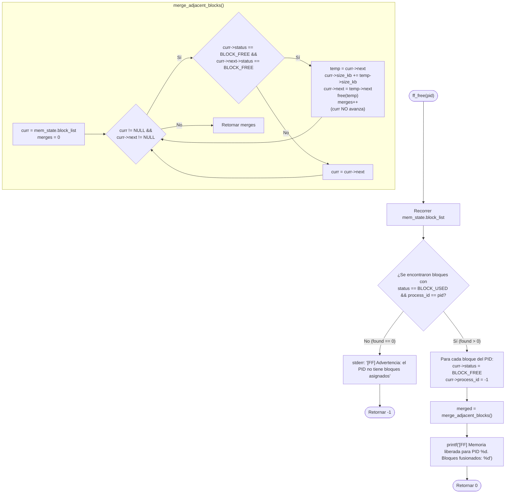

# 📋 Especificación Técnica: SIS-49 — Algoritmo First-Fit — Liberación (ff_free) y Coalescencia de Bloques (Issue 3.4)

> **Identificador Linear:** `SIS-49` | **Hito:** `Milestone 3: Configuración de RAM, Presets y First-Fit`  
> **Proyecto / Módulo:** `Módulo 3 — Gestión de Memoria (First-Fit & Paginación)`  
> **Alcance Estricto:** Implementación de la función de liberación `ff_free(pid)` y la función de fusión de bloques adyacentes `merge_adjacent_blocks()`, previniendo fragmentación externa innecesaria y fugas de memoria dinámica (`free` de nodos fusionados).  
> **Estado:** Completado (`Done`) | **Etapa Git:** `feature/issue-3.4-first-fit-free`  
> **🔗 Depende de:**  
> - [SIS-46](sis-46.md) (*Issue 3.1: Estructuras de datos de memoria y lista de bloques*)  
> - [SIS-48](sis-48.md) (*Issue 3.3: Algoritmo First-Fit — Asignación contigua ff_alloc y split*)  
> **🔒 Bloquea a:**  
> - `SIS-50` (*Issue 4.1: Cola de espera para procesos sin memoria suficiente y despacho automático al liberar*)  
> - `SIS-57` (*Issue 6.1: Comando mem-view — Mapa visual de memoria*)  

---

## 1. Objetivo y Alcance Estricto de la Tarea

La tarea **SIS-49 (Issue 3.4)** completa el ciclo de vida del particionamiento dinámico contiguo **First-Fit** en miniOS. Permite liberar las particiones asignadas a un proceso (`pid`) y fusionar inmediatamente (*coalescing*) cualquier secuencia de bloques libres contiguos en un único bloque libre de mayor tamaño, combatiendo la fragmentación externa.

### 🎯 Lo que SÍ cubre esta tarea:

1. **Función de coalescencia (`merge_adjacent_blocks`):**
   - **Firma:** `int merge_adjacent_blocks(void);`
   - Recorre secuencialmente `mem_state.block_list`.
   - Cuando detecta que tanto `curr` como `curr->next` tienen estado `BLOCK_FREE`:
     - Acumula el tamaño: `curr->size_kb += curr->next->size_kb`.
     - Desenlaza `temp = curr->next` actualizando `curr->next = temp->next`.
     - Libera la memoria heap del nodo absorbido mediante `free(temp)`.
     - Incrementa el contador de fusiones y **mantiene `curr` en su posición actual** para evaluar si el nuevo `curr->next` también está libre (coalescencia triple o múltiple en una sola pasada $\mathcal{O}(N)$).
   - Retorna el número total de fusiones realizadas.

2. **Función de liberación (`ff_free`):**
   - **Firma:** `int ff_free(int pid);`
   - Recorre `mem_state.block_list` buscando todos los bloques con `curr->status == BLOCK_USED && curr->process_id == pid`.
   - Por cada bloque encontrado:
     - Cambia `curr->status = BLOCK_FREE`.
     - Restablece `curr->process_id = -1`.
   - Si el `pid` no tiene bloques asignados, emite un mensaje de advertencia por `stderr` y retorna `-1`.
   - Si se liberó al menos un bloque:
     - Invoca `merge_adjacent_blocks()`.
     - Imprime el resumen:
       ```
       [FF] Memoria liberada para PID <pid>. Bloques fusionados: <merged>
       ```
     - Retorna `0`.

3. **Integración con la interfaz general de memoria:**
   - Conexión de `memory_free(int pid)` en `src/memory/memory.c` y `first_fit_free(int pid)` en `src/memory/first_fit.c` para delegar en `ff_free(pid)` cuando el algoritmo activo es First-Fit.

### 🚫 Lo que NO cubre esta tarea (pertenece a issues posteriores):
- **NO despierta procesos de la cola de espera (`mem_queue`):** El reintento automático de procesos en estado `WAITING` tras liberar memoria pertenece a **Milestone 4 (SIS-50)**.
- **NO libera marcos de paginación:** Corresponde a **Milestone 5 (SIS-51 / SIS-52)**.
- **NO implementa compactación (reubicación de bloques ocupados):** La coalescencia solo une bloques libres **adyacentes**.

---

## 2. Diagrama de Flujo: Liberación y Coalescencia



---

## 3. Trazado de Coalescencia Triple (Caso Entre Dos Bloques Libres)

Supóngase una RAM de `128 KB` con 3 procesos de `32 KB` asignados y `32 KB` libres al final:

1. **Estado tras `ff_alloc(1, 32)`, `ff_alloc(2, 32)`, `ff_alloc(3, 32)`:**
   ```
   [0..32 KB: PID 1 (USED)] -> [32..64 KB: PID 2 (USED)] -> [64..96 KB: PID 3 (USED)] -> [96..128 KB: FREE]
   ```
2. **Se libera `PID 1` (`ff_free(1)`) — 0 fusiones:**
   ```
   [0..32 KB: FREE] -> [32..64 KB: PID 2 (USED)] -> [64..96 KB: PID 3 (USED)] -> [96..128 KB: FREE]
   ```
3. **Se libera `PID 3` (`ff_free(3)`) — 1 fusión (con `[96..128 KB: FREE]`):**
   ```
   [0..32 KB: FREE] -> [32..64 KB: PID 2 (USED)] -> [64..128 KB: FREE (64 KB)]
   ```
4. **Se libera `PID 2` (`ff_free(2)`) — 2 fusiones en una sola pasada:**
   - Primera iteración en `[0..32 KB: FREE]`: absorbe `[32..64 KB: FREE]` → `[0..64 KB: FREE]`.
   - Sin avanzar `curr`, evalúa el nuevo `curr->next` (`[64..128 KB: FREE]`): lo absorbe → `[0..128 KB: FREE]`.
   ```
   [0..128 KB: FREE (128 KB)]
   ```

---

## 4. Archivos Modificados

| Archivo | Rol en SIS-49 |
|---|---|
| [src/memory/first_fit.c](file:///Users/luisc/Documents/mini-OS/src/memory/first_fit.c) | Implementación de `merge_adjacent_blocks()`, `ff_free(int pid)` y delegación desde `first_fit_free()`. |
| [src/memory/first_fit.h](file:///Users/luisc/Documents/mini-OS/src/memory/first_fit.h) | Prototipos y documentación Doxygen de `ff_free` y `merge_adjacent_blocks`. |
| [src/memory/memory.h](file:///Users/luisc/Documents/mini-OS/src/memory/memory.h) | Exposición pública de `ff_free` y `merge_adjacent_blocks` en la API del subsistema de memoria. |
| [src/memory/memory.c](file:///Users/luisc/Documents/mini-OS/src/memory/memory.c) | Conexión de `memory_free(int pid)` con `ff_free(pid)` cuando First-Fit está activo. |

---

## 5. Verificación y Criterios de Aceptación

- ✅ **Restauración de metadatos:** `curr->status = BLOCK_FREE` y `curr->process_id = -1`, conservando intacto `curr->start_kb`.
- ✅ **Coalescencia completa:** Bloques libres contiguos (2, 3 o más) se unen en una sola pasada sin dejar nodos libres adyacentes sin fusionar.
- ✅ **Cero fugas de memoria:** Verificado con **AddressSanitizer (`-fsanitize=address`)** que todos los nodos absorbidos en `merge_adjacent_blocks()` son liberados con `free(temp)`.
- ✅ **Manejo de PID inexistente:** Retorna `-1` y notifica por `stderr` cuando se intenta liberar un PID sin bloques asignados.

