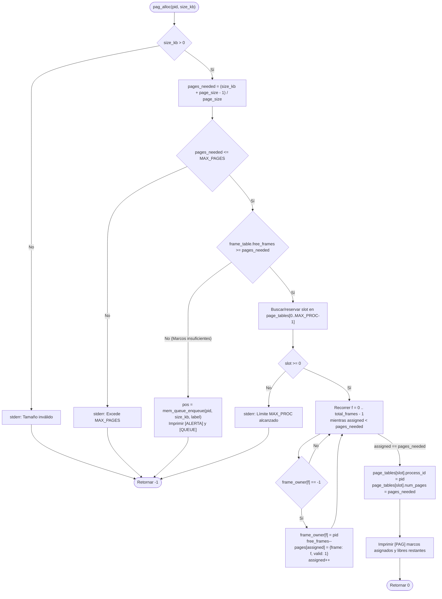

# 📋 Especificación Técnica: SIS-54 — Estructuras de Paginación y Asignación de Marcos (Issue 5.1)

> **Identificador Linear:** `SIS-54` | **Hito:** `Milestone 5: Paginación y Traducción de Direcciones`  
> **Proyecto / Módulo:** `Módulo 3 — Gestión de Memoria (First-Fit & Paginación)`  
> **Alcance Estricto:** Definición de `FrameTable`, `PageTable` y `PageEntry` en `src/memory/paging.h`, inicialización con `paging_init(total_ram_kb, page_size_kb)` e implementación de `pag_alloc(pid, size_kb)` con división techo, asignación de marcos físicos no contiguos y encolado en `mem_queue` ante marcos insuficientes.  
> **Estado:** Completado (`Done`) | **Etapa Git:** `feature/issue-5.1-paging-alloc`  
> **🔗 Depende de:**  
> - [SIS-47](sis-47.md) (*Issue 3.2: Configuración de marcos y páginas*)  
> - `SIS-50` (*Issue 4.1: Cola de espera FIFO mem_queue*)  
> **🔒 Bloquea a:**  
> - `SIS-55` (*Issue 5.2: Traducción de dirección lógica a física — mem-translate*)  
> - `SIS-56` (*Issue 5.3: Visualizador de tabla de páginas mem-page-table y liberación pag_free*)  

---

## 1. Objetivo y Alcance Estricto de la Tarea

La tarea **SIS-54 (Issue 5.1)** implementa el núcleo del esquema de **Paginación** en miniOS. A diferencia de First-Fit (que exige bloques contiguos y sufre fragmentación externa), la paginación divide la memoria física en **marcos de tamaño fijo** (`FrameTable`) y el espacio lógico de cada proceso en **páginas del mismo tamaño** (`PageTable`), permitiendo asignar cualquier conjunto de marcos libres aunque estén físicamente dispersos.

### 🎯 Lo que SÍ cubre esta tarea:

1. **Estructuras de datos en `src/memory/paging.h`:**
   - Constantes de capacidad: `MAX_PAGES = 256` y `MAX_PROC = 32`.
   - `PageEntry`: Par `(frame_number, valid)` que relaciona una página lógica con su marco físico.
   - `PageTable`: Tabla por proceso con `process_id`, `num_pages` y el arreglo `pages[MAX_PAGES]`.
   - `FrameTable`: Tabla global de marcos con `total_frames`, `free_frames` y `frame_owner[MAX_PAGES]` (`-1` si está libre, `PID` si está ocupado).
   - Instancias globales exportadas: `extern FrameTable frame_table;` y `extern PageTable page_tables[MAX_PROC];`.

2. **Inicialización (`paging_init`):**
   - Calcula `total_frames = total_ram_kb / page_size_kb` (acotado a `MAX_PAGES`).
   - Inicializa `free_frames = total_frames` y marca todos los `frame_owner[i] = -1`.
   - Limpia las `MAX_PROC` tablas de páginas (`process_id = -1`, `num_pages = 0`, `valid = 0`).
   - Se invoca automáticamente desde `mem_init()` y tras cada cambio en `mem-config` (`ram`, `page`, `frames`, `default`) para mantener sincronizados `mem_state` y `frame_table`.

3. **Asignación de marcos no contiguos (`pag_alloc`):**
   - **División techo (ceiling):**
     $$\text{pages\_needed} = \left\lceil \frac{\text{size\_kb}}{\text{page\_size\_kb}} \right\rceil = \frac{\text{size\_kb} + \text{page\_size\_kb} - 1}{\text{page\_size\_kb}}$$
   - **Recurso a la cola de espera (`mem_queue`):** Si `frame_table.free_frames < pages_needed`, el proceso no se descarta: se invoca `mem_queue_enqueue(pid, size_kb, cmd_label)`, se informa la posición en la cola y se retorna `-1`.
   - **Búsqueda dispersa:** Recorre `frame_table.frame_owner[0 .. total_frames - 1]` tomando los primeros `pages_needed` marcos con valor `-1` sin exigir que sean adyacentes, registrando cada mapeo en `page_tables[slot].pages[p]` con `valid = 1`.

### 🚫 Lo que NO cubre esta tarea (pertenece a issues posteriores):
- **NO implementa la traducción de direcciones lógicas (`mem-translate`):** Corresponde a **SIS-55 (Issue 5.2)**.
- **NO implementa `mem-page-table` ni la liberación de marcos (`pag_free`):** Corresponde a **SIS-56 (Issue 5.3)**.
- **NO implementa la conmutación interactiva `switch-ram`:** Corresponde a **SIS-58 (Issue 6.2)**.

---

## 2. Diagrama de Flujo de `pag_alloc`

---

## 3. Ejemplo de Asignación Dispersa (No Contigua)

Con una RAM de `512 KB` y páginas de `64 KB` (`8` marcos físicos: `0..7`):

1. **`pag_alloc(10, 130)`:**
   - $\text{pages\_needed} = (130 + 64 - 1) / 64 = 3$ páginas (`192 KB`, fragmentación interna de `62 KB` en la última página).
   - Marcos asignados a `PID 10`: `Pág 0 -> Marco 0`, `Pág 1 -> Marco 1`, `Pág 2 -> Marco 2`.
   - Marcos libres restantes: `5` (`[3, 4, 5, 6, 7]`).
2. **El marco `1` queda libre (hueco intermedio):**
   - Marcos libres disponibles: `[1, 3, 4, 5, 6, 7]` (discontinuos entre `1` y `3`).
3. **`pag_alloc(20, 128)`:**
   - $\text{pages\_needed} = (128 + 64 - 1) / 64 = 2$ páginas.
   - `pag_alloc` toma el primer marco libre (`1`) y luego salta al siguiente libre (`3`):
     - `Pág 0 -> Marco 1 (valid = 1)`
     - `Pág 1 -> Marco 3 (valid = 1)`
   - Marcos libres restantes: `4` (`[4, 5, 6, 7]`).

---

## 4. Archivos Modificados y Creados

| Archivo | Rol en SIS-54 |
|---|---|
| [src/memory/paging.h](file:///Users/luisc/Documents/mini-OS/src/memory/paging.h) | Definición de `MAX_PAGES`, `MAX_PROC`, `PageEntry`, `PageTable`, `FrameTable` y prototipos de `paging_init` y `pag_alloc`. |
| [src/memory/paging.c](file:///Users/luisc/Documents/mini-OS/src/memory/paging.c) | Implementación de `paging_init()` y `pag_alloc(int pid, int size_kb)` con división techo, mapeo no contiguo e integración con `mem_queue`. |
| [src/memory/memory.h](file:///Users/luisc/Documents/mini-OS/src/memory/memory.h) | Declaración de `pag_alloc(int pid, int size_kb)` en la interfaz general de memoria. |
| [src/memory/memory.c](file:///Users/luisc/Documents/mini-OS/src/memory/memory.c) | Sincronización de `paging_init()` en `mem_init()` / `memory_config_*()`, delegación en `memory_alloc()` y lectura de `frame_table` en `memory_status()`. |
| [tests/test_paging.c](file:///Users/luisc/Documents/mini-OS/tests/test_paging.c) | Suite de 5 pruebas unitarias automatizadas para verificar inicialización, división techo, marcos dispersos y encolamiento en `mem_queue`. |
| [Makefile](file:///Users/luisc/Documents/mini-OS/Makefile) | Target `make test` para compilar y ejecutar las pruebas unitarias de paginación. |

---

## 5. Verificación y Criterios de Aceptación

- ✅ **División techo exacta:** `(size_kb + page_size - 1) / page_size` validado con solicitudes no múltiplos del tamaño de página (`130 KB` en páginas de `64 KB` $\rightarrow 3$ páginas).
- ✅ **Encolado en `mem_queue` ante falta de marcos:** Si `free_frames < pages_needed`, encola el proceso con `mem_queue_enqueue()` y retorna `-1` sin modificar `frame_table`.
- ✅ **Asignación dispersa no contigua:** Asigna marcos libres salteados (`[1, 3]`) y actualiza `page_tables[slot].pages[i]` con `valid = 1`.
- ✅ **Ejecución automatizada:** `make test` ejecuta las 5 pruebas unitarias (`5/5 OK`) sin advertencias de compilación (`-Wall -Wextra -std=c11`).

