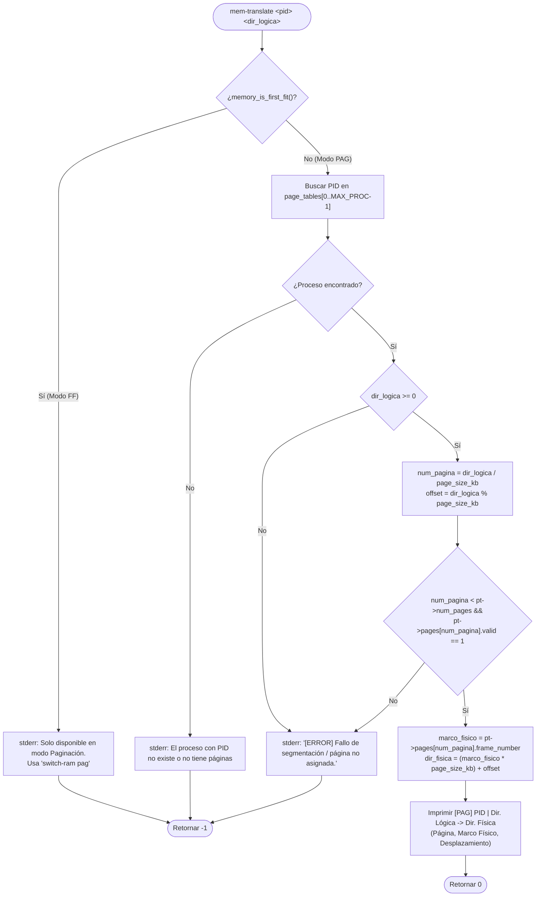

# 📋 Especificación Técnica: SIS-55 — Traducción de Dirección Lógica a Física (`mem-translate`) (Issue 5.2)

> **Identificador Linear:** `SIS-55` | **Hito:** `Milestone 5: Paginación y Traducción de Direcciones`  
> **Proyecto / Módulo:** `Módulo 3 — Gestión de Memoria (First-Fit & Paginación)`  
> **Alcance Estricto:** Implementación de `cmd_mem_translate(pid, dir_logica)` y `paging_translate()` en `src/memory/paging.c`, junto con el comando built-in `mem-translate <pid> <dir_logica>` en `src/shell/shell.c`, validando el algoritmo activo (`pag`), existencia del proceso, límites de direccionamiento y bit de validez (`valid == 1`).  
> **Estado:** Completado (`Done`) | **Etapa Git:** `feature/issue-5.2-mem-translate`  
> **🔗 Depende de:**  
> - [SIS-47](sis-47.md) (*Issue 3.2: Configuración de marcos y páginas y bloqueo de comandos incompatibles*)  
> - [SIS-54](sis-54.md) (*Issue 5.1: Estructuras de paginación y asignación de marcos*)  
> **🔒 Bloquea a:**  
> - `SIS-56` (*Issue 5.3: Visualizador de tabla de páginas `mem-page-table` y liberación `pag_free`*)  

---

## 1. Objetivo y Alcance Estricto de la Tarea

La tarea **SIS-55 (Issue 5.2)** incorpora la unidad de gestión de memoria simulada (**MMU**) para el esquema de **Paginación** mediante el comando `mem-translate <pid> <dir_logica>`. Permite descomponer cualquier dirección lógica expresada en KB en su número de página y desplazamiento interno (*offset*), consultar la tabla de páginas del proceso (`PageTable`) y obtener la dirección física exacta en RAM o disparar un fallo de segmentación si la dirección excede el espacio asignado al proceso.

### 🎯 Lo que SÍ cubre esta tarea:

1. **Formulación matemática de traducción:**
   $$\begin{aligned}
   \text{num\_pagina} &= \lfloor \text{dir\_logica} / \text{page\_size\_kb} \rfloor \\
   \text{offset} &= \text{dir\_logica} \bmod \text{page\_size\_kb} \\
   \text{marco\_fisico} &= \text{PageTable}[\text{pid}].\text{pages}[\text{num\_pagina}].\text{frame\_number} \\
   \text{dir\_fisica} &= (\text{marco\_fisico} \times \text{page\_size\_kb}) + \text{offset}
   \end{aligned}$$

2. **Validaciones obligatorias:**
   - **Algoritmo activo (`pag`):** Si el modo activo es First-Fit (`ff`), rechaza la operación indicando usar `switch-ram pag`.
   - **Argumentos numéricos:** Verifica que `<pid>` sea un entero positivo y `<dir_logica>` un entero válido en KB.
   - **Existencia del proceso:** Busca `page_tables[i].process_id == pid` en `page_tables[MAX_PROC]`.
   - **Protección de límites y bit de validez:** Verifica `dir_logica >= 0`, `0 <= num_pagina < pt->num_pages` y `pt->pages[num_pagina].valid == 1`. En caso contrario, emite:
     ```
     [ERROR] Fallo de segmentación / página no asignada.
     ```

3. **Formato de salida estandarizado:**
   ```
   [PAG] PID <pid> | Dir. Lógica: <dir_logica> KB -> Dir. Física: <dir_fisica> KB
         (Página: <num_pagina>, Marco Físico: <marco_fisico>, Desplazamiento: <offset> KB)
   ```

4. **Integración en el Shell (`shell.c`):**
   - Registro de `mem-translate` en la tabla `BUILTINS[]` con su handler `builtin_mem_translate`.
   - Documentación integrada en `help` y `help mem-translate`.

### 🚫 Lo que NO cubre esta tarea (pertenece a issues posteriores):
- **NO implementa `mem-page-table <pid>` ni `pag_free(pid)`:** Corresponde a **SIS-56 (Issue 5.3)**.
- **NO implementa `switch-ram [ff|pag]`:** Corresponde a **SIS-58 (Issue 6.2)**.

---

## 2. Diagrama de Flujo de `cmd_mem_translate`



---

## 3. Ejemplos de Trazado

Con `page_size_kb = 64 KB` y el proceso `PID 42` con `4` páginas asignadas (`256 KB`, páginas `0..3`), donde la `Página 3` está alojada en el `Marco Físico 10`:

1. **Dirección lógica exacta al inicio de página (`192 KB`):**
   - $\text{num\_pagina} = 192 / 64 = 3$
   - $\text{offset} = 192 \bmod 64 = 0\text{ KB}$
   - $\text{marco\_fisico} = 10$
   - $\text{dir\_fisica} = (10 \times 64) + 0 = 640\text{ KB}$
   ```
   [PAG] PID 42 | Dir. Lógica: 192 KB -> Dir. Física: 640 KB
         (Página: 3, Marco Físico: 10, Desplazamiento: 0 KB)
   ```

2. **Dirección lógica con desplazamiento (`207 KB`):**
   - $\text{num\_pagina} = 207 / 64 = 3$
   - $\text{offset} = 207 \bmod 64 = 15\text{ KB}$
   - $\text{dir\_fisica} = (10 \times 64) + 15 = 655\text{ KB}$
   ```
   [PAG] PID 42 | Dir. Lógica: 207 KB -> Dir. Física: 655 KB
         (Página: 3, Marco Físico: 10, Desplazamiento: 15 KB)
   ```

3. **Dirección lógica fuera del espacio del proceso (`256 KB`):**
   - $\text{num\_pagina} = 256 / 64 = 4 \ge \text{num\_pages} (4)$
   ```
   [ERROR] Fallo de segmentación / página no asignada.
   ```

---

## 4. Archivos Modificados

| Archivo | Rol en SIS-55 |
|---|---|
| [src/memory/paging.h](file:///Users/luisc/Documents/mini-OS/src/memory/paging.h) | Prototipo y documentación Doxygen de `cmd_mem_translate(int pid, int dir_logica)`. |
| [src/memory/paging.c](file:///Users/luisc/Documents/mini-OS/src/memory/paging.c) | Implementación de `find_page_table_by_pid()`, `cmd_mem_translate()` y `paging_translate()`. |
| [src/memory/memory.h](file:///Users/luisc/Documents/mini-OS/src/memory/memory.h) | Exposición de `cmd_mem_translate()` en la cabecera general del subsistema de memoria. |
| [src/shell/shell.c](file:///Users/luisc/Documents/mini-OS/src/shell/shell.c) | Registro del comando `mem-translate` en `BUILTINS[]`, implementación de `builtin_mem_translate` y sección de ayuda en `builtin_help`. |

---

## 5. Verificación y Criterios de Aceptación

- ✅ **Bloqueo en modo First-Fit:** Rechaza la ejecución con mensaje orientativo (`switch-ram pag`) cuando el algoritmo activo es `ff`.
- ✅ **Cálculo exacto de página, marco y offset:** Verificado para desplazamientos nulos y no nulos.
- ✅ **Detección de fallo de segmentación:** Rechaza direcciones negativas, páginas fuera de `num_pages` o con `valid == 0` mostrando `[ERROR] Fallo de segmentación / página no asignada.`.
- ✅ **Compilación limpia:** Cero advertencias y cero errores bajo `-Wall -Wextra -std=c11`.

