# 📋 Especificación Técnica: SIS-56 — Visualizador de Tabla de Páginas (`mem-page-table`) y Liberación de Marcos (`pag_free`) (Issue 5.3)

> **Identificador Linear:** `SIS-56` | **Hito:** `Milestone 5: Paginación y Traducción de Direcciones`  
> **Proyecto / Módulo:** `Módulo 3 — Gestión de Memoria (First-Fit & Paginación)`  
> **Alcance Estricto:** Implementación del comando interactivo `mem-page-table <pid>` (`cmd_mem_page_table`) con formato tabular Unicode, la rutina de liberación de memoria paginada `pag_free(pid)` y su integración con el desencolado reactivo de procesos en espera (`mem_queue_process_waiting()`).  
> **Estado:** Completado (`Done`) | **Etapa Git:** `feature/issue-5.3-page-table-free`  
> **🔗 Depende de:**  
> - [SIS-54](sis-54.md) (*Issue 5.1: Estructuras de paginación y asignación de marcos*)  
> - [SIS-55](sis-55.md) (*Issue 5.2: Traducción de dirección lógica a física `mem-translate`*)  
> **🔒 Bloquea a:**  
> - `SIS-57` (*Issue 6.1: Visualizador gráfico interactivo de RAM en terminal `mem-view`*)  
> - `SIS-58` (*Issue 6.2: Cambio dinámico y seguro de algoritmo `switch-ram`*)  

---

## 1. Objetivo y Alcance Estricto de la Tarea

La tarea **SIS-56 (Issue 5.3)** cierra el **Milestone 5** completando las capacidades de inspección y liberación del esquema de **Paginación** en miniOS. Permite visualizar la correspondencia entre páginas lógicas y marcos físicos de cualquier proceso activo mediante `mem-page-table <pid>` y devolver los marcos ocupados al pool global mediante `pag_free(pid)` (invocado por `mem-free <pid>`), promoviendo automáticamente los procesos retenidos en la cola `mem_queue`.

### 🎯 Lo que SÍ cubre esta tarea:

1. **Visualizador de tabla de páginas (`cmd_mem_page_table` / `mem-page-table <pid>`):**
   - **Validación de algoritmo:** Verifica que el modo activo sea Paginación (`pag`). Si está en First-Fit (`ff`), rechaza la ejecución indicando cambiar con `switch-ram pag`.
   - **Validación de proceso:** Parsing defensivo de `<pid>` con `strtol` y búsqueda en `page_tables[MAX_PROC]`.
   - **Renderizado tabular Unicode:** Imprime cada página lógica del proceso junto con su marco físico asignado, bandera de validez (`SÍ`/`NO`) y dirección base física ($\text{marco\_fisico} \times \text{page\_size\_kb}$):
     ```
     ╔══════════╦════════════╦══════════╦══════════════════╗
     ║ Página # ║ Marco Fís. ║ Válido   ║ Dir. Base Física ║
     ╠══════════╬════════════╬══════════╬══════════════════╣
     ║    0     ║     3      ║    SÍ    ║   192 KB         ║
     ║    1     ║    10      ║    SÍ    ║   640 KB         ║
     ║    2     ║     7      ║    SÍ    ║   448 KB         ║
     ╚══════════╩════════════╩══════════╩══════════════════╝
     ```

2. **Rutina de liberación de marcos (`pag_free(int pid)`):**
   - Localiza la `PageTable` del proceso.
   - Recorre las páginas asignadas (`0 .. num_pages - 1`), liberando en `frame_table` cada marco propiedad del PID (`frame_owner[f] = -1`, `free_frames++`).
   - Invalida las entradas de la tabla (`valid = 0`, `frame_number = -1`) y libera el slot de `page_tables` (`num_pages = 0`, `process_id = -1`).
   - Invoca inmediatamente `mem_queue_process_waiting()` para reintentar la asignación en orden FIFO de los procesos en espera.

3. **Integración con `memory_free` y el Dispatcher (`shell.c`):**
   - `memory_free(int pid)` en `src/memory/memory.c` delega en `paging_free(pid)` cuando el modo activo es Paginación.
   - `mem-page-table` queda registrado en `BUILTINS[]` y documentado en `help`.

### 🚫 Lo que NO cubre esta tarea (pertenece a issues posteriores):
- **NO implementa el mapa visual unificado `mem-view`:** Corresponde a **SIS-57 (Issue 6.1)**.
- **NO implementa el comando `switch-ram [ff|pag]`:** Corresponde a **SIS-58 (Issue 6.2)**.

---

## 2. Diagrama de Flujo: `mem-page-table` y `pag_free`

```mermaid
flowchart TD
    subgraph PageTableView ["cmd_mem_page_table(argc, argv)"]
        VStart(["mem-page-table &lt;pid&gt;"]) --> VCheckAlgo{"¿memory_is_first_fit()?"}
        VCheckAlgo -- "Sí (Modo FF)" --> VErrFF["stderr: Solo disponible en modo Paginación"] --> VRetErr(["Retornar 1"])
        VCheckAlgo -- "No (Modo PAG)" --> VParse["Validar argc >= 2 y pid > 0"]
        VParse -- "Inválido" --> VRetErr
        VParse -- "Válido" --> VFind["Buscar PageTable del PID"]
        VFind -- "No existe" --> VErrPID["stderr: Proceso no tiene tabla de páginas activa"] --> VRetErr
        VFind -- "Existe" --> VPrint["Imprimir tabla Unicode:<br>Página # | Marco Fís. | Válido | Dir. Base Física"] --> VRetOK(["Retornar 0"])
    end

    subgraph PagFree ["pag_free(pid)"]
        FStart(["pag_free(pid)"]) --> FFind["Buscar PageTable del PID"]
        FFind -- "No existe" --> FWarn["stderr: Advertencia PID sin páginas asignadas"] --> FEnd(["Retornar"])
        FFind -- "Existe" --> FLoop["Para cada página válida p:<br>f = pages[p].frame_number<br>frame_owner[f] = -1, free_frames++<br>pages[p] = {frame: -1, valid: 0}"]
        FLoop --> FReset["pt->num_pages = 0<br>pt->process_id = -1"]
        FReset --> FMsg["Imprimir [PAG] Memoria liberada para PID"]
        FMsg --> FQueue["mem_queue_process_waiting()<br>(Promover procesos FIFO que ahora quepan)"]
        FQueue --> FEnd
    end
```



---

## 3. Archivos Modificados

| Archivo | Rol en SIS-56 |
|---|---|
| [src/memory/paging.h](file:///Users/luisc/Documents/mini-OS/src/memory/paging.h) | Prototipos de `pag_free(int pid)`, `cmd_mem_page_table(int argc, char **argv)` y `mem_queue_process_waiting(void)`. |
| [src/memory/paging.c](file:///Users/luisc/Documents/mini-OS/src/memory/paging.c) | Implementación de `pag_free()`, `paging_free()`, `cmd_mem_page_table()` y `mem_queue_process_waiting()`. |
| [src/memory/memory.h](file:///Users/luisc/Documents/mini-OS/src/memory/memory.h) | Exposición pública de `pag_free`, `cmd_mem_page_table` y `mem_queue_process_waiting`. |
| [src/memory/memory.c](file:///Users/luisc/Documents/mini-OS/src/memory/memory.c) | Conexión de `memory_free(int pid)` con `paging_free(pid)` en modo Paginación y `mem_queue_process_waiting()` en modo First-Fit. |
| [src/shell/shell.c](file:///Users/luisc/Documents/mini-OS/src/shell/shell.c) | Registro de `mem-page-table` en `BUILTINS[]`, handler `builtin_mem_page_table` y ayuda en `builtin_help`. |

---

## 4. Verificación y Criterios de Aceptación

- ✅ **Validación de modo:** En modo First-Fit, `mem-page-table` se rechaza con mensaje claro indicando usar `switch-ram pag`.
- ✅ **Formato de tabla Unicode:** Muestra `Página #`, `Marco Fís.`, `Válido` (`SÍ`/`NO`) y `Dir. Base Física` ($\text{marco\_fisico} \times \text{page\_size\_kb}$) con bordes perfectamente alineados.
- ✅ **Liberación y promoción reactiva desde `mem_queue`:** Verificado con **AddressSanitizer (`-fsanitize=address`)** que al liberar un proceso con `pag_free`, sus marcos regresan a `frame_table` y los procesos en espera en `mem_queue` se asignan automáticamente en orden FIFO.

