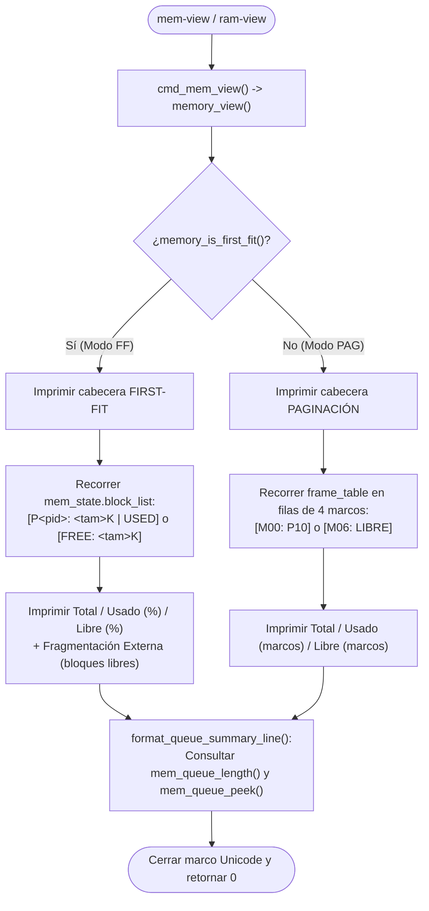

# 📋 Especificación Técnica: SIS-57 — Visualizador Gráfico Interactivo de RAM en Terminal (`mem-view` / `ram-view`) (Issue 6.1)

> **Identificador Linear:** `SIS-57` | **Hito:** `Milestone 6: Visualizador Terminal (mem-view) y Switch Seguro`  
> **Proyecto / Módulo:** `Módulo 3 — Gestión de Memoria (First-Fit & Paginación)`  
> **Alcance Estricto:** Implementación de `cmd_mem_view`, `render_mem_view_ff` y `render_mem_view_pag` en `src/memory/memory.c`, junto con el registro del comando `mem-view` y su alias `ram-view` en `src/shell/shell.c`, mostrando en tiempo real el mapa de bloques o marcos, métricas de fragmentación y el estado de `mem_queue`.  
> **Estado:** Completado (`Done`) | **Etapa Git:** `feature/issue-6.1-mem-view`  
> **🔗 Depende de:**  
> - [SIS-49](sis-49.md) (*Issue 3.4: Liberación First-Fit y coalescencia*)  
> - `SIS-52` (*Issue 4.3: Inspección de la cola de espera `mem-queue`*)  
> - [SIS-56](sis-56.md) (*Issue 5.3: Tabla de páginas y liberación de marcos*)  
> **🔒 Bloquea a:**  
> - `SIS-58` (*Issue 6.2: Comando `switch-ram` con capa de seguridad interactiva*)  

---

## 1. Objetivo y Alcance Estricto de la Tarea

La tarea **SIS-57 (Issue 6.1)** provee el visualizador gráfico en terminal del subsistema de memoria de miniOS mediante el comando `mem-view` y su alias `ram-view`. Adapta dinámicamente su representación visual al algoritmo activo (**First-Fit** o **Paginación**) e integra en el pie del reporte las métricas de uso, fragmentación externa y el resumen en vivo de la cola de espera (`mem_queue`).

### 🎯 Lo que SÍ cubre esta tarea:

1. **Detección automática de modo (`memory_view` / `cmd_mem_view`):**
   - Evalúa `memory_is_first_fit()` y despacha hacia `render_mem_view_ff()` o `render_mem_view_pag()`.

2. **Modo First-Fit (`render_mem_view_ff`):**
   - Recorre `mem_state.block_list` renderizando la secuencia continua de bloques:
     - Ocupado: `[P<pid>: <tam>K | USED]`
     - Libre: `[FREE: <tam>K]`
   - Realiza salto de línea automático dentro del marco Unicode si la tira de bloques supera las 64 columnas.
   - Calcula y presenta:
     - Memoria Total (KB), Memoria Usada (KB y `%`), Memoria Libre (KB y `%`).
     - Fragmentación externa: número de bloques libres no contiguos y KB totales libres.
     - Estado de `mem_queue`.

3. **Modo Paginación (`render_mem_view_pag`):**
   - Recorre `frame_table` renderizando una cuadrícula de 4 marcos físicos por fila:
     - Ocupado: `[M<idx>: P<pid>]`
     - Libre: `[M<idx>: LIBRE]`
   - Calcula y presenta:
     - Total de marcos y tamaño por marco (`page_size_kb`).
     - Memoria Total (KB), Usada (KB y marcos ocupados) y Libre (KB y marcos disponibles).
     - Estado de `mem_queue`.

4. **Alineación UTF-8 exacta (`utf8_visible_len`):**
   - Cuenta los *code points* visibles de cada línea (ignorando bytes de continuación UTF-8 en caracteres acentuados como `ó`, `í`, `á`) para asegurar que el borde derecho `║` quede perfectamente alineado a 70 columnas.

5. **Registro de `mem-view` y alias `ram-view` en el REPL (`shell.c`):**
   - Ambos comandos invocan `builtin_mem_view` $\rightarrow$ `cmd_mem_view`.

### 🚫 Lo que NO cubre esta tarea (pertenece a issues posteriores):
- **NO implementa la conmutación de algoritmo (`switch-ram [ff|pag]`):** Corresponde a **SIS-58 (Issue 6.2)**.

---

## 2. Diagrama de Flujo de `mem-view` / `ram-view`



---

## 3. Salidas Verificadas en Terminal

### Renderizado en modo First-Fit
```text
╔════════════════════════════════════════════════════════════════════╗
║                      MAPA DE MEMORIA RAM (MiniOS)                  ║
║                      Algoritmo Activo: FIRST-FIT                   ║
╠════════════════════════════════════════════════════════════════════╣
║  [P10: 256K | USED] [FREE: 128K] [P20: 384K | USED] [FREE: 256K]   ║
╠════════════════════════════════════════════════════════════════════╣
║  Total: 1024 KB | Usado: 640 KB (62.5%) | Libre: 384 KB (37.5%)    ║
║  Fragmentación Externa: 2 bloques libres no contiguos (384 KB)     ║
║  Cola de Espera RAM: 1 proceso(s) en espera (PID 105: 512 KB)      ║
╚════════════════════════════════════════════════════════════════════╝
```

### Renderizado en modo Paginación
```text
╔════════════════════════════════════════════════════════════════════╗
║                      MAPA DE MEMORIA RAM (MiniOS)                  ║
║                      Algoritmo Activo: PAGINACIÓN                  ║
╠════════════════════════════════════════════════════════════════════╣
║  Marcos Físicos (Total: 16 marcos de 64 KB c/u):                   ║
║  [M00: P10] [M01: P10] [M02: P10] [M03: P10]                       ║
║  [M04: P20] [M05: P20] [M06: LIBRE] [M07: LIBRE]                   ║
║  [M08: LIBRE] [M09: LIBRE] [M10: LIBRE] [M11: LIBRE]               ║
║  [M12: LIBRE] [M13: LIBRE] [M14: LIBRE] [M15: LIBRE]               ║
╠════════════════════════════════════════════════════════════════════╣
║  Total: 1024 KB | Usado: 384 KB (6 marcos) | Libre: 640 KB (10 m)  ║
║  Cola de Espera RAM: Vacía (0 procesos esperando)                  ║
╚════════════════════════════════════════════════════════════════════╝
```

---

## 4. Archivos Modificados

| Archivo | Rol en SIS-57 |
|---|---|
| [src/memory/memory.h](file:///Users/luisc/Documents/mini-OS/src/memory/memory.h) | Prototipos de `render_mem_view_ff()`, `render_mem_view_pag()` y `cmd_mem_view(int argc, char **argv)`. |
| [src/memory/memory.c](file:///Users/luisc/Documents/mini-OS/src/memory/memory.c) | Implementación de `utf8_visible_len()`, `print_view_box_line()`, `format_queue_summary_line()`, `render_mem_view_ff()`, `render_mem_view_pag()`, `memory_view()` y `cmd_mem_view()`. |
| [src/memory/first_fit.c](file:///Users/luisc/Documents/mini-OS/src/memory/first_fit.c) | Conexión de `first_fit_view()` con `render_mem_view_ff()`. |
| [src/memory/paging.c](file:///Users/luisc/Documents/mini-OS/src/memory/paging.c) | Conexión de `paging_view()` con `render_mem_view_pag()`. |
| [src/shell/shell.c](file:///Users/luisc/Documents/mini-OS/src/shell/shell.c) | Registro de `mem-view` y su alias `ram-view` en `BUILTINS[]` y documentación en `builtin_help`. |

---

## 5. Verificación y Criterios de Aceptación

- ✅ **Representación dual según algoritmo activo:** Tira continua de bloques en First-Fit y cuadrícula 4×N de marcos físicos en Paginación.
- ✅ **Métricas y fragmentación externa:** Cálculo exacto de KB usados/libres, porcentajes y conteo de bloques libres.
- ✅ **Integración con `mem_queue`:** Reporta el estado de espera en tiempo real tanto con cola vacía como con procesos retenidos.
- ✅ **Alias funcional:** Tanto `mem-view` como `ram-view` están registrados y documentados en el shell.

