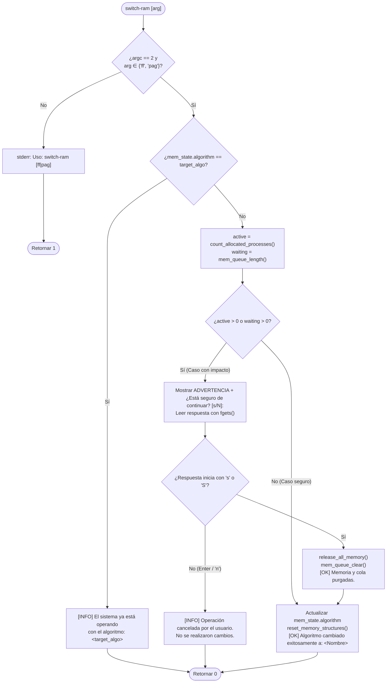

# 📋 Especificación Técnica: SIS-58 — Conmutación Dinámica y Segura de Algoritmo de Memoria (`switch-ram`) (Issue 6.2)

> **Identificador Linear:** `SIS-58` | **Hito:** `Milestone 6: Visualizador Terminal (mem-view) y Switch Seguro`  
> **Proyecto / Módulo:** `Módulo 3 — Gestión de Memoria (First-Fit & Paginación)`  
> **Alcance Estricto:** Implementación de `cmd_switch_ram(int argc, char **argv)` y sus funciones auxiliares (`count_allocated_processes`, `release_all_memory`, `reset_memory_structures`) en `src/memory/memory.c`, junto con el registro del comando `switch-ram [ff|pag]` en `src/shell/shell.c`, proveyendo alternancia en caliente entre First-Fit y Paginación con una capa de seguridad interactiva (`[s/N]`).  
> **Estado:** Completado (`Done`) | **Etapa Git:** `feature/issue-6.2-switch-ram-security`  
> **🔗 Depende de:**  
> - [SIS-49](sis-49.md) (*Issue 3.4: Liberación First-Fit y coalescencia*)  
> - [SIS-53](sis-53.md) (*Issue 4.4: Desencolado reactivo y cola de espera `mem_queue`*)  
> - [SIS-56](sis-56.md) (*Issue 5.3: Tabla de páginas y liberación de marcos*)  
> - [SIS-57](sis-57.md) (*Issue 6.1: Visualizador gráfico interactivo de RAM `mem-view` / `ram-view`*)  

---

## 1. Objetivo y Alcance Estricto de la Tarea

La tarea **SIS-58 (Issue 6.2)** cierra el **Milestone 6** y el **Módulo 3 de Gestión de Memoria** de miniOS incorporando el comando interactivo `switch-ram [ff|pag]`. Permite alternar en caliente entre el particionamiento dinámico contiguo (**First-Fit**) y el esquema no contiguo de marcos fijos (**Paginación**), protegiendo los procesos alojados en RAM y la cola de espera (`mem_queue`) mediante una confirmación interactiva antes de purgar el estado.

### 🎯 Lo que SÍ cubre esta tarea:

1. **Validación estricta de argumentos (`cmd_switch_ram`):**
   - Exige exactamente un parámetro válido (`ff` o `pag`). Si falta o es inválido, imprime en `stderr`:
     ```text
     Uso: switch-ram [ff|pag]
     ```

2. **Detección de estado redundante:**
   - Si el sistema ya opera con el algoritmo solicitado (`strcmp(mem_state.algorithm, target_algo) == 0`), informa sin alterar la memoria:
     ```text
     [INFO] El sistema ya está operando con el algoritmo: <target_algo>
     ```

3. **Capa de seguridad y confirmación interactiva (`[s/N]`):**
   - Calcula los procesos alojados en RAM con `count_allocated_processes()` y los retenidos en espera con `mem_queue_length()`.
   - **Caso seguro (`active == 0 && waiting == 0`):** Conmuta inmediatamente sin pedir confirmación.
   - **Caso con impacto (`active > 0 || waiting > 0`):**
     - Imprime la advertencia:
       ```text
       ADVERTENCIA: Hay <active> proceso(s) en RAM y <waiting> en cola de espera.
       El cambio a '<target_algo>' liberará toda la memoria y purgará la cola.
       ¿Está seguro de continuar? [s/N]: 
       ```
     - Lee la respuesta desde `stdin` con `fgets`.
     - Si la respuesta no inicia con `'s'` o `'S'` (incluyendo `Enter` o `'n'`), cancela sin tocar la RAM ni la cola:
       ```text
       [INFO] Operación cancelada por el usuario. No se realizaron cambios.
       ```
     - Si el usuario confirma con `'s'` o `'S'`, ejecuta `release_all_memory()` y `mem_queue_clear()` e informa:
       ```text
       [OK] Memoria y cola purgadas.
       ```

4. **Conmutación e inicialización del nuevo pool (`reset_memory_structures`):**
   - Actualiza `mem_state.algorithm` y `s_mem_config.active_algorithm`.
   - Reinicia tanto la lista de bloques (`mem_reset_blocks()`) como la tabla global de marcos y tablas de páginas (`paging_init()`).
   - Imprime la confirmación final:
     ```text
     [OK] Algoritmo cambiado exitosamente a: <First-Fit|Paginación>
     ```

---

## 2. Diagrama de Flujo de `switch-ram`



---

## 3. Salida Verificada en Terminal

```text
miniOS> switch-ram
Uso: switch-ram [ff|pag]
miniOS> switch-ram ff
[INFO] El sistema ya está operando con el algoritmo: ff
miniOS> mem-alloc 10 64
[FF] PID 10 asignado en dirección 0 KB (64 KB)
miniOS> mem-alloc 20 64
[FF] PID 20 asignado en dirección 64 KB (64 KB)
miniOS> mem-alloc 30 32
[ALERTA] Memoria RAM insuficiente para asignar 32 KB al PID 30.
[QUEUE] Proceso PID 30 encolado en cola de espera (Posicion: 1).
miniOS> switch-ram pag
ADVERTENCIA: Hay 2 proceso(s) en RAM y 1 en cola de espera.
El cambio a 'pag' liberará toda la memoria y purgará la cola.
¿Está seguro de continuar? [s/N]: n
[INFO] Operación cancelada por el usuario. No se realizaron cambios.
miniOS> switch-ram pag
ADVERTENCIA: Hay 2 proceso(s) en RAM y 1 en cola de espera.
El cambio a 'pag' liberará toda la memoria y purgará la cola.
¿Está seguro de continuar? [s/N]: s
[OK] Memoria y cola purgadas.
[OK] Algoritmo cambiado exitosamente a: Paginación
```

---

## 4. Archivos Modificados

| Archivo | Rol en SIS-58 |
|---|---|
| [src/memory/memory.h](file:///Users/luisc/Documents/mini-OS/src/memory/memory.h) | Prototipos de `count_allocated_processes()`, `release_all_memory()`, `reset_memory_structures()` y `cmd_switch_ram(int argc, char **argv)`. |
| [src/memory/memory.c](file:///Users/luisc/Documents/mini-OS/src/memory/memory.c) | Implementación de `count_allocated_processes()`, `release_all_memory()`, `reset_memory_structures()` y `cmd_switch_ram()`. |
| [src/shell/shell.c](file:///Users/luisc/Documents/mini-OS/src/shell/shell.c) | Registro de `switch-ram` en `BUILTINS[]`, handler `builtin_switch_ram` y documentación en `builtin_help`. |

---

## 5. Verificación y Criterios de Aceptación

- ✅ **Validación de argumentos:** Rechaza llamadas sin argumentos, con más de un argumento o con valores distintos de `ff` y `pag`, imprimiendo `Uso: switch-ram [ff|pag]`.
- ✅ **Detección de algoritmo redundante:** Si se solicita el algoritmo ya activo, informa con `[INFO]` sin reiniciar estructuras.
- ✅ **Conmutación inmediata sin carga:** Cuando hay `0` procesos en RAM y `0` en `mem_queue`, cambia directamente sin solicitar confirmación.
- ✅ **Confirmación interactiva `[s/N]` bajo carga:** Con procesos en RAM o en cola, advierte del impacto; si el usuario responde `n` o presiona `Enter`, conserva intactas la RAM y la cola; si confirma con `s`/`S`, purga ambos subsistemas y reinicia el pool bajo el nuevo algoritmo.

