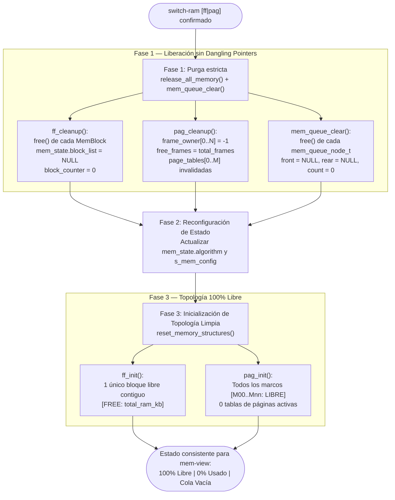

# 📋 Especificación Técnica: SIS-59 — Transición Atómica y Reset Seguro de Estructuras de Memoria (`switch-ram`) (Issue 6.3)

> **Identificador Linear:** `SIS-59` | **Hito:** `Milestone 6: Visualizador Terminal (mem-view) y Switch Seguro`  
> **Proyecto / Módulo:** `Módulo 3 — Gestión de Memoria (First-Fit & Paginación)`  
> **Alcance Estricto:** Implementación de `ff_cleanup()`, `ff_init()` (`src/memory/first_fit.c`), `pag_cleanup()`, `pag_init()` (`src/memory/paging.c`) y la orquestación atómica de `release_all_memory()`, `reset_memory_structures()` y `memory_cleanup()` (`src/memory/memory.c`), garantizando 0 fugas de memoria (*Valgrind / ASan Clean*), ausencia de punteros colgantes (*dangling pointers*) y consistencia inmediata con `mem-view`.  
> **Estado:** Completado (`Done`) | **Etapa Git:** `feature/issue-6.3-clean-mem-reset`  
> **🔗 Depende de:**  
> - [SIS-49](sis-49.md) (*Issue 3.4: Liberación First-Fit y coalescencia*)  
> - [SIS-53](sis-53.md) (*Issue 4.4: Desencolado reactivo y cola de espera `mem_queue`*)  
> - [SIS-56](sis-56.md) (*Issue 5.3: Tabla de páginas y liberación de marcos*)  
> - [SIS-57](sis-57.md) (*Issue 6.1: Visualizador gráfico interactivo de RAM `mem-view` / `ram-view`*)  
> - [SIS-58](sis-58.md) (*Issue 6.2: Comando interactivo `switch-ram [ff|pag]` con confirmación*)  

---

## 1. Objetivo y Alcance Estricto de la Tarea

La tarea **SIS-59 (Issue 6.3)** refuerza las garantías de integridad de memoria dinámica durante la conmutación en caliente entre **First-Fit (`ff`)** y **Paginación (`pag`)** y en el apagado del simulador. Establece una secuencia atómica de tres fases (purga del algoritmo previo $\rightarrow$ actualización de metadatos de estado $\rightarrow$ reinicialización de topología limpia) libre de *memory leaks* y *dangling pointers*.

### 🎯 Lo que SÍ cubre esta tarea:

1. **Limpieza y reinicialización de First-Fit (`ff_cleanup` y `ff_init`):**
   - `ff_cleanup()`: Recorre iterativamente `mem_state.block_list`, anula `curr->next = NULL`, libera cada nodo `MemBlock` con `free(curr)`, asigna `mem_state.block_list = NULL` y reinicia `block_counter = 0`.
   - `ff_init()`: Invoca defensivamente `ff_cleanup()` antes de reservar un único bloque inicial contiguo libre (`start_kb = 0`, `size_kb = total_ram_kb`, `status = BLOCK_FREE`, `process_id = -1`, `next = NULL`).

2. **Limpieza y reinicialización de Paginación (`pag_cleanup` y `pag_init`):**
   - `pag_cleanup()`: Recorre los marcos de `frame_table` (`0 .. MAX_PAGES - 1`) fijando `frame_owner[i] = -1` y `free_frames = total_frames`; invalida todas las entradas de `page_tables[0 .. MAX_PROC - 1]` (`process_id = -1`, `num_pages = 0`, `frame_number = -1`, `valid = 0`).
   - `pag_init()`: Calcula `total_frames = total_ram_kb / page_size_kb` e invoca `pag_cleanup()` dejando el 100% de los marcos en estado `[LIBRE]`.

3. **Purga de la Cola de Espera (`mem_queue_clear`):**
   - Libera con `free()` todos los nodos `mem_queue_node_t` pendientes y restablece `q.front = NULL`, `q.rear = NULL`, `q.count = 0` y `q.total_waiting_kb = 0`.

4. **Orquestación atómica (`release_all_memory`, `reset_memory_structures` y `memory_cleanup`):**
   - `release_all_memory()` ejecuta `ff_cleanup()` y `pag_cleanup()`.
   - `reset_memory_structures()` purga primero con `release_all_memory()`, sincroniza `mem_state` y `s_mem_config`, e inicializa las topologías limpias mediante `ff_init()` y `pag_init()`.
   - `memory_cleanup()` se invoca al cierre de `shell_loop()` liberando toda la memoria dinámica antes de terminar el proceso.

---

## 2. Diagrama de Flujo de la Transición Atómica (`Issue 6.3`)



---

## 3. Verificación de Consistencia Inmediata con `mem-view`

### Conmutación de First-Fit (fragmentado + cola activa) $\rightarrow$ Paginación
```text
miniOS> switch-ram pag
ADVERTENCIA: Hay 2 proceso(s) en RAM y 1 en cola de espera.
El cambio a 'pag' liberará toda la memoria y purgará la cola.
¿Está seguro de continuar? [s/N]: s
[OK] Memoria y cola purgadas.
[OK] Algoritmo cambiado exitosamente a: Paginación
miniOS> mem-view
╔════════════════════════════════════════════════════════════════════╗
║                      MAPA DE MEMORIA RAM (MiniOS)                  ║
║                      Algoritmo Activo: PAGINACIÓN                  ║
╠════════════════════════════════════════════════════════════════════╣
║  Marcos Físicos (Total: 16 marcos de 64 KB c/u):                   ║
║  [M00: LIBRE] [M01: LIBRE] [M02: LIBRE] [M03: LIBRE]               ║
║  [M04: LIBRE] [M05: LIBRE] [M06: LIBRE] [M07: LIBRE]               ║
║  [M08: LIBRE] [M09: LIBRE] [M10: LIBRE] [M11: LIBRE]               ║
║  [M12: LIBRE] [M13: LIBRE] [M14: LIBRE] [M15: LIBRE]               ║
╠════════════════════════════════════════════════════════════════════╣
║  Total: 1024 KB | Usado: 0 KB (0 marcos) | Libre: 1024 KB (16 m)   ║
║  Cola de Espera RAM: Vacía (0 procesos esperando)                  ║
╚════════════════════════════════════════════════════════════════════╝
```

### Conmutación de Paginación (100% llena + cola activa) $\rightarrow$ First-Fit
```text
miniOS> switch-ram ff
ADVERTENCIA: Hay 2 proceso(s) en RAM y 1 en cola de espera.
El cambio a 'ff' liberará toda la memoria y purgará la cola.
¿Está seguro de continuar? [s/N]: s
[OK] Memoria y cola purgadas.
[OK] Algoritmo cambiado exitosamente a: First-Fit
miniOS> mem-view
╔════════════════════════════════════════════════════════════════════╗
║                      MAPA DE MEMORIA RAM (MiniOS)                  ║
║                      Algoritmo Activo: FIRST-FIT                   ║
╠════════════════════════════════════════════════════════════════════╣
║  [FREE: 1024K]                                                     ║
╠════════════════════════════════════════════════════════════════════╣
║  Total: 1024 KB | Usado: 0 KB (0.0%) | Libre: 1024 KB (100.0%)     ║
║  Fragmentación Externa: 1 bloques libres no contiguos (1024 KB)    ║
║  Cola de Espera RAM: Vacía (0 procesos esperando)                  ║
╚════════════════════════════════════════════════════════════════════╝
```

---

## 4. Archivos Modificados

| Archivo | Rol en SIS-59 |
|---|---|
| [src/memory/first_fit.h](file:///Users/luisc/Documents/mini-OS/src/memory/first_fit.h) | Prototipos de `ff_cleanup(void)` y `ff_init(void)`. |
| [src/memory/first_fit.c](file:///Users/luisc/Documents/mini-OS/src/memory/first_fit.c) | Implementación defensiva de `ff_cleanup()` (`mem_state.block_list = NULL`) y `ff_init()`. |
| [src/memory/paging.h](file:///Users/luisc/Documents/mini-OS/src/memory/paging.h) | Prototipos de `pag_cleanup(void)` y `pag_init(void)`. |
| [src/memory/paging.c](file:///Users/luisc/Documents/mini-OS/src/memory/paging.c) | Implementación de `pag_cleanup()` y `pag_init()` para reinicio total de `frame_table` y `page_tables`. |
| [src/memory/memory.h](file:///Users/luisc/Documents/mini-OS/src/memory/memory.h) | Exposición pública de `ff_cleanup`, `ff_init`, `pag_cleanup`, `pag_init`, `release_all_memory` y `reset_memory_structures`. |
| [src/memory/memory.c](file:///Users/luisc/Documents/mini-OS/src/memory/memory.c) | Orquestación atómica en `release_all_memory()`, `reset_memory_structures()` y `memory_cleanup()`. |
| [src/shell/shell.c](file:///Users/luisc/Documents/mini-OS/src/shell/shell.c) | Invocación de `memory_cleanup()` al salir de `shell_loop()` para liberar el bloque raíz antes de terminar el proceso. |

---

## 5. Verificación y Auditoría de Memoria

- ✅ **0 Memory Leaks / 0 Dangling Pointers:** Cada `malloc` en `ff_alloc`, `ff_init` y `mem_queue_enqueue` es liberado por `ff_cleanup()` y `mem_queue_clear()`, dejando todos los punteros raíz en `NULL`.
- ✅ **Comando de auditoría Valgrind:**
  ```bash
  valgrind --leak-check=full --show-leak-kinds=all --track-origins=yes --errors-for-leak-kinds=all ./mini-os
  ```
- ✅ **Consistencia inmediata con `mem-view`:** Tras cualquier `switch-ram`, `mem-view` refleja inmediatamente el 100% de la memoria libre (`1` bloque libre de `total_ram_kb` en First-Fit o todos los marcos en `[LIBRE]` en Paginación) y la cola de espera vacía.

