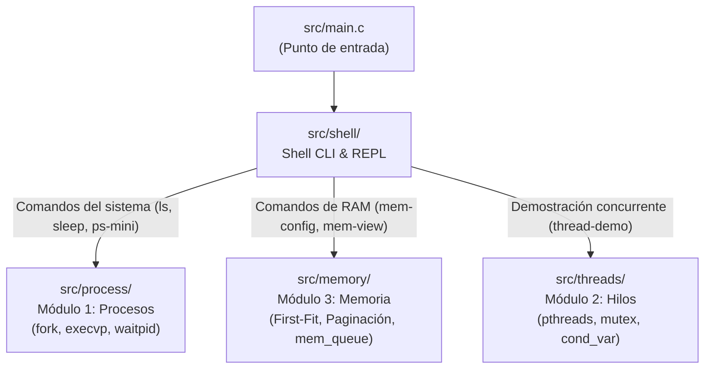
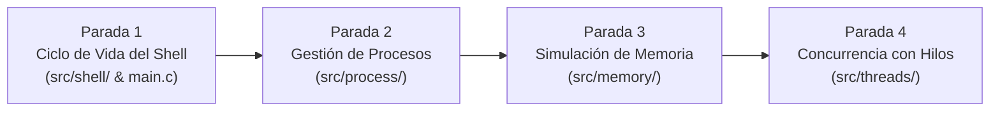

# 📖 Guía Didáctica y Arquitectura del Código (`src/`)

> **Documento de Referencia Pedagógica — mini-OS**  
> Este documento recopila la fundamentación conceptual, el análisis línea por línea de la estructura base y el **Roadmap de 4 Paradas** para el aprendizaje progresivo del código en C11.

---

## 1. La Gran Foto: ¿Qué es mini-OS?

**mini-OS** es un sistema operativo didáctico diseñado para ejecutarse en el **espacio de usuario** de Linux. A diferencia del kernel que interactúa con el hardware, este programa simula y ejercita los subsistemas primordiales de un SO mediante llamadas al sistema reales y algoritmos de gestión en memoria:



---

## 2. Conceptos Fundamentales de C Resueltos

### A. La semántica de `void` en C11 estricto
En el código encontramos dos usos particulares de `void`:

1. **En la firma de funciones (`void func(void)`):**
   ```c
   void shell_init(void);
   ```
   - El primer `void` (tipo de retorno) indica que la función **no devuelve ningún dato**.
   - El segundo `void` (en la lista de parámetros) especifica rigurosamente que la función **recibe exactamente 0 argumentos**.  
     *Nota pedagógica:* En C antiguo, escribir `void func()` permitía invocar `func(1, 2)` sin que el compilador marcara error sintáctico. Con `(void)` el compilador C11 rechaza cualquier parámetro no deseado.

2. **En el cuerpo de funciones stubs (`(void)line;`):**
   ```c
   int shell_dispatch(char *line) {
       (void)line; // Supresión intencional de warning
       return 0;
   }
   ```
   - Al compilar con banderas de máxima exigencia (`-Wall -Wextra`), cualquier variable o parámetro recibido que no se utilice genera una advertencia (*unused parameter 'line'*).
   - Realizar un casteo a `(void)line;` le indica explícitamente al compilador: *"Sé que este parámetro existe y aún no lo utilizo porque es un stub provisional; no generes avisos"*.

---

### B. Funciones Clave del Shell Base (`src/shell/shell.c`)

| Función | ¿Qué hace en el esqueleto actual? | ¿Qué debe hacer en la versión final? |
|:---|:---|:---|
| **`shell_init(void)`** | Vacía (stub). | Inicializa estructuras de datos globales: resetea tablas de procesos en segundo plano, limpia contadores de memoria y prepara el estado inicial de la sesión. No imprime texto al usuario. |
| **`shell_loop(void)`** | Imprime una única línea `miniOS> \n` y finaliza. | Contiene el bucle interactivo **REPL** (`while (1)`). Muestra el prompt, lee la entrada con `fgets`, maneja `EOF` (`Ctrl+D`), omite líneas vacías y despacha comandos. |
| **`shell_dispatch(char *line)`** | Ignora el parámetro y retorna `0`. | Analiza la línea introducida. Si es un comando interno (*built-in* como `help`, `clear`, `exit`), lo ejecuta directamente. Si es un comando externo o de módulo, delega su ejecución a procesos, memoria o hilos. |

---

## 3. Roadmap Didáctico de Aprendizaje: Las 4 Paradas



---

### 🛑 Parada 1: El Ciclo de Vida del Shell y CLI Base (`src/shell/`, `src/main.c`)
**Objetivo:** Comprender cómo un programa de consola cobra vida, escucha al operador y comprende comandos.

- **Punto de Entrada ([src/main.c](file:///Users/aron/githubRepo/mini-OS/src/main.c)):**
  Imprime el banner del sistema, invoca la inicialización del subsistema (`shell_init`) y transfiere el control al ciclo infinito (`shell_loop`).
- **El Patrón REPL (*Read-Eval-Print-Loop*):**
  1. **Print Prompt:** Despliega `miniOS> ` forzando la salida inmediata a terminal con `fflush(stdout)` (evita bloqueos de buffer).
  2. **Read:** Captura líneas acotadas mediante `fgets(line, MAX_LINE, stdin)` para prevenir desbordamientos de búfer (*buffer overflow*).
  3. **Sanitize:** Elimina caracteres residuales de fin de línea (`\r`, `\n`) mediante `strcspn`.
  4. **Eval/Dispatch:** Si la entrada no está vacía, la envía a `shell_dispatch`.
  5. **Loop:** Repite el ciclo hasta recibir `exit` o `EOF` (`Ctrl+D`).
- **Tokenización y Parser ([src/shell/parser.c](file:///Users/aron/githubRepo/mini-OS/src/shell/parser.c)):**
  Toma la cadena continua ingresada (ej. `"sleep 10 256 &"`) y la divide en un arreglo de palabras (`argv[]`) usando `strtok_r`. Detecta si el último token es el operador de background `&` para activar la bandera correspondiente.

---

### 🛑 Parada 2: Gestión de Procesos y Concurrencia (`src/process/`)
**Objetivo:** Dominar cómo el kernel de Linux crea, ejecuta y supervisa programas concurrentes.

- **Bifurcación con `fork()`:**
  Clona el proceso padre (el shell) creando un proceso hijo idéntico con un nuevo `PID`.
- **Reemplazo de Imagen con `execvp()`:**
  El proceso hijo sustituye su memoria y código por el ejecutable solicitado (ej. `/bin/ls` o `/bin/sleep`). Si falla, reporta error y termina con código de error.
- **Modos de Ejecución:**
  - **Foreground (Primer plano):** El shell padre suspende su ejecución invocando `waitpid(pid, &status, 0)` hasta que el hijo termine, devolviendo el control al prompt.
  - **Background (`&`, Segundo plano):** El shell **no se bloquea**. Valida la memoria disponible, registra el proceso en la tabla interna (`bg_table`) y devuelve inmediatamente el prompt `miniOS> ` al usuario.
- **Señales y Procesos Zombi (`signals.c`):**
  Uso de `sigaction` para capturar la señal `SIGCHLD`. Cuando un hijo en background termina, el kernel avisa al shell para cosecharlo (`waitpid(-1, &status, WNOHANG)`), liberando su memoria asignada y evitando procesos zombi.
- **Comando `ps-mini`:**
  Inspecciona e imprime en formato tabular todos los procesos activos de la sesión actual: `PID`, `PPID`, `ESTADO`, `RAM(KB)` y `COMANDO`.

---

### 🛑 Parada 3: Simulación de Gestión de Memoria RAM (`src/memory/`)
**Objetivo:** Entender los algoritmos fundamentales con los que un SO administra la memoria física antes de otorgársela a un proceso.

- **Modelo de Memoria Física Simulada ([src/memory/memory.c](file:///Users/aron/githubRepo/mini-OS/src/memory/memory.c)):**
  No se utiliza `malloc` directo para los programas simulados; se define un espacio contiguo modelado en KB (por defecto 1024 KB de RAM).
- **Esquema 1 — Particionamiento Dinámico First-Fit ([src/memory/first_fit.c](file:///Users/aron/githubRepo/mini-OS/src/memory/first_fit.c)):**
  - **Asignación (`ff_alloc`):** Recorre la lista de bloques enlazados y ubica el *primer hueco libre* con tamaño suficiente. Si el hueco es mayor al solicitado, realiza una división (*split*) conservando el excedente como bloque libre.
  - **Liberación y Coalescencia (`ff_free`):** Al finalizar un proceso, el bloque se marca como libre y se fusiona automáticamente (*merging*) con bloques libres vecinos para combatir la fragmentación externa.
- **Cola de Espera por RAM Insuficiente ([src/memory/mem_queue.c](file:///Users/aron/githubRepo/mini-OS/src/memory/mem_queue.c)):**
  Si un proceso en background requiere más RAM de la disponible (o no hay un bloque contiguo suficiente), el sistema no aborta: encola el proceso en una estructura FIFO (`mem_queue`). En cuanto otro proceso libera memoria, la cola revisa reactivamente y despacha el proceso en espera.
- **Esquema 2 — Paginación y Traducción ([src/memory/paging.c](file:///Users/aron/githubRepo/mini-OS/src/memory/paging.c)):**
  Divide la memoria en marcos físicos de tamaño fijo (ej. 64 KB o 128 KB). Cada proceso posee su tabla de páginas.
  - **Traducción (`mem-translate`):** Implementa el cálculo matemático formal:
    $$\text{Número de Página} = \lfloor \text{Dirección Lógica} / \text{Tamaño de Página} \rfloor$$
    $$\text{Desplazamiento (Offset)} = \text{Dirección Lógica} \pmod{\text{Tamaño de Página}}$$
    $$\text{Dirección Física} = (\text{Marco Físico} \times \text{Tamaño de Página}) + \text{Desplazamiento}$$
- **Visualizador y Switch Seguro:**
  - `mem-view`: Dibuja en la terminal el mapa gráfico de la RAM en bloques o cuadrícula de marcos.
  - `switch-ram`: Permite cambiar en caliente entre First-Fit y Paginación solicitando confirmación interactiva `[s/N]` si hay procesos activos.

---

### 🛑 Parada 4: Concurrencia con Hilos y Sincronización (`src/threads/`)
**Objetivo:** Dominar la programación multihilo (*multithreading*) con el estándar POSIX Threads y erradicar las condiciones de carrera (*race conditions*).

- **El Problema del Productor-Consumidor ([src/threads/producer_consumer.c](file:///Users/aron/githubRepo/mini-OS/src/threads/producer_consumer.c)):**
  Múltiples hilos productores generan elementos numéricos e intentan depositarlos en un recurso compartido; múltiples hilos consumidores los extraen e interpretan.
- **Búfer Circular Protegido ([src/threads/buffer.c](file:///Users/aron/githubRepo/mini-OS/src/threads/buffer.c)):**
  Estructura circular con capacidad finita (`BUFFER_CAPACITY`).
- **Primitivas de Sincronización (Pthreads):**
  - **Mutex (`pthread_mutex_t`):** Garantiza exclusión mutua; solo un hilo puede modificar los índices (`head`, `tail`, `count`) a la vez.
  - **Variables de Condición (`pthread_cond_t`):**
    - `not_full`: Si el búfer se llena, los productores se duermen con `pthread_cond_wait(&b->not_full, &b->mutex)` hasta que un consumidor libere espacio.
    - `not_empty`: Si el búfer está vacío, los consumidores se duermen hasta que un productor inserte un ítem.
- **Garantía de Cero Pérdidas (`thread-stats`):**
  Al finalizar la sesión demostrativa (`thread-demo`), el sistema audita matemáticamente que la cantidad de ítems producidos sea exactamente idéntica a los consumidos, certificando ausencia total de pérdidas o bloqueos mutuos (*deadlocks*).

---

## 4. Estado de Implementación del Código

```
[src/main.c] ..................... Punto de entrada base (Llama a init y loop)
[src/shell/shell.c] .............. Stub inicial de Issue 1.1 -> Pendiente REPL interactivo (SIS-39)
[src/shell/parser.c] ............. Stub inicial de Issue 1.1 -> Pendiente Tokenizador (SIS-40)
[src/process/] ................... Stubs mínimos listos para Milestone 2 (SIS-42 a SIS-45)
[src/memory/] .................... Stubs mínimos listos para Milestones 3 a 6 (SIS-46 a SIS-59)
[src/threads/] ................... Stubs mínimos listos para Milestone 7 (SIS-60 a SIS-63)
```

> 💡 **Siguiente paso recomendado para aprender codificando:**  
> Implementar la **Parada 1**, transformando el stub de [src/shell/shell.c](file:///Users/aron/githubRepo/mini-OS/src/shell/shell.c) en el bucle interactivo funcional según la especificación [docs/issues/sis-39.md](file:///Users/aron/githubRepo/mini-OS/docs/issues/sis-39.md).
